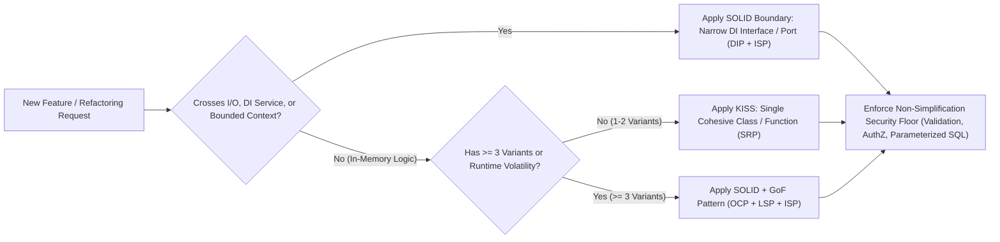

# Balancing KISS and SOLID: Pragmatic OOP & Pattern Governance

## 1. The Core Tension: When Misapplied SOLID Violates KISS
Taken to a dogmatic extreme, SOLID—specifically `OCP` and `DIP`—degenerates into the **6-class Over-Engineered Calculator** from AlgoMaster KISS: wrapping every trivial calculation, DTO, or internal helper in an interface, a factory, and a strategy hierarchy *"just in case requirements change."*
- **Resolution Principle**: **KISS governs whether a multi-class pattern hierarchy is needed; SOLID governs how classes and boundaries are structured once OOP responsibilities and seams are justified.**

## 2. Permissive `1:1` DI Service Uniformity vs. Prohibited Speculative Bloat
In modern OOP stacks (.NET `IServiceCollection`, Angular DI), registering application and domain services through `1:1` service interfaces (`IFooService` -> `FooService`) is a standard architectural idiom (AlgoMaster's *"Know Your Audience"* and `the crud-service-generator skill`). However, applying `1:1` interfaces outside service/port boundaries creates severe bloat.

| Code Artifact Category | `1:1` Interface Policy | Rationale & KISS + SOLID Rule |
| :--- | :--- | :--- |
| **DI-Registered Application & Domain Services** (`OrderService`, `UserAuthService`) | **PERMITTED (`IFooService` / `FooService`)** | Standard DI container registration uniformity, controller/endpoint decoupling (`DIP`), and clean service boundary contracts (`ISP`) |
| **Repositories & External I/O / Infrastructure Ports** (`OrderRepository`, `Clock`, `FileSystem`, `EmailGateway`) | **REQUIRED (`IOrderRepository`, `TimeProvider`, `IFileSystem`)** | Essential `DIP` boundary isolating non-deterministic I/O (DB, network, clock, disk) so tests can inject fast deterministic fakes |
| **DTOs, Request/Response Contracts, Value Objects, Domain Entities, Records** (`OrderDto`, `Money`, `Customer`) | **STRICTLY FORBIDDEN (No `IOrderDto` or `IMoney`)** | Pure data carriers and cohesive domain records have no polymorphic volatility; interfaces double file count with zero benefit |
| **Pure Stateless Domain Calculations & Internal Helpers** (`TaxMath`, `SlugNormalizer`, `Calculator`) | **STRICTLY FORBIDDEN (Concrete Class / Module Function)** | Deterministic in-memory functions are tested directly with real inputs/outputs; wrapping them in `1:1` interfaces replicates the Over-Engineered Calculator anti-pattern |

## 3. The Rule of Three (`>= 3` Variants) Gate for Multi-Class GoF Hierarchies
Before introducing multi-class Gang of Four (`GoF`) hierarchies (`Factory Method`, `Abstract Factory`, `Strategy` families, `Bridge`, `Visitor`, `Mediator`, `Chain of Responsibility` via `the oop-design-patterns skill`), verify at least one **Evidence Trigger**:

| Number of Concrete Variants / Volatility | KISS + SOLID Action |
| :--- | :--- |
| **1 Variant (No I/O Boundary)** | Write **1 concrete class or pure function** (`SRP`). Zero factories, zero strategy hierarchies. |
| **2 Deterministic Variants** | Use a focused method, explicit `switch`/`match` expression, or lightweight injected delegate/callable. Do not scaffold a 5-file class family yet. |
| **`>= 3` Concrete Variants OR Proven Runtime/Plugin Volatility** | **Rule of Three Satisfied**: Extract a narrow role interface (`ISP`) and apply `Strategy`, `Factory`, or polymorphic dispatch (`OCP`, `LSP`, `DIP`). |
| **External I/O, Non-Determinism, or Cross-Context Boundary (Even with 1 Prod Adapter)** | **Architectural Seam Satisfied**: Extract a narrow port (`DIP`/`ISP`, e.g. `TimeProvider`, `IFileSystem`, `Anti-Corruption Layer`) so production uses the real adapter and tests use an in-memory fake. |

## 4. Keeping Architectural Patterns KISS-Compliant

1. **DDD Tactical Patterns (`the domain-driven-design skill`)**:
   - Use **Rich Domain Entities and Immutable Value Objects** when enforcing real domain invariants (`Money`, `EmailAddress`, `Order` state transitions).
   - For simple CRUD read/lookup endpoints with no domain state machine, allow direct **CQRS Read Projections** (`IQueryable.Select(x => x.ToDto())`) instead of forcing ceremonial multi-aggregate hydration.
2. **GoF Design Patterns (`the oop-design-patterns skill`)**:
   - Prefer language-native constructs first: C# primary constructors, records, and pattern matching; Angular `signal()` and `computed()` over custom `Observer` classes; Python first-class functions and decorators over single-method `Command`/`Strategy` wrapper classes.
3. **Unit Testing with `1:1` DI Services**:
   - Even when `IFooService` exists for DI registration, prefer instantiating the **real `FooService`** with a fake I/O repository in unit tests when practical, rather than mocking 5 internal services with brittle interaction verification.
