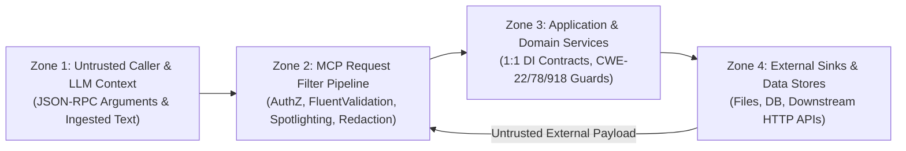

# MCP Trust Boundaries, Request Filters, and Defense-in-Depth

## 1. Four-Zone MCP Trust Boundary Model



- **Zone 1 (Untrusted by Default)**: Treat all `CallToolRequestParams.Arguments`, `ReadResourceRequestParams.Uri`, and LLM-supplied strings as untrusted taint sources (`OWASP LLM01:2025`).
- **Zone 2 (Centralized Filter Mediation)**: Intercept every tool/resource call via `.WithRequestFilters(...)` in C# or middleware decorators in Python.
- **Zone 3 (Domain & OS Sandboxing)**: Enforce canonical path confinement (`CWE-22`), argument-array process execution (`CWE-78`), and SSRF IP blocking (`CWE-918`).
- **Zone 4 (Untrusted External Data)**: Any text read from files, databases, logs, or external APIs is an **Indirect Prompt Injection (XPIA)** vector and MUST be wrapped in Data Spotlighting delimiters before returning to Zone 1.

## 2. Centralized C# `.WithRequestFilters` Security Pipeline

Use `.WithRequestFilters` on `IMcpServerBuilder` so individual `[McpServerTool]` and `[McpServerResource]` methods stay clean (**KISS**):

- **`AddListToolsFilter`**: Verify static schema integrity and filter tool visibility by caller scopes.
- **`AddCallToolFilter`**:
  1. Validate caller claims (`sub`, `scp`, `tenant_id`) and enforce rate/concurrency bounds.
  2. Catch unhandled exceptions, log diagnostics to `stderr` (`CWE-532`), and return a sanitized `CallToolResult { IsError = true }` without stack traces or connection strings (`CWE-209`).
  3. Enforce `MaxOutputBytes` (`<= 64 KB`, `CWE-400`) and wrap untrusted text blocks via `SpotlightResult.WrapUntrusted`.
- **`AddReadResourceFilter`**:
  1. Validate URI scheme and canonical root confinement (`CWE-22`).
  2. Automatically apply nonce Data Spotlighting (`<untrusted_mcp_data_{nonce}>`) to resource contents read from mutable/external sources.

## 3. OAuth 2.1 (`RFC 8707`) & Confused Deputy / Token Passthrough Prevention

- **Exact Audience (`aud`) Validation (`RFC 8707`)**:
  - On `Streamable HTTP` servers (`ModelContextProtocol.AspNetCore`), configure `AddAuthentication().AddJwtBearer(...)` with `ValidAudience` set to the MCP server's canonical resource URI (`https://mcp.example.com/mcp`) and `ValidateAudience = true`.
  - Bind local development HTTP servers strictly to `127.0.0.1` and validate `Origin` and `Host` headers to prevent DNS rebinding (`CWE-346`).
- **Strict Prohibition of Token Passthrough (`RFC 8693`)**:
  - **NEVER** forward an incoming MCP client's `Authorization: Bearer` token to downstream `HttpClient` calls.
  - Terminate the client token at the MCP server boundary and acquire downstream credentials via OAuth 2.0 Token Exchange (`RFC 8693` On-Behalf-Of) or scoped service identity while binding queries to the verified caller `sub` / `tenant_id` (`BOLA` prevention).

## 4. OS & Network Execution Guardrails (`CWE-22`, `CWE-78`, `CWE-918`)

- **`CWE-22` Path Confinement (C#)**:
  ```csharp
  public static string ResolveConfinedPath(string allowedRoot, string relativePath)
  {
      var root = Path.GetFullPath(allowedRoot).TrimEnd(Path.DirectorySeparatorChar) + Path.DirectorySeparatorChar;
      var full = Path.GetFullPath(Path.Combine(root, relativePath));
      if (!full.StartsWith(root, StringComparison.Ordinal) ||
          (File.Exists(full) && File.GetAttributes(full).HasFlag(FileAttributes.ReparsePoint)))
          throw new UnauthorizedAccessException("Path escapes confined root or is a symlink (CWE-22).");
      return full;
  }
  ```
- **`CWE-78` Process Execution**: Use `ProcessStartInfo { FileName = binary, UseShellExecute = false }` and `ArgumentList.Add(arg)`. Never invoke `/bin/sh -c` or `cmd.exe /c`.
- **`CWE-918` SSRF Protection**: Allow only `https://` URIs against an explicit host allowlist and reject loopback (`127.0.0.0/8`, `::1`), RFC 1918 private networks (`10.0.0.0/8`, `172.16.0.0/12`, `192.168.0.0/16`), and cloud metadata (`169.254.169.254`).

## 5. Prompt-Injection & Security Invariants

- Every external resource or tool payload crossing from Zone 4 to Zone 1 MUST pass through nonce Data Spotlighting and `MaxOutputBytes` truncation.
