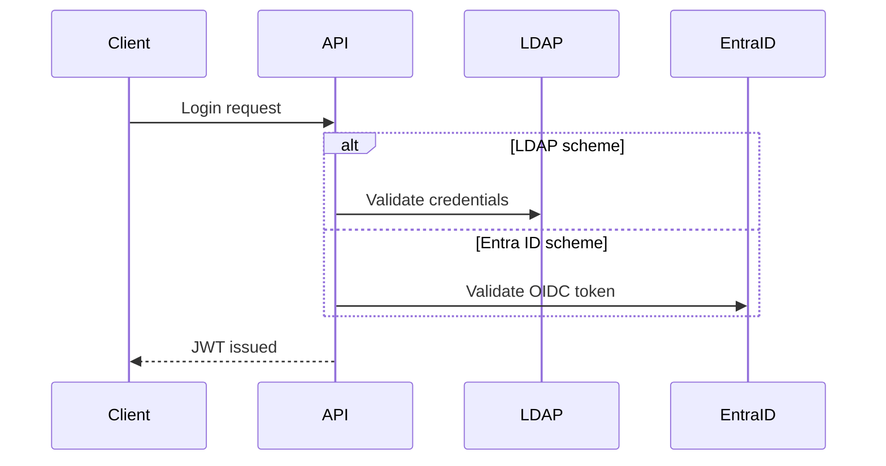

# Workflow 01: Scope and Placement

## Why this matters

Markdown documents produced by skills and agents often serve two audiences at once: a human reading the file, and another AI agent that will later read the same file as context (to continue work, debug, or reason about the system). Both audiences benefit from the same thing when a flow gets complex: an explicit, unambiguous representation of the structure — not just prose.

Mermaid is well suited for this because it's plain text (diffable, greppable, version-controllable) that most markdown renderers display as a real diagram, and that LLMs parse reliably as a graph rather than having to infer structure from a paragraph. A diagram next to the prose reduces the chance that a future reader — human or AI — misreads the order of steps, missing branches, or which actor does what.

**The diagram is an aid, not a replacement.** It sits alongside the textual description, never instead of it. Someone skimming needs the prose to understand intent and context; someone tracing exact logic needs the diagram. Neither one alone tells the full story — the prose carries the "why," the diagram carries the "shape."

## When to add a diagram

Add a Mermaid diagram when the content you're documenting has genuine structural complexity:

- A process with more than ~3 sequential steps, or any branching/conditional logic
- Interactions between two or more actors, services, or systems (e.g., client → API → auth provider → database)
- A state machine (an entity that moves through distinct states over time)
- Relationships between data entities, types, or classes that aren't obvious from a flat list
- A pipeline or workflow that other steps/skills depend on

**Don't** add one for:
- A single linear sequence with no branches ("first do X, then Y, then Z" — that's fine as a numbered list)
- Something already fully clear from a short paragraph
- Padding — a diagram with 2 trivial nodes adds noise, not clarity

If you're unsure, ask: "would a reader (human or AI) get something from seeing the structure that they wouldn't get from the sentence describing it?" If no, skip it.

## How to add it

Use a fenced code block with the `mermaid` language tag, placed immediately after (or before) the paragraph describing the same flow:

````markdown
The service authenticates requests using one of three schemes depending on
the caller's context, then issues a JWT scoped to that scheme.



The chosen scheme is recorded in the token's issuer claim so downstream
services know which validator to use.
````

Notice the pattern: prose before, diagram in the middle, prose continues after if there's more to say. Never let the diagram be the *only* explanation of a non-trivial flow.

## Phase Requirements (EARS)

- WHEN a document describes more than three steps, branching logic, multiple actors, state transitions, or entity schemas, the scoping workflow SHALL embed a fenced Mermaid block alongside explanatory prose.
- IF a flow forms a trivial linear sequence without branches or multiple actors, THEN the scoping workflow SHALL omit a Mermaid diagram and keep a numbered list.
