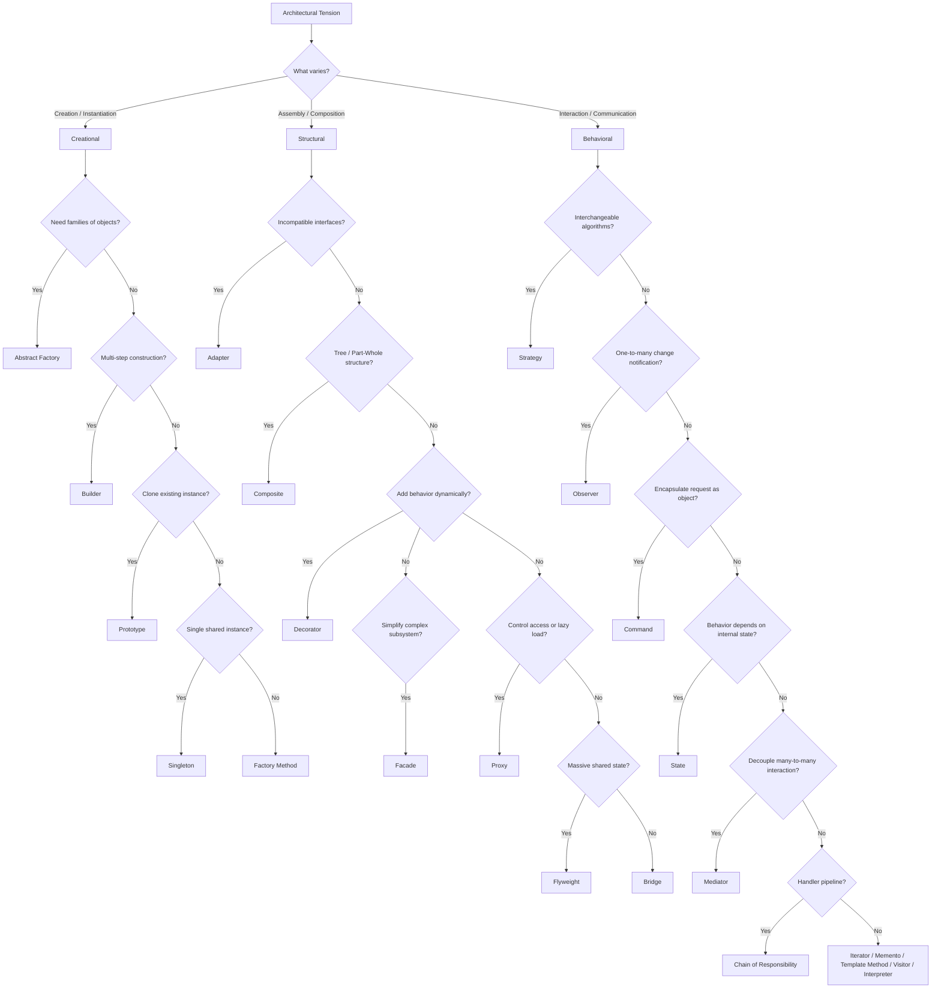

# OOP Design Patterns Skill (Gang of Four Catalog)

Comprehensive catalog, architectural guidance, and modern implementations for all 23 Gang of Four (GoF) object-oriented design patterns. Each pattern provides complete, standalone, production-ready examples across three modern runtime platforms:
1. **C# (.NET 10)**: Primary constructors, records, pattern matching, keyed DI, and `ValueTask`.
2. **TypeScript (Angular v20+)**: Standalone components, reactive Signals (`signal()`, `computed()`, `effect()`), `inject()`, and `DestroyRef`.
3. **Python (3.12+)**: PEP 695 type parameter syntax, PEP 544 structural `Protocol`, `@dataclass(slots=True, frozen=True)`, and `match/case`.

---

## 1. Quick Navigation & Taxonomy

The 23 patterns are partitioned into three canonical categories under `references/`:

### Creational Patterns (5)
Deal with object creation mechanisms, isolating clients from direct instantiation.
- [Abstract Factory](./references/creational/abstract-factory.md) — Interface for families of related/dependent objects.
- [Builder](./references/creational/builder.md) — Separate construction of a complex object from its representation.
- [Factory Method](./references/creational/factory-method.md) — Defer instantiation to subclasses or factory delegates.
- [Prototype](./references/creational/prototype.md) — Clone existing instances using copy constructors or identity-guarded graphs.
- [Singleton](./references/creational/singleton.md) — Ensure exactly one thread-safe instance with immutable state.

### Structural Patterns (7)
Assemble classes and objects into larger, flexible structures while maintaining loose coupling.
- [Adapter](./references/structural/adapter.md) — Convert incompatible interfaces into expected target contracts.
- [Bridge](./references/structural/bridge.md) — Decouple an abstraction from its implementation hierarchy.
- [Composite](./references/structural/composite.md) — Compose objects into tree part-whole hierarchies with uniform handling.
- [Decorator](./references/structural/decorator.md) — Attach responsibilities to objects dynamically without subclassing.
- [Facade](./references/structural/facade.md) — Unified high-level interface over a complex subsystem.
- [Flyweight](./references/structural/flyweight.md) — Share fine-grained intrinsic immutable state to support high volumes.
- [Proxy](./references/structural/proxy.md) — Surrogate or placeholder controlling access, caching, or lazy loading.

### Behavioral Patterns (11)
Characterize the ways in which classes or objects interact and distribute responsibility.
- [Chain of Responsibility](./references/behavioral/chain-of-responsibility.md) — Pass request sequentially through a pipeline of handlers.
- [Command](./references/behavioral/command.md) — Encapsulate action as an object enabling undo/redo and queuing.
- [Interpreter](./references/behavioral/interpreter.md) — Represent grammar and evaluate abstract syntax tree expressions.
- [Iterator](./references/behavioral/iterator.md) — Sequential access to collection elements without exposing underlying structure.
- [Mediator](./references/behavioral/mediator.md) — Centralize complex communication and eliminate many-to-many coupling.
- [Memento](./references/behavioral/memento.md) — Capture and externalize internal state for restoration without breaking encapsulation.
- [Observer](./references/behavioral/observer.md) — One-to-many state change distribution via reactive events or signals.
- [State](./references/behavioral/state.md) — Alter object behavior at runtime when internal state changes.
- [Strategy](./references/behavioral/strategy.md) — Encapsulate interchangeable algorithms behind a common contract.
- [Template Method](./references/behavioral/template-method.md) — Define algorithm skeleton, deferring specific primitive steps to subclasses.
- [Visitor](./references/behavioral/visitor.md) — Represent operations to be performed on elements of an object structure.

---

## 2. Decision Tree: How to Select a Pattern

When an architectural challenge arises, identify **what varies**:

---

## 3. Platform Idioms & Best Practices

### C# (.NET 10 / C# 13/14)
- **Primary Constructors**: Declare parameters on class/record headers: `public sealed class OrderService(IShippingStrategy strategy)`.
- **Records**: Use positional `readonly record` for immutable DTOs, mementos, and events.
- **Pattern Matching**: Prefer switch expressions over rigid class-based visitors or double-dispatch.
- **Keyed Services**: Resolve named strategies using `[FromKeyedServices("express")]`.
- **ValueTask / Channels**: Use async channels for observers and `ValueTask` for high-throughput commands.

### TypeScript / Angular (v20+)
- **Standalone Architecture**: All components and directives declare `standalone: true`.
- **Signals**: Use `signal()`, `computed()`, and `effect()` for reactive observer/state management.
- **Dependency Injection**: Use functional `inject(Service)` instead of verbose constructor parameter injection.
- **Cleanup**: Guard event listeners and observers using `DestroyRef` or `takeUntilDestroyed()`.

### Python (3.12+)
- **Structural Subtyping**: Use `typing.Protocol` over rigid multiple inheritance.
- **Type Parameter Syntax (PEP 695)**: Declare generics directly: `class Repository[T]: ...`.
- **Immutability**: Use `@dataclass(slots=True, frozen=True)` for values, states, and commands.
- **Pattern Matching (PEP 634)**: Use `match/case` for state machines, visitor dispatch, and factory branches.

---

## 4. Security & Defensive Guidelines

1. **Command Pattern**: Always use closed compile-time allowlists. Never dynamically invoke `eval()` or reflection (`Type.GetType()`, `pickle.loads()`).
2. **Prototype Pattern**: Implement identity tracking (`ReferenceEqualityComparer`, `memo` dict, `WeakMap`) and enforce a recursion depth limit (max 32).
3. **Singleton Pattern**: Enforce thread-safety (`Lazy<T>`, locked `__new__`) and strictly immutable internal state to prevent cross-session poisoning.
4. **Observer Pattern**: Prevent the "Lapsed Listener" memory leak by guaranteeing cleanup (`IDisposable`, `DestroyRef`, `weakref`).
5. **Zero Secrets Policy**: Never hardcode credentials, tokens, or private keys into pattern files or sample code.

---

## 5. Autonomous Agent Usage Guide

When an agent needs to implement or advise on a specific GoF pattern:
1. **Identify Pattern**: Look up the pattern name in Section 1 or via the decision tree in Section 2.
2. **Read Specific File**: Load ONLY the corresponding reference file (e.g. `Read` on `references/structural/adapter.md`). This preserves context window tokens.
3. **Adapt Code**: Extract the relevant language snippet (C# .NET 10, Angular Signals, or Python 3.12+) and adapt it to the user's specific domain model.

## Black-Box Execution

- **Do not read** script source before running it; the scripts are maintained upstream black boxes.
- Run commands from the skill base directory (the folder containing this `SKILL.md`).
- Read the source only after a non-zero exit that stderr does not explain.

| Command | Parameters | Stdout | Exit codes |
|---|---|---|---|
| `python scripts/validate_skill.py` | No arguments; locates the repository root itself | JSON report | 0 pass, 1 fail |
