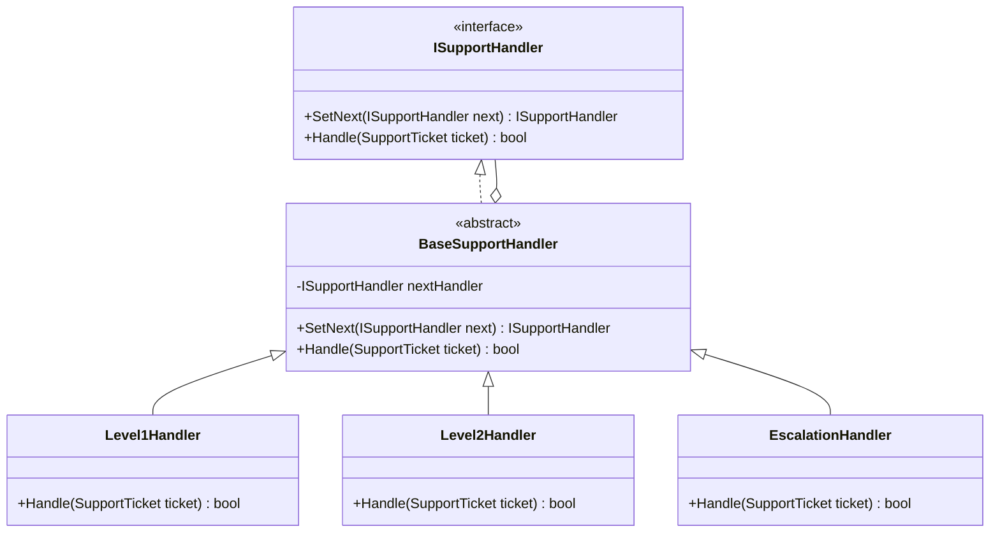

# Chain of Responsibility Pattern

## 1. Intent & Core Problem
The Chain of Responsibility pattern decouples the sender of a request from its potential receivers by passing the request along a pipeline of handlers. Each handler in the chain decides either to process the request, pass it to the next handler, or abort the pipeline.

```
[Client Request] ──> [AuthHandler] ──Pass──> [RateLimitHandler] ──Pass──> [BusinessHandler]
```

## 2. Mermaid Structural Collaboration


## 3. Applicability & Selection Rubric

### 3.1 Architectural Scope
- **Granularity**: 
- **Evolutionary Rule of Three**: Do not build a dynamic chain of responsibility for fewer than 3 distinct handlers or static sequential logic.
- **Language-First Substitution**: Prefer functional middleware pipelines (Func<Context, Func<Task>, Task>) or collection iteration over linked-list handler nodes.

### 3.2 Decision Indicators
- [X] Green Flag 1: More than one handler object may handle a request, and the actual handler is not known until runtime.
- [X] Green Flag 2: You want to issue a request to one of several objects without specifying the receiver explicitly.
- [X] Green Flag 3: The set of handlers and their execution order should be configurable dynamically at runtime.
- [!] Red Flag 1: The execution flow is strictly fixed and sequential with no branching or short-circuiting.
- [!] Red Flag 2: Requests frequently reach the end of the chain unhandled, indicating poor error handling or design mismatch.
- [!] Red Flag 3: Debugging becomes excessively difficult due to deep, opaque runtime traversal of handler chains.

### 3.3 Alternative Simplification
Use a standard list iteration over handler functions or standard ASP.NET / Express-style middleware pipelines.
## 4. Modern Idiomatic Implementations

### C# (.NET 10)
```csharp
namespace DesignPatterns.Behavioral.ChainOfResponsibility;

public sealed record SupportTicket(string TicketId, int SeverityLevel, string Description);

public interface ITicketHandler
{
    ITicketHandler SetNext(ITicketHandler next);
    bool Process(SupportTicket ticket);
}

public abstract class BaseTicketHandler : ITicketHandler
{
    private ITicketHandler? _next;

    public ITicketHandler SetNext(ITicketHandler next)
    {
        _next = next;
        return next;
    }

    public virtual bool Process(SupportTicket ticket)
    {
        return _next?.Process(ticket) ?? false;
    }
}

public sealed class BasicSupportHandler : BaseTicketHandler
{
    public override bool Process(SupportTicket ticket)
    {
        if (ticket.SeverityLevel <= 1)
        {
            Console.WriteLine($"[Level 1] Resolved ticket {ticket.TicketId}: {ticket.Description}");
            return true;
        }
        return base.Process(ticket);
    }
}

public sealed class AdvancedSupportHandler : BaseTicketHandler
{
    public override bool Process(SupportTicket ticket)
    {
        if (ticket.SeverityLevel <= 3)
        {
            Console.WriteLine($"[Level 2] Resolved ticket {ticket.TicketId}: {ticket.Description}");
            return true;
        }
        return base.Process(ticket);
    }
}
```

### TypeScript (Angular Standalone & Signals)
```typescript
import { Component, Injectable, signal } from '@angular/core';

export interface FormSubmission {
  hasValidEmail: boolean;
  acceptedTerms: boolean;
  isSpamScoreHigh: boolean;
}

export interface ValidationStep {
  setNext(step: ValidationStep): ValidationStep;
  validate(submission: FormSubmission): string | null;
}

export abstract class BaseValidationStep implements ValidationStep {
  private next: ValidationStep | null = null;

  setNext(step: ValidationStep): ValidationStep {
    this.next = step;
    return step;
  }

  validate(submission: FormSubmission): string | null {
    return this.next ? this.next.validate(submission) : null;
  }
}

export class TermsValidationStep extends BaseValidationStep {
  override validate(submission: FormSubmission): string | null {
    if (!submission.acceptedTerms) {
      return 'Terms of Service must be accepted.';
    }
    return super.validate(submission);
  }
}

export class EmailValidationStep extends BaseValidationStep {
  override validate(submission: FormSubmission): string | null {
    if (!submission.hasValidEmail) {
      return 'Invalid email address provided.';
    }
    return super.validate(submission);
  }
}

@Component({
  selector: 'app-form-checker',
  standalone: true,
  template: `<p>Validation Result: {{ validationResult() }}</p>`,
})
export class FormCheckerComponent {
  private readonly chain: ValidationStep;

  readonly validationResult = signal<string>('Valid');

  constructor() {
    this.chain = new TermsValidationStep();
    this.chain.setNext(new EmailValidationStep());
  }

  submit(form: FormSubmission): void {
    const error = this.chain.validate(form);
    this.validationResult.set(error ?? 'Form submission is valid!');
  }
}
```

### Python (3.12+ Modern Type System)
```python
from typing import Self

class ApprovalRequest:
    def __init__(self, request_id: str, amount: float) -> None:
        self.request_id = request_id
        self.amount = amount

class Approver:
    def __init__(self) -> None:
        self._next_approver: Approver | None = None

    def set_next(self, approver: "Approver") -> "Approver":
        self._next_approver = approver
        return approver

    def process(self, request: ApprovalRequest) -> str:
        if self._next_approver is not None:
            return self._next_approver.process(request)
        return f"Request {request.request_id} reached end of chain without approval."

class TeamLeadApprover(Approver):
    def process(self, request: ApprovalRequest) -> str:
        if request.amount <= 1000.0:
            return f"Approved by Team Lead: {request.request_id} (${request.amount})"
        return super().process(request)

class DirectorApprover(Approver):
    def process(self, request: ApprovalRequest) -> str:
        if request.amount <= 50000.0:
            return f"Approved by Director: {request.request_id} (${request.amount})"
        return super().process(request)
```

## 5. Consequences & Trade-offs
- **Pros**:
  - Reduces coupling: an object only needs to know that a request will be handled "appropriately".
  - Adds flexibility in assigning responsibilities to objects: change chain linkages dynamically at runtime.
- **Cons**:
  - Receipt is not guaranteed: an unhandled request can fall off the end of the chain silently without an explicit terminal handler.

## 6. Security, Misuse & Anti-patterns
- **Circular Chain Infinite Loops**: Guard chain construction against accidental cycles (`A -> B -> C -> A`) that lead to stack overflows.
- **Silent Dropping**: Always provide a default terminal handler that flags, rejects, or logs unhandled requests to avoid silent security failures.

## 7. Related Patterns
- **Composite**: Chain of Responsibility is often applied in conjunction with Composite. A component's parent can act as its successor.
- **Command**: Requests in Chain of Responsibility can be specified as Command objects.
