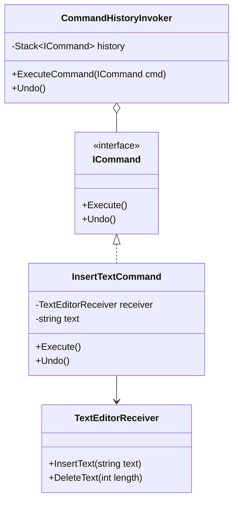

# Command Pattern

## 1. Intent & Core Problem
The Command pattern turns a request into a stand-alone object containing all information about the request (the receiver, the method to call, arguments, and undo state). This transformation lets you pass requests as method arguments, delay or queue a request's execution, log transaction history, and support undoable operations.

```
[UI Button / Controller] ──> [Invoker.Execute(ICommand)] ──> [Receiver.Action()]
                                    │
                            [Undo/Redo Stack]
```

## 2. Mermaid Structural Collaboration


## 3. Applicability & Selection Rubric

### 3.1 Architectural Scope
- **Granularity**: 
- **Evolutionary Rule of Three**: Do not encapsulate actions into Command objects unless you need undo/redo, queueing, or audit logging for 3+ commands.
- **Language-First Substitution**: In modern C#, TypeScript, and Python, prefer simple lambda expressions, actions (Action), or records over multi-class command hierarchies.

### 3.2 Decision Indicators
- [X] Green Flag 1: Parameterizing objects by an action to perform (e.g. menu items, buttons, scheduled job runners).
- [X] Green Flag 2: Supporting reversible operations with full undo and redo histories.
- [X] Green Flag 3: Structuring a system around high-level operations built on primitive commands (macro commands, transaction queues).
- [!] Red Flag 1: Actions are executed synchronously and never need undo, queuing, or persistence.
- [!] Red Flag 2: Scaffolding a new command class for every single trivial method call leads to massive class explosion.
- [!] Red Flag 3: Commands dynamically evaluate unvalidated arbitrary strings or execute untrusted reflection.

### 3.3 Alternative Simplification
Use direct method invocation, passing a callback function / lambda delegate directly.
## 4. Modern Idiomatic Implementations

### C# (.NET 10)
```csharp
namespace DesignPatterns.Behavioral.Command;

public interface ICommand
{
    void Execute();
    void Undo();
}

public sealed class DocumentReceiver
{
    private readonly System.Text.StringBuilder _content = new();

    public void Append(string text) => _content.Append(text);
    public void TrimEnd(int length) => _content.Length -= Math.Min(length, _content.Length);
    public string Read() => _content.ToString();
}

public sealed class WriteTextCommand(DocumentReceiver receiver, string text) : ICommand
{
    public void Execute() => receiver.Append(text);
    public void Undo() => receiver.TrimEnd(text.Length);
}

// Invoker managing bounded history stack
public sealed class CommandHistoryManager
{
    private const int MaxHistory = 50;
    private readonly Stack<ICommand> _undoStack = new();

    public void Execute(ICommand command)
    {
        ArgumentNullException.ThrowIfNull(command);
        command.Execute();

        if (_undoStack.Count >= MaxHistory)
        {
            // Bounded stack prevents memory exhaustion
            var items = _undoStack.Take(MaxHistory - 1).Reverse().ToList();
            _undoStack.Clear();
            foreach (var item in items) _undoStack.Push(item);
        }
        _undoStack.Push(command);
    }

    public bool Undo()
    {
        if (_undoStack.TryPop(out var command))
        {
            command.Undo();
            return true;
        }
        return false;
    }
}
```

### TypeScript (Angular Standalone & Signals)
```typescript
import { Component, computed, signal } from '@angular/core';

export interface Command {
  execute(): void;
  undo(): void;
}

export class CounterReceiver {
  count = 0;
}

export class AddCommand implements Command {
  constructor(private readonly receiver: CounterReceiver, private readonly value: number) {}

  execute(): void {
    this.receiver.count += this.value;
  }

  undo(): void {
    this.receiver.count -= this.value;
  }
}

// Closed allowlist for dispatching commands safely without dynamic eval
export type CommandType = 'INCREMENT_ONE' | 'INCREMENT_FIVE';

export function createCommand(type: CommandType, receiver: CounterReceiver): Command {
  switch (type) {
    case 'INCREMENT_ONE':
      return new AddCommand(receiver, 1);
    case 'INCREMENT_FIVE':
      return new AddCommand(receiver, 5);
    default: {
      const _exhaustive: never = type;
      throw new Error(`Unsupported command: ${_exhaustive}`);
    }
  }
}

@Component({
  selector: 'app-command-counter',
  standalone: true,
  template: `
    <div>
      <p>Count: {{ currentCount() }}</p>
      <button (click)="runCommand('INCREMENT_ONE')">+1</button>
      <button (click)="runCommand('INCREMENT_FIVE')">+5</button>
      <button (click)="undo()" [disabled]="!canUndo()">Undo</button>
    </div>
  `,
})
export class CommandCounterComponent {
  private readonly receiver = new CounterReceiver();
  private readonly history: Command[] = [];

  readonly currentCount = signal<number>(0);
  readonly canUndo = signal<boolean>(false);

  runCommand(type: CommandType): void {
    const cmd = createCommand(type, this.receiver);
    cmd.execute();
    this.history.push(cmd);
    this.currentCount.set(this.receiver.count);
    this.canUndo.set(true);
  }

  undo(): void {
    const last = this.history.pop();
    if (last) {
      last.undo();
      this.currentCount.set(this.receiver.count);
      this.canUndo.set(this.history.length > 0);
    }
  }
}
```

### Python (3.12+ Modern Type System)
```python
from dataclasses import dataclass, field
from typing import Protocol

class Command(Protocol):
    def execute(self) -> None: ...
    def undo(self) -> None: ...

class LightReceiver:
    def __init__(self) -> None:
        self.is_on: bool = False

    def turn_on(self) -> None:
        self.is_on = True

    def turn_off(self) -> None:
        self.is_on = False

class ToggleLightCommand:
    def __init__(self, light: LightReceiver) -> None:
        self._light = light
        self._previous_state = False

    def execute(self) -> None:
        self._previous_state = self._light.is_on
        if self._light.is_on:
            self._light.turn_off()
        else:
            self._light.turn_on()

    def undo(self) -> None:
        if self._previous_state:
            self._light.turn_on()
        else:
            self._light.turn_off()

# Strict static allowlist dispatching
COMMAND_REGISTRY = {
    "toggle": ToggleLightCommand,
}

def dispatch_command(key: str, receiver: LightReceiver) -> Command:
    command_cls = COMMAND_REGISTRY.get(key)
    if not command_cls:
        raise ValueError(f"Unknown command key: {key}")
    return command_cls(receiver)
```

## 5. Consequences & Trade-offs
- **Pros**:
  - Single Responsibility: Decouples classes that invoke operations from classes that perform these operations.
  - Open/Closed Principle: You can introduce new commands without breaking existing code.
  - Enables queuing, scheduling, transactions, and undo/redo stacks.
- **Cons**:
  - Code becomes more complicated because you are introducing a whole new layer between senders and receivers.

## 6. Security, Misuse & Anti-patterns
- **Arbitrary Code Execution (RCE) via Unsafe Deserialization**: Never deserialize external client payloads directly into executable Command objects using raw reflection, dynamic `importlib`, or `eval()`.
- Always validate incoming command identifiers against a static, compile-time allowlist (such as an enum or frozen dictionary).
- **Unbounded History Memory Denial (DoS)**: An unbounded undo/redo history stack will retain references to domain objects indefinitely, causing memory exhaustion. Always cap undo stacks with a maximum depth or ring buffer.

## 7. Related Patterns
- **Composite**: You can use Composite to implement macro commands (commands that execute a sequence of other commands).
- **Memento**: Can be kept to hold the state the command requires for undoing its effect.
- **Prototype**: A command might be cloned before being placed into a history list.
