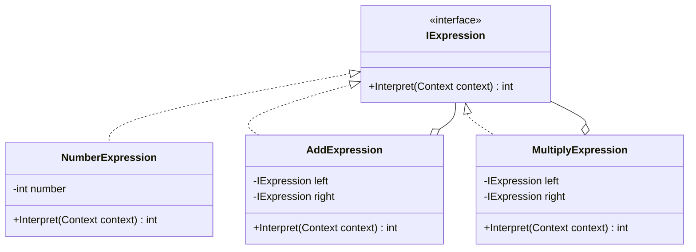

# Interpreter Pattern

## 1. Intent & Core Problem
The Interpreter pattern defines a grammatical representation for a domain-specific language (DSL) along with an interpreter that parses and evaluates abstract syntax tree (AST) expressions. It is commonly used for search query filters, arithmetic expression evaluators, rules engines, and configuration format processors.

```
       [AST Root: AddExpression]
              ┌────┴────┐
     [Number: 5]   [MultiplyExpression]
                         ┌────┴────┐
                [Number: 3]   [Number: 2]
```

## 2. Mermaid Structural Collaboration


## 3. Applicability & Selection Rubric

### 3.1 Architectural Scope
- **Granularity**: 
- **Evolutionary Rule of Three**: Do not write a custom AST interpreter unless the grammar is simple, domain-specific, and has 3+ expression types.
- **Language-First Substitution**: Prefer parsing libraries (e.g. parser combinators, regex matchers) or modern pattern matching over manual AST class hierarchies.

### 3.2 Decision Indicators
- [X] Green Flag 1: The problem occurs repeatedly in a well-defined domain that can be expressed as sentences in a simple language.
- [X] Green Flag 2: The grammar is simple and stability is high; complex grammars require full parser generators.
- [X] Green Flag 3: Efficiency is not a critical concern compared to domain readability and dynamic expression evaluation.
- [!] Red Flag 1: The grammar is complex with dozens of production rules; AST class hierarchies become unmaintainable.
- [!] Red Flag 2: Performance-critical parsing where tree-walking interpreter overhead causes significant lag.
- [!] Red Flag 3: A standard data format (JSON, YAML) or query language (LINQ, SQL) already solves the requirement.

### 3.3 Alternative Simplification
Use existing expression evaluators (e.g. LINQ expressions), regex pattern matching, or a mature parser generator.
## 4. Modern Idiomatic Implementations

### C# (.NET 10)
```csharp
namespace DesignPatterns.Behavioral.Interpreter;

public interface IFilterExpression
{
    bool Evaluate(IReadOnlyDictionary<string, string> record);
}

public sealed record ExactMatchExpression(string Field, string ExpectedValue) : IFilterExpression
{
    public bool Evaluate(IReadOnlyDictionary<string, string> record)
    {
        return record.TryGetValue(Field, out var actual) && actual == ExpectedValue;
    }
}

public sealed record AndExpression(IFilterExpression Left, IFilterExpression Right) : IFilterExpression
{
    public bool Evaluate(IReadOnlyDictionary<string, string> record)
    {
        return Left.Evaluate(record) && Right.Evaluate(record);
    }
}

public sealed record OrExpression(IFilterExpression Left, IFilterExpression Right) : IFilterExpression
{
    public bool Evaluate(IReadOnlyDictionary<string, string> record)
    {
        return Left.Evaluate(record) || Right.Evaluate(record);
    }
}
```

### TypeScript (Angular Standalone & Signals)
```typescript
import { Component, computed, signal } from '@angular/core';

export interface BooleanExpression {
  evaluate(context: Record<string, boolean>): boolean;
}

export class VariableExpression implements BooleanExpression {
  constructor(private readonly name: string) {}

  evaluate(context: Record<string, boolean>): boolean {
    return context[this.name] ?? false;
  }
}

export class AndLogicExpression implements BooleanExpression {
  constructor(private readonly left: BooleanExpression, private readonly right: BooleanExpression) {}

  evaluate(context: Record<string, boolean>): boolean {
    return this.left.evaluate(context) && this.right.evaluate(context);
  }
}

@Component({
  selector: 'app-rule-interpreter',
  standalone: true,
  template: `<p>Rule Match: {{ isEligible() }}</p>`,
})
export class RuleInterpreterComponent {
  private readonly context = signal<Record<string, boolean>>({
    isAdmin: true,
    hasPaidSubscription: true,
  });

  private readonly ast = new AndLogicExpression(
    new VariableExpression('isAdmin'),
    new VariableExpression('hasPaidSubscription')
  );

  readonly isEligible = computed(() => this.ast.evaluate(this.context()));
}
```

### Python (3.12+ Modern Type System)
```python
from typing import Protocol

class Expression(Protocol):
    def interpret(self, context: dict[str, int]) -> int: ...

class Number:
    def __init__(self, value: int) -> None:
        self._value = value

    def interpret(self, context: dict[str, int]) -> int:
        return self._value

class Variable:
    def __init__(self, name: str) -> None:
        self._name = name

    def interpret(self, context: dict[str, int]) -> int:
        return context.get(self._name, 0)

class Add:
    def __init__(self, left: Expression, right: Expression) -> None:
        self._left = left
        self._right = right

    def interpret(self, context: dict[str, int]) -> int:
        return self._left.interpret(context) + self._right.interpret(context)
```

## 5. Consequences & Trade-offs
- **Pros**:
  - Easy to change and extend the grammar: classes representing grammar rules can be modified and extended via inheritance.
  - Implementing the grammar is straightforward since node types map directly to grammar rules.
- **Cons**:
  - Complex grammars are hard to maintain: a grammar with dozens of rules produces dozens of classes.

## 6. Security, Misuse & Anti-patterns
- **ReDoS (Regular Expression Denial of Service) / Recursive Exhaustion**: Deeply nested AST trees parsed from untrusted external strings can cause stack overflow during evaluation. Enforce a maximum nesting depth during grammar parsing.
- **Never Use `eval()`**: Never replace the Interpreter pattern with raw Python/JS `eval()` or `exec()` for parsing expressions, as this creates direct Remote Code Execution vulnerabilities.

## 7. Related Patterns
- **Composite**: The abstract syntax tree is an instance of the Composite pattern.
- **Visitor**: Can be used to maintain the behavior in each node in the AST in one class rather than spreading it across node classes.
