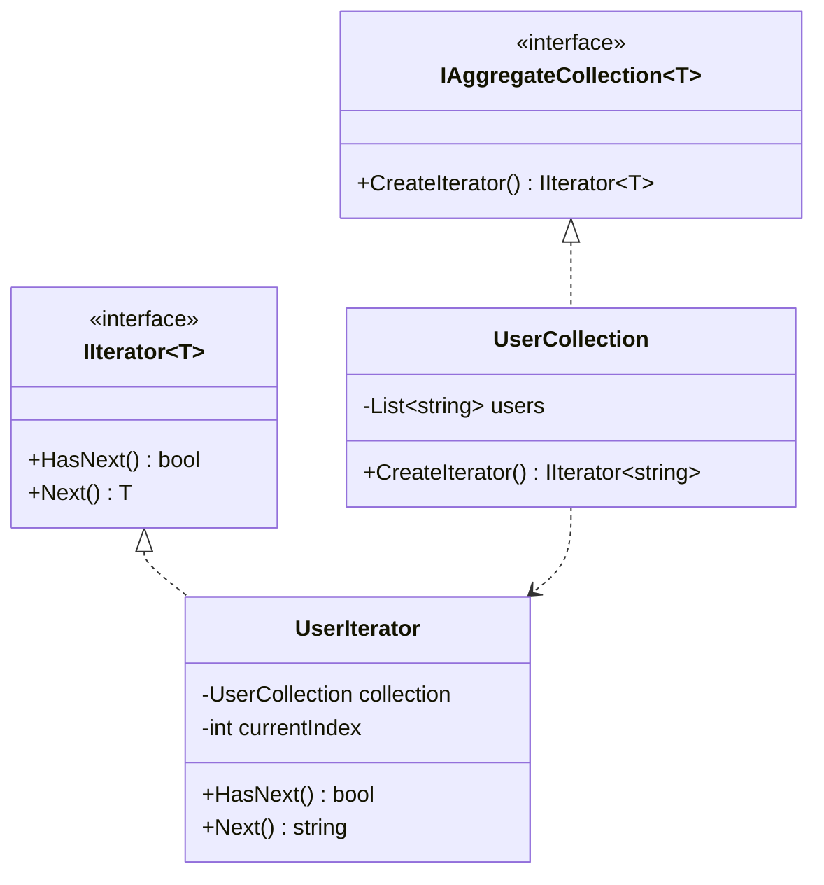

# Iterator Pattern

## 1. Intent & Core Problem
The Iterator pattern provides a standard mechanism to sequentially traverse elements of a complex data structure (list, tree, graph, hash table) without exposing its internal representation. It abstracts traversal logic, allows multiple concurrent traversals over the same collection, and supports polymorphic iteration.

```
[Collection: Tree / Graph / List] ──> [CreateIterator()] ──> [Iterator: HasNext(), Next()]
```

## 2. Mermaid Structural Collaboration


## 3. Applicability & Selection Rubric

### 3.1 Architectural Scope
- **Granularity**: 
- **Evolutionary Rule of Three**: Never build a custom iterator class when language-native generator functions or IEnumerable/yield suffice.
- **Language-First Substitution**: Always prefer language-native features: C# IEnumerable<T> with yield return, Python generator functions (yield), or JS Symbol.iterator.

### 3.2 Decision Indicators
- [X] Green Flag 1: Accessing an aggregate object contents without exposing its internal representation (trees, graphs, composite structures).
- [X] Green Flag 2: Supporting multiple simultaneous traversals of the same aggregate data structure.
- [X] Green Flag 3: Providing a uniform interface for traversing diverse, heterogeneous collections polymorphically.
- [!] Red Flag 1: The collection is already a standard array or list with built-in iteration capabilities.
- [!] Red Flag 2: Creating custom iterator classes when yield return or Python def __iter__ accomplishes the same in 5 lines.
- [!] Red Flag 3: Modifying the underlying collection during traversal without robust fail-fast mechanics, causing concurrency bugs.

### 3.3 Alternative Simplification
Use native generators (yield), standard LINQ / list comprehensions, or built-in iteration protocols.
## 4. Modern Idiomatic Implementations

### C# (.NET 10)
```csharp
namespace DesignPatterns.Behavioral.Iterator;

using System.Collections;

public sealed record Employee(string Name, string Department);

public sealed class DepartmentRoster : IEnumerable<Employee>
{
    private readonly List<Employee> _employees = [];

    public void Add(Employee employee) => _employees.Add(employee);

    // Modern C# idiomatic iteration uses yield return
    public IEnumerator<Employee> GetEnumerator()
    {
        for (int i = 0; i < _employees.Count; i++)
        {
            yield return _employees[i];
        }
    }

    IEnumerator IEnumerable.GetEnumerator() => GetEnumerator();

    // Custom filtered iterator
    public IEnumerable<Employee> FilterByDepartment(string department)
    {
        foreach (var emp in _employees)
        {
            if (emp.Department.Equals(department, StringComparison.OrdinalIgnoreCase))
            {
                yield return emp;
            }
        }
    }
}
```

### TypeScript (Angular Standalone & Signals)
```typescript
import { Component, signal } from '@angular/core';

export class PaginatedDataset<T> implements Iterable<T> {
  constructor(private readonly items: T[]) {}

  // JavaScript/TypeScript native Symbol.iterator implementation
  *[Symbol.iterator](): Iterator<T> {
    for (const item of this.items) {
      yield item;
    }
  }

  *reverseIterator(): IterableIterator<T> {
    for (let i = this.items.length - 1; i >= 0; i--) {
      yield this.items[i];
    }
  }
}

@Component({
  selector: 'app-iterator-demo',
  standalone: true,
  template: `
    <div>
      <p>Processed items count: {{ itemCount() }}</p>
    </div>
  `,
})
export class IteratorDemoComponent {
  private readonly dataset = new PaginatedDataset<string>(['Alpha', 'Beta', 'Gamma']);

  readonly itemCount = signal<number>(this.calculateCount());

  private calculateCount(): number {
    let count = 0;
    for (const item of this.dataset) {
      count++;
    }
    return count;
  }
}
```

### Python (3.12+ Modern Type System)
```python
from collections.abc import Iterator
from dataclasses import dataclass

@dataclass(slots=True, frozen=True)
class LogEntry:
    timestamp: str
    message: str

class AuditLogBuffer:
    def __init__(self) -> None:
        self._entries: list[LogEntry] = []

    def append(self, timestamp: str, message: str) -> None:
        self._entries.append(LogEntry(timestamp, message))

    # Python native iterator protocol via __iter__ generator
    def __iter__(self) -> Iterator[LogEntry]:
        yield from self._entries

    def reverse(self) -> Iterator[LogEntry]:
        for entry in reversed(self._entries):
            yield entry
```

## 5. Consequences & Trade-offs
- **Pros**:
  - Single Responsibility: Traversal algorithms are extracted into separate classes or generator functions.
  - Open/Closed Principle: You can implement new types of collections and iterators without breaking existing code.
  - Can iterate over the same collection in parallel.
- **Cons**:
  - Applying the pattern can be an overkill if your app only works with simple collections.

## 6. Security, Misuse & Anti-patterns
- **Concurrent Modification Exception**: Modifying the underlying collection while an iterator is actively traversing it leads to undefined behavior or exceptions. Ensure snapshots or concurrent synchronization locks are used if collections are mutated concurrently.

## 7. Related Patterns
- **Composite**: Iterators are frequently applied to traverse recursive Composite trees.
- **Factory Method**: Polymorphic iterators rely on factory methods to instantiate the appropriate iterator subclass.
- **Memento**: Often used in tandem with Iterator to capture the current state of an iteration for rewind/restore.
