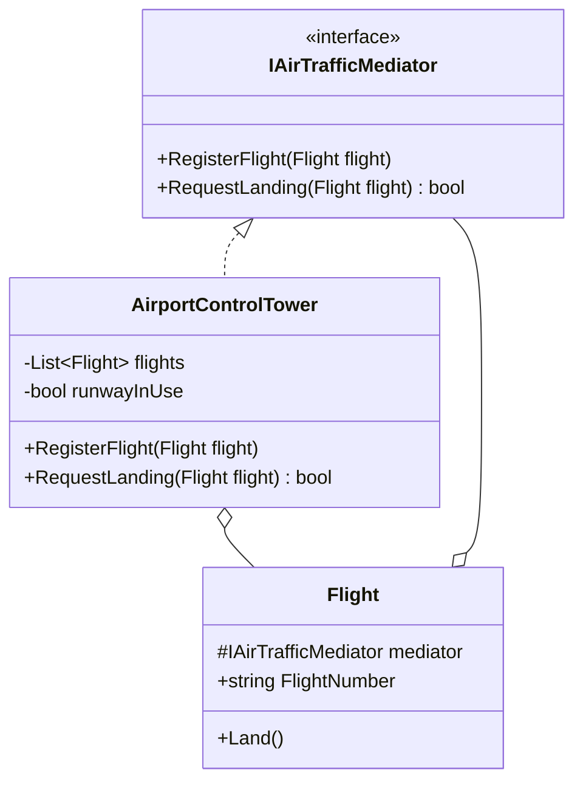

# Mediator Pattern

## 1. Intent & Core Problem
The Mediator pattern reduces chaotic dependencies between components in an application. Instead of components communicating directly with each other in an entangled web of $N \times (N - 1)$ cross-references, they notify a central mediator object whenever an event occurs, and the mediator orchestrates the necessary updates across related colleagues.

```
[Component A] ──┐                     ┌──> [Component C]
[Component B] ──┴──> [Central Mediator] ──┴──> [Component D]
```

## 2. Mermaid Structural Collaboration


## 3. Applicability & Selection Rubric

### 3.1 Architectural Scope
- **Granularity**: 
- **Evolutionary Rule of Three**: Do not introduce a Mediator for fewer than 3 communicating components or where direct point-to-point connections are clear.
- **Language-First Substitution**: Prefer event buses, reactive signals/streams, or message channels over heavyweight bidirectional mediator classes.

### 3.2 Decision Indicators
- [X] Green Flag 1: A set of objects communicate in well-defined but complex ways, resulting in unmanageable web-like dependencies.
- [X] Green Flag 2: Reusing an object is difficult because it refers to and communicates with many other disparate objects.
- [X] Green Flag 3: Behavior that should be distributed between several classes ought to be customizable without a lot of subclassing.
- [!] Red Flag 1: Only 2 components interact, where direct callback or event notification is straightforward.
- [!] Red Flag 2: The mediator evolves into an unmaintainable God Object that knows too much and centralizes all application logic.
- [!] Red Flag 3: Event cascades in the mediator cause hard-to-trace infinite cycles or performance bottlenecks.

### 3.3 Alternative Simplification
Connect components with direct event callbacks, reactive Signals, or publish-subscribe channels.
## 4. Modern Idiomatic Implementations

### C# (.NET 10)
```csharp
namespace DesignPatterns.Behavioral.Mediator;

public interface IChatRoomMediator
{
    void SendMessage(string senderId, string message);
    void RegisterParticipant(ChatUser user);
}

public sealed class ChatRoom : IChatRoomMediator
{
    private readonly Dictionary<string, ChatUser> _users = [];

    public void RegisterParticipant(ChatUser user)
    {
        _users[user.UserId] = user;
        user.SetMediator(this);
    }

    public void SendMessage(string senderId, string message)
    {
        foreach (var (id, user) in _users)
        {
            if (id != senderId)
            {
                user.Receive(senderId, message);
            }
        }
    }
}

public sealed class ChatUser(string userId)
{
    private IChatRoomMediator? _mediator;
    public string UserId { get; } = userId;

    public void SetMediator(IChatRoomMediator mediator) => _mediator = mediator;

    public void Send(string message) => _mediator?.SendMessage(UserId, message);

    public void Receive(string from, string message) =>
        Console.WriteLine($"[{UserId} received from {from}]: {message}");
}
```

### TypeScript (Angular Standalone & Signals)
```typescript
import { Component, Injectable, signal } from '@angular/core';

export interface DialogMediator {
  notify(sender: string, event: string): void;
}

@Injectable({ providedIn: 'root' })
export class ModalDialogMediator implements DialogMediator {
  readonly isTermsAccepted = signal<boolean>(false);
  readonly isSubmitEnabled = signal<boolean>(false);

  notify(sender: string, event: string): void {
    if (sender === 'checkbox' && event === 'change') {
      const accepted = !this.isTermsAccepted();
      this.isTermsAccepted.set(accepted);
      this.isSubmitEnabled.set(accepted);
    }
  }
}

@Component({
  selector: 'app-dialog-mediator-demo',
  standalone: true,
  template: `
    <div>
      <input type="checkbox" (change)="toggleTerms()" />
      <button [disabled]="!mediator.isSubmitEnabled()">Submit</button>
    </div>
  `,
})
export class DialogMediatorDemoComponent {
  constructor(public readonly mediator: ModalDialogMediator) {}

  toggleTerms(): void {
    this.mediator.notify('checkbox', 'change');
  }
}
```

### Python (3.12+ Modern Type System)
```python
from typing import Protocol

class Mediator(Protocol):
    def notify(self, sender: object, event: str) -> None: ...

class UIComponent:
    def __init__(self, mediator: Mediator | None = None) -> None:
        self._mediator = mediator

    def set_mediator(self, mediator: Mediator) -> None:
        self._mediator = mediator

class Checkbox(UIComponent):
    def __init__(self) -> None:
        super().__init__()
        self.is_checked: bool = False

    def check(self) -> None:
        self.is_checked = True
        if self._mediator:
            self._mediator.notify(self, "check")

class SubmitButton(UIComponent):
    def __init__(self) -> None:
        super().__init__()
        self.is_enabled: bool = False

class FormMediator:
    def __init__(self, checkbox: Checkbox, button: SubmitButton) -> None:
        self._checkbox = checkbox
        self._button = button
        self._checkbox.set_mediator(self)
        self._button.set_mediator(self)

    def notify(self, sender: object, event: str) -> None:
        if sender is self._checkbox and event == "check":
            self._button.is_enabled = self._checkbox.is_checked
```

## 5. Consequences & Trade-offs
- **Pros**:
  - Limits subclassing: encapsulates behavior that would otherwise be distributed across many subclasses.
  - Decouples colleagues: colleagues become reusable without knowing each other.
  - Simplifies object protocols: replaces many-to-many with one-to-many interactions.
- **Cons**:
  - Centralizes control: a mediator can easily evolve into a monolithic, unmaintainable "God Object".

## 6. Security, Misuse & Anti-patterns
- **Infinite Notification Loops**: Ensure events forwarded by the mediator don't bounce back from colleague callbacks causing infinite recursive dispatch. Enforce a re-entrancy depth guard.

## 7. Related Patterns
- **Facade**: Differs from Mediator in that Facade abstracts a subsystem from external clients (unidirectional); Mediator coordinates internal communication between colleagues (multidirectional).
- **Observer**: Colleagues often interact with the mediator using the Observer pattern.
