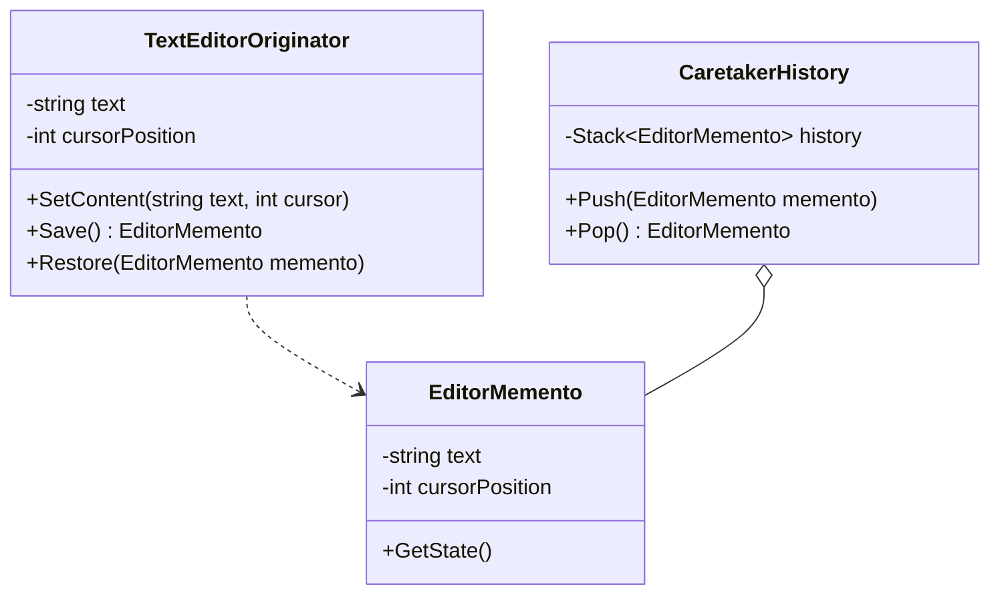

# Memento Pattern

## 1. Intent & Core Problem
The Memento pattern captures and externalizes an object's internal state without exposing its private fields or violating encapsulation. This saved state snapshot (the *Memento*) is held by an external caretaker (such as a transaction manager or history stack) and can be passed back to the originating object at any time to restore its previous condition.

```
[Originator] ──Creates──> [Memento (Opaque Snapshot)]
     ▲                               │
     │ Held by                       ▼
     └────────────────────── [Caretaker History]
```

## 2. Mermaid Structural Collaboration


## 3. Applicability & Selection Rubric

### 3.1 Architectural Scope
- **Granularity**: 
- **Evolutionary Rule of Three**: Do not use Memento unless you require full multi-level undo/redo or state rollback across 3+ checkpoints.
- **Language-First Substitution**: In modern C#, TypeScript, and Python, prefer immutable data structures, readonly records, or serialization snapshots.

### 3.2 Decision Indicators
- [X] Green Flag 1: A snapshot of an object state must be saved so that it can be restored to that exact state later.
- [X] Green Flag 2: Direct access to obtaining the state would expose private implementation details and violate encapsulation.
- [X] Green Flag 3: Implementing undo, transaction rollback, or checkpointing in stateful editors or engines.
- [!] Red Flag 1: Saving frequent large mementos causes prohibitive memory consumption without diff-based compression.
- [!] Red Flag 2: The originator object state is completely public anyway, rendering memento encapsulation protection pointless.
- [!] Red Flag 3: Memento objects contain active resource references (open files, sockets) that cannot be safely restored.

### 3.3 Alternative Simplification
Use immutable record snapshots, JSON/binary serialization, or event sourcing diffs.
## 4. Modern Idiomatic Implementations

### C# (.NET 10)
```csharp
namespace DesignPatterns.Behavioral.Memento;

// Opaque memento representation
public interface IMemento
{
    DateTime SavedAtUtc { get; }
}

public sealed class DocumentOriginator
{
    public string Content { get; set; } = string.Empty;
    public int Version { get; private set; }

    public IMemento Save() => new DocumentMemento(Content, Version);

    public void Restore(IMemento memento)
    {
        if (memento is not DocumentMemento concrete)
        {
            throw new ArgumentException("Invalid memento type provided.", nameof(memento));
        }

        Content = concrete.Content;
        Version = concrete.Version;
    }

    // Private inner record guarantees encapsulation
    private sealed record DocumentMemento(string Content, int Version) : IMemento
    {
        public DateTime SavedAtUtc { get; } = DateTime.UtcNow;
    }
}
```

### TypeScript (Angular Standalone & Signals)
```typescript
import { Component, signal } from '@angular/core';

export interface FormSnapshot {
  readonly formData: Record<string, string>;
  readonly timestamp: number;
}

export class UserFormOriginator {
  private fields: Record<string, string> = {};

  updateField(key: string, value: string): void {
    this.fields = { ...this.fields, [key]: value };
  }

  saveSnapshot(): FormSnapshot {
    return {
      formData: { ...this.fields },
      timestamp: Date.now(),
    };
  }

  restoreSnapshot(snapshot: FormSnapshot): void {
    this.fields = { ...snapshot.formData };
  }

  get currentData(): Record<string, string> {
    return { ...this.fields };
  }
}

@Component({
  selector: 'app-memento-form',
  standalone: true,
  template: `
    <div>
      <p>Name: {{ formDisplay().name || 'Empty' }}</p>
      <button (click)="save()">Save Checkpoint</button>
      <button (click)="restore()" [disabled]="!hasSnapshot()">Rollback</button>
    </div>
  `,
})
export class MementoFormComponent {
  private readonly originator = new UserFormOriginator();
  private savedSnapshot: FormSnapshot | null = null;

  readonly formDisplay = signal<Record<string, string>>(this.originator.currentData);
  readonly hasSnapshot = signal<boolean>(false);

  save(): void {
    this.savedSnapshot = this.originator.saveSnapshot();
    this.hasSnapshot.set(true);
  }

  restore(): void {
    if (this.savedSnapshot) {
      this.originator.restoreSnapshot(this.savedSnapshot);
      this.formDisplay.set(this.originator.currentData);
    }
  }
}
```

### Python (3.12+ Modern Type System)
```python
from dataclasses import dataclass
from datetime import datetime, timezone

@dataclass(slots=True, frozen=True)
class EditorStateMemento:
    content: str
    cursor_index: int
    saved_at: datetime

class TextEditor:
    def __init__(self) -> None:
        self.content: str = ""
        self.cursor_index: int = 0

    def write(self, text: str) -> None:
        self.content += text
        self.cursor_index += len(text)

    def create_snapshot(self) -> EditorStateMemento:
        return EditorStateMemento(
            content=self.content,
            cursor_index=self.cursor_index,
            saved_at=datetime.now(timezone.utc),
        )

    def restore(self, memento: EditorStateMemento) -> None:
        self.content = memento.content
        self.cursor_index = memento.cursor_index
```

## 5. Consequences & Trade-offs
- **Pros**:
  - Preserves encapsulation boundaries: other objects can't see the internal state stored in the memento.
  - Simplifies the originator: originator doesn't need to maintain multiple versions of its state.
- **Cons**:
  - Memory-intensive: copying large states frequently consumes excessive heap memory if clients do not prune checkpoints.

## 6. Security, Misuse & Anti-patterns
- **Sensitive State Leaks**: If the originator holds credentials, API keys, or decrypted session tokens, ensure mementos either omit or cryptographically protect sensitive fields.
- **Tampering with Mementos**: If mementos are stored externally (e.g. client cookies or browser localStorage), sign or encrypt them to prevent state tampering attacks.

## 7. Related Patterns
- **Command**: Commands can use mementos to maintain state for undoable operations.
- **Iterator**: Mementos can be used for iteration bookmarks.
