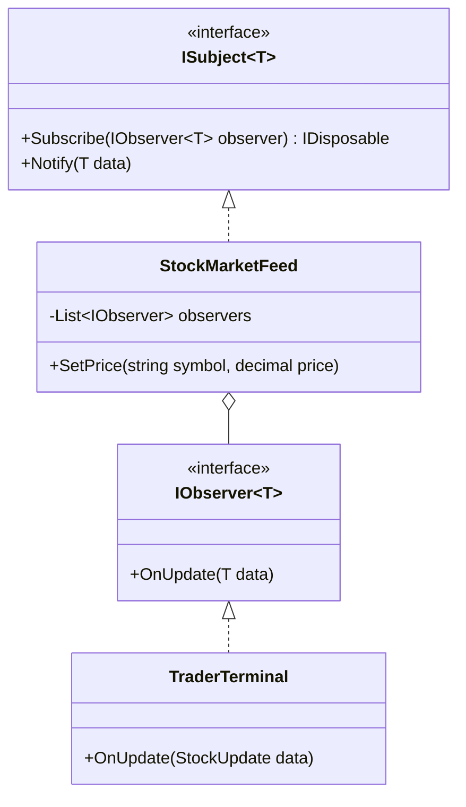

# Observer Pattern

## 1. Intent & Core Problem
The Observer pattern establishes a subscription mechanism allowing multiple observer objects to listen for and react to state changes occurring in a subject object. It decouples the broadcast subject from the concrete types, count, and lifecycles of its subscribers.

```
       [Subject: PriceEmitter]
         │ (State Changes)
         ├───────────────────┐
         ▼                   ▼
[EmailSubscriber]    [UINotificationSubscriber]
```

## 2. Mermaid Structural Collaboration


## 3. Applicability & Selection Rubric

### 3.1 Architectural Scope
- **Granularity**: 
- **Evolutionary Rule of Three**: Do not implement manual Observer registries when native language events, reactive Signals, or RxJS exist.
- **Language-First Substitution**: Always prioritize modern primitives: C# event / IObservable<T>, Angular Signals (signal(), computed()), Python asyncio events.

### 3.2 Decision Indicators
- [X] Green Flag 1: A change to one object requires changing others, and you do not know how many objects need to change.
- [X] Green Flag 2: An object should be able to notify other objects without making assumptions about who those objects are.
- [X] Green Flag 3: Establishing loose coupling between core domain models and presentation/UI views.
- [!] Red Flag 1: Observers are registered but never unregistered, resulting in Lapsed Listener memory leaks.
- [!] Red Flag 2: Notifications trigger cascading reactive updates that loop infinitely or destroy performance.
- [!] Red Flag 3: The order of notifications must be strictly guaranteed, which standard observer sets do not provide.

### 3.3 Alternative Simplification
Use reactive Signals (signal(), computed()), modern language events, or reactive streams (Observable).
## 4. Modern Idiomatic Implementations

### C# (.NET 10)
```csharp
namespace DesignPatterns.Behavioral.Observer;

public sealed record PriceTick(string Symbol, decimal Price, DateTime TimestampUtc);

public interface IPriceObserver
{
    void OnPriceChanged(PriceTick tick);
}

// Subject managing subscriptions with explicit IDisposable to eliminate Lapsed Listener leaks
public sealed class StockTicker
{
    private readonly List<IPriceObserver> _observers = [];
    private readonly object _lock = new();

    public IDisposable Subscribe(IPriceObserver observer)
    {
        lock (_lock)
        {
            _observers.Add(observer);
        }
        return new Unsubscriber(() =>
        {
            lock (_lock)
            {
                _observers.Remove(observer);
            }
        });
    }

    public void PublishPrice(string symbol, decimal price)
    {
        var tick = new PriceTick(symbol, price, DateTime.UtcNow);
        List<IPriceObserver> snapshot;
        lock (_lock)
        {
            snapshot = [.. _observers];
        }

        foreach (var observer in snapshot)
        {
            observer.OnPriceChanged(tick);
        }
    }

    private sealed class Unsubscriber(Action unsubscribeAction) : IDisposable
    {
        private Action? _action = unsubscribeAction;

        public void Dispose()
        {
            Interlocked.Exchange(ref _action, null)?.Invoke();
        }
    }
}
```

### TypeScript (Angular Standalone & Signals)
```typescript
import { Component, DestroyRef, Injectable, inject, signal } from '@angular/core';

export interface WeatherData {
  city: string;
  temperatureC: number;
}

@Injectable({ providedIn: 'root' })
export class WeatherStationService {
  readonly #currentWeather = signal<WeatherData>({ city: 'Milan', temperatureC: 22.0 });

  // Read-only signal automatically cleans up downstream subscribers upon component destruction
  readonly weather = this.#currentWeather.asReadonly();

  updateTemperature(newTemp: number): void {
    this.#currentWeather.update((curr) => ({ ...curr, temperatureC: newTemp }));
  }
}

@Component({
  selector: 'app-weather-widget',
  standalone: true,
  template: `
    <div>
      <h3>{{ weatherService.weather().city }}</h3>
      <p>Temperature: {{ weatherService.weather().temperatureC }}°C</p>
    </div>
  `,
})
export class WeatherWidgetComponent {
  // Angular Signals provide automated injection-context tear down via DestroyRef
  constructor(public readonly weatherService: WeatherStationService) {}
}
```

### Python (3.12+ Modern Type System)
```python
import weakref
from dataclasses import dataclass
from typing import Callable

@dataclass(slots=True, frozen=True)
class EventData:
    topic: str
    payload: str

class EventDispatcher:
    def __init__(self) -> None:
        # Use weak references to prevent lapsed listener memory leaks
        self._listeners: list[weakref.WeakMethod] = []

    def subscribe(self, callback: Callable[[EventData], None]) -> None:
        # Registers bound method without keeping object alive
        if hasattr(callback, "__self__"):
            self._listeners.append(weakref.WeakMethod(callback))

    def broadcast(self, topic: str, payload: str) -> None:
        event = EventData(topic=topic, payload=payload)
        alive_listeners = []
        for ref in self._listeners:
            func = ref()
            if func is not None:
                func(event)
                alive_listeners.append(ref)
        self._listeners = alive_listeners
```

## 5. Consequences & Trade-offs
- **Pros**:
  - Abstract coupling between Subject and Observer: Subject doesn't need to know concrete observer classes.
  - Support for broadcast communication: notification is automatically broadcast to all interested objects.
- **Cons**:
  - Unexpected updates: observers have no knowledge of each other, and a small change in subject can trigger a cascade of updates.

## 6. Security, Misuse & Anti-patterns
- **The Lapsed Listener Problem (Memory Leak)**: Strong references retained by a long-lived subject prevent short-lived observers from being collected by the Garbage Collector. Always return an `IDisposable` or use `weakref` / Angular Signals.
- **Cascading Re-entrancy Loops**: If Observer A reacts to Subject 1 by updating Subject 2, which notifies Observer B who updates Subject 1, an infinite loop locks the thread. Implement a re-entrancy depth threshold guard.

## 7. Related Patterns
- **Mediator**: By encapsulating complex updates, a Mediator often acts as an observer for colleagues.
- **Singleton**: Event dispatchers / event buses are frequently registered as singletons.
