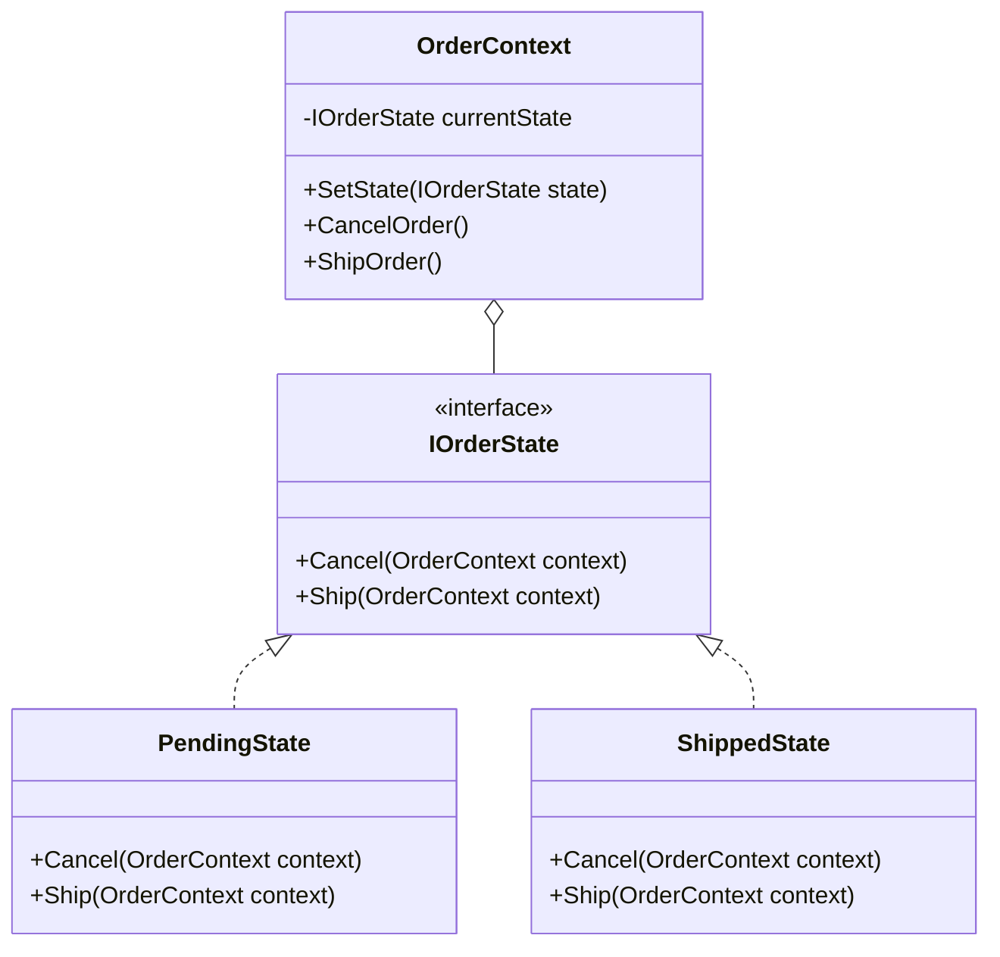

# State Pattern

## 1. Intent & Core Problem
The State pattern allows an object to alter its behavior dynamically when its internal state changes, appearing as if it changed its underlying class. It replaces monolithic, brittle switch/case statements and conditional flags (`if (state == A) ... else if (state == B) ...`) with cohesive, polymorphic state objects.

```
[Context: Order] ──> [CurrentState.Process()] ──> [Transitions to Next State]
```

## 2. Mermaid Structural Collaboration


## 3. Applicability & Selection Rubric

### 3.1 Architectural Scope
- **Granularity**: 
- **Evolutionary Rule of Three**: Do not introduce State pattern classes for fewer than 3 states or where simple boolean flags suffice.
- **Language-First Substitution**: Prefer pattern matching switch expressions (match/case) over separate state classes when states have few transitions.

### 3.2 Decision Indicators
- [X] Green Flag 1: An object behavior depends on its state, and it must change its behavior at runtime in response to state transitions.
- [X] Green Flag 2: Operations have massive, multipart conditional branches (switch or if-else) that depend on the object state.
- [X] Green Flag 3: State transition logic is complex, distinct, and prone to bugs when mixed in a single monolithic class.
- [!] Red Flag 1: The state machine has only 2 simple states (e.g. Active / Inactive) easily managed with a boolean property.
- [!] Red Flag 2: States share almost all behavior with minimal variation, leading to duplicate pass-through code.
- [!] Red Flag 3: State transitions are static and never change during the lifetime of the object.

### 3.3 Alternative Simplification
Use an enum with modern pattern matching (switch expressions or Python match/case) or a lightweight state machine library.
## 4. Modern Idiomatic Implementations

### C# (.NET 10)
```csharp
namespace DesignPatterns.Behavioral.State;

public interface IAccountState
{
    void Deposit(BankAccount account, decimal amount);
    void Withdraw(BankAccount account, decimal amount);
}

public sealed class BankAccount
{
    public decimal Balance { get; set; }
    public IAccountState State { get; set; }

    public BankAccount()
    {
        State = new ActiveState();
    }

    public void Deposit(decimal amount) => State.Deposit(this, amount);
    public void Withdraw(decimal amount) => State.Withdraw(this, amount);
}

public sealed class ActiveState : IAccountState
{
    public void Deposit(BankAccount account, decimal amount) => account.Balance += amount;

    public void Withdraw(BankAccount account, decimal amount)
    {
        account.Balance -= amount;
        if (account.Balance < 0)
        {
            account.State = new OverdrawnState();
        }
    }
}

public sealed class OverdrawnState : IAccountState
{
    public void Deposit(BankAccount account, decimal amount)
    {
        account.Balance += amount;
        if (account.Balance >= 0)
        {
            account.State = new ActiveState();
        }
    }

    public void Withdraw(BankAccount account, decimal amount)
    {
        throw new InvalidOperationException("Cannot withdraw funds while account is overdrawn.");
    }
}
```

### TypeScript (Angular Standalone & Signals)
```typescript
import { Component, computed, signal } from '@angular/core';

export type PlayerState = 'STOPPED' | 'PLAYING' | 'PAUSED';

@Component({
  selector: 'app-media-state-player',
  standalone: true,
  template: `
    <div>
      <p>Current State: {{ currentState() }}</p>
      <p>Action Status: {{ statusMessage() }}</p>
      <button (click)="play()">Play</button>
      <button (click)="pause()">Pause</button>
      <button (click)="stop()">Stop</button>
    </div>
  `,
})
export class MediaStatePlayerComponent {
  readonly currentState = signal<PlayerState>('STOPPED');

  readonly statusMessage = computed(() => {
    switch (this.currentState()) {
      case 'STOPPED':
        return 'Track ready to start.';
      case 'PLAYING':
        return 'Streaming audio stream at 320kbps.';
      case 'PAUSED':
        return 'Playback paused at current frame.';
      default: {
        const _exhaustive: never = this.currentState();
        return _exhaustive;
      }
    }
  });

  play(): void {
    if (this.currentState() !== 'PLAYING') {
      this.currentState.set('PLAYING');
    }
  }

  pause(): void {
    if (this.currentState() === 'PLAYING') {
      this.currentState.set('PAUSED');
    }
  }

  stop(): void {
    this.currentState.set('STOPPED');
  }
}
```

### Python (3.12+ Modern Type System)
```python
from abc import ABC, abstractmethod

class DocumentState(ABC):
    @abstractmethod
    def publish(self, document: "Document") -> str: ...

class DraftState(DocumentState):
    def publish(self, document: "Document") -> str:
        document.set_state(ModerationState())
        return "Draft submitted for moderation."

class ModerationState(DocumentState):
    def publish(self, document: "Document") -> str:
        document.set_state(PublishedState())
        return "Document approved and published."

class PublishedState(DocumentState):
    def publish(self, document: "Document") -> str:
        return "Document is already publicly live."

class Document:
    def __init__(self) -> None:
        self._state: DocumentState = DraftState()

    def set_state(self, state: DocumentState) -> None:
        self._state = state

    def publish(self) -> str:
        return self._state.publish(self)
```

## 5. Consequences & Trade-offs
- **Pros**:
  - Localizes state-specific behavior and partitions behavior for different states.
  - Makes state transitions explicit.
  - State objects can be shared if they have no instance variables (Flyweight).
- **Cons**:
  - Can be overkill if a state machine has only a couple of states and rarely changes.

## 6. Security, Misuse & Anti-patterns
- **Illegal State Transitions**: Ensure validation invariants are strictly enforced before state transition assignments; prevent bypass attacks where an unapproved entity jumps directly to an authorized state.

## 7. Related Patterns
- **Flyweight**: State objects that have no intrinsic state variables can be shared as flyweights.
- **Singleton**: State objects are often singletons.
- **Strategy**: State and Strategy share similar class diagrams; however, Strategy algorithms are chosen by the client, whereas State changes internal behavior in response to lifecycle events.
