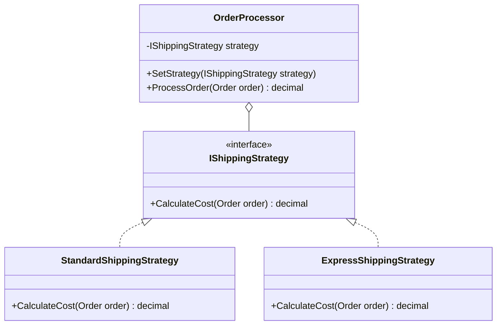

# Strategy Pattern

## 1. Intent & Core Problem
The Strategy pattern defines a family of algorithms, encapsulates each algorithm inside a separate class or callable, and makes them interchangeable. This enables the client to switch algorithms at runtime (e.g. compression types, payment processors, routing algorithms, validation policies) without altering the calling code.

```
[Context: OrderProcessor] ──> [IStrategy.CalculateCost()] ──> [Standard / Express / Drone]
```

## 2. Mermaid Structural Collaboration


## 3. Applicability & Selection Rubric

### 3.1 Architectural Scope
- **Granularity**: 
- **Evolutionary Rule of Three**: Do not introduce Strategy classes for fewer than 3 calculation variants unless runtime user selection is strictly mandated.
- **Language-First Substitution**: In modern C# and Python, prefer first-class functions / delegates (Func<Order, decimal> or Callable[[Order], float]) over dedicated strategy classes for simple single-method algorithms.

### 3.2 Decision Indicators
- [X] Green Flag 1: Multiple algorithmic variants exist (e.g. 3+ shipping or tax calculation rules) with frequent domain volatility.
- [X] Green Flag 2: Complex conditional branches (switch or nested if-else) duplicate algorithm logic across multiple consumer classes.
- [X] Green Flag 3: Algorithm implementations contain internal dependencies that should remain completely hidden from consuming callers.
- [!] Red Flag 1: Only 1 or 2 static variants exist that rarely change; direct methods or simple inline branching provide far better readability.
- [!] Red Flag 2: Algorithms require heavy contextual access to internal private state of the context class, forcing undesirable encapsulation breaches.
- [!] Red Flag 3: Extreme micro-performance constraints where virtual method invocation and object allocation overhead cannot be tolerated.

### 3.3 Alternative Simplification
If only 1 or 2 calculation variants exist, use direct method calls or pass a simple lambda/delegate instead of scaffolding formal IShippingStrategy classes.
## 4. Modern Idiomatic Implementations

### C# (.NET 10)
```csharp
namespace DesignPatterns.Behavioral.Strategy;

public sealed record Order(string OrderId, decimal Amount, double WeightKg);

public interface IShippingStrategy
{
    decimal CalculateCost(Order order);
}

public sealed class StandardShippingStrategy : IShippingStrategy
{
    public decimal CalculateCost(Order order) => 5.00m + ((decimal)order.WeightKg * 0.50m);
}

public sealed class ExpressShippingStrategy : IShippingStrategy
{
    public decimal CalculateCost(Order order) => 15.00m + ((decimal)order.WeightKg * 1.25m);
}

public sealed class OrderProcessor(IShippingStrategy shippingStrategy)
{
    public decimal FinalizeOrder(Order order)
    {
        ArgumentNullException.ThrowIfNull(order);
        var shippingFee = shippingStrategy.CalculateCost(order);
        return order.Amount + shippingFee;
    }
}
```

### TypeScript (Angular Standalone & Signals)
```typescript
import { Component, computed, signal } from '@angular/core';

export interface ShippingStrategy {
  calculate(weightKg: number): number;
}

export const standardStrategy: ShippingStrategy = {
  calculate: (w) => 5.0 + w * 0.5,
};

export const expressStrategy: ShippingStrategy = {
  calculate: (w) => 15.0 + w * 1.25,
};

@Component({
  selector: 'app-checkout',
  standalone: true,
  template: `
    <div>
      <p>Total Cost: {{ total() }}</p>
      <button (click)="setExpress()">Express Shipping</button>
    </div>
  `,
})
export class CheckoutComponent {
  readonly weightKg = signal<number>(2.5);
  readonly baseAmount = signal<number>(50.0);
  readonly activeStrategy = signal<ShippingStrategy>(standardStrategy);

  readonly total = computed(() => {
    const shipping = this.activeStrategy().calculate(this.weightKg());
    return this.baseAmount() + shipping;
  });

  setExpress(): void {
    this.activeStrategy.set(expressStrategy);
  }
}
```

### Python (3.12+ Modern Type System)
```python
from dataclasses import dataclass
from typing import Protocol

@dataclass(slots=True, frozen=True)
class Order:
    order_id: str
    amount: float
    weight_kg: float

class ShippingStrategy(Protocol):
    def __call__(self, order: Order) -> float: ...

def standard_shipping(order: Order) -> float:
    return 5.0 + (order.weight_kg * 0.5)

def express_shipping(order: Order) -> float:
    return 15.0 + (order.weight_kg * 1.25)

class OrderService:
    def __init__(self, strategy: ShippingStrategy) -> None:
        self._strategy = strategy

    def process_order(self, order: Order) -> float:
        return order.amount + self._strategy(order)
```

## 5. Consequences & Trade-offs
- **Pros**:
  - Families of related algorithms: inheritance or delegate protocols can clarify common functionality.
  - An alternative to subclassing: provides dynamic alternative to subclassing the Context class.
  - Eliminates conditional statements (`switch` / `if-else`).
- **Cons**:
  - Clients must be aware of how Strategies differ in order to select the right one.
  - Communication overhead between Strategy and Context.

## 6. Security, Misuse & Anti-patterns
- **Dynamic Class Reflection**: Never construct strategy instances from unvalidated user strings via reflection (`Type.GetType()`, `eval()`). Use closed enum dispatch or keyed DI.
- **Thread Safety**: Ensure shared strategy instances are stateless and thread-safe when registered as singletons in DI.

## 7. Related Patterns
- **Flyweight**: Strategy objects often make good flyweights because they contain no mutable extrinsic state.
- **State**: Similar structure, but in State the context transitions automatically, whereas in Strategy the caller configures the algorithm.
- **Template Method**: Template Method uses inheritance to vary parts of an algorithm; Strategy uses composition to vary the entire algorithm.
