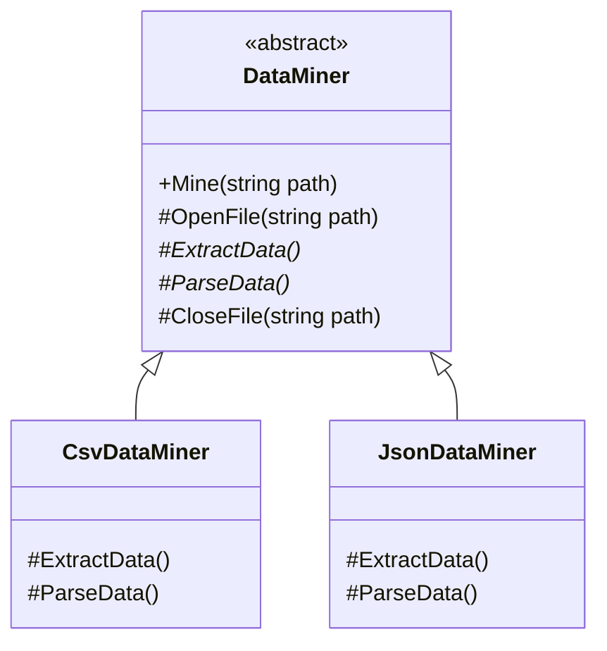

# Template Method Pattern

## 1. Intent & Core Problem
The Template Method pattern defines the overarching algorithmic workflow in a base method, deferring the implementation of specific primitive steps (or hooks) to derived subclasses. It enforces invariant algorithm sequences while granting subclasses the freedom to customize individual steps without altering the high-level workflow.

```
[Base Template Algorithm]
├── 1. ReadData()           (Invariant)
├── 2. ParseContent()       (Deferred to Subclass)
├── 3. ValidateContent()    (Deferred to Subclass)
└── 4. WriteResults()       (Invariant)
```

## 2. Mermaid Structural Collaboration


## 3. Applicability & Selection Rubric

### 3.1 Architectural Scope
- **Granularity**: 
- **Evolutionary Rule of Three**: Do not create a Template Method class hierarchy for fewer than 3 concrete variants with shared skeleton steps.
- **Language-First Substitution**: Prefer strategy composition or higher-order functions accepting callback hooks over rigid abstract class inheritance.

### 3.2 Decision Indicators
- [X] Green Flag 1: Implementing invariant parts of an algorithm once and leaving it up to subclasses to implement the variant behavior.
- [X] Green Flag 2: Common behavior among subclasses should be factored out and localized in a common class to avoid code duplication.
- [X] Green Flag 3: Controlling subclass extensions via specific hook points while keeping the main skeleton algorithm final.
- [!] Red Flag 1: Only a single implementation exists, making the abstract base class unnecessary indirection.
- [!] Red Flag 2: Subclasses need to reorder or alter the fundamental structure of the algorithm skeleton, which violates the pattern.
- [!] Red Flag 3: Deep inheritance ladders where tracing execution through super-calls becomes fragile and difficult to maintain.

### 3.3 Alternative Simplification
Use function composition or pass strategy callbacks into a single non-abstract orchestrator method.
## 4. Modern Idiomatic Implementations

### C# (.NET 10)
```csharp
namespace DesignPatterns.Behavioral.TemplateMethod;

public abstract class DataProcessor
{
    // The Template Method defines invariant execution order
    public void ProcessPipeline(string sourceUri)
    {
        ArgumentException.ThrowIfNullOrWhiteSpace(sourceUri);

        Connect(sourceUri);
        var rawData = ExtractRawData();
        var processed = TransformData(rawData);
        SaveOutput(processed);
        Disconnect();
    }

    protected virtual void Connect(string source) => Console.WriteLine($"Connected to {source}");
    protected abstract string ExtractRawData();
    protected abstract string TransformData(string raw);
    protected virtual void SaveOutput(string output) => Console.WriteLine($"Saved: {output}");
    protected virtual void Disconnect() => Console.WriteLine("Disconnected.");
}

public sealed class CsvDataProcessor : DataProcessor
{
    protected override string ExtractRawData() => "col1,col2\nval1,val2";
    protected override string TransformData(string raw) => $"CSV Normalized: {raw.Replace('\n', ';')}";
}

public sealed class JsonDataProcessor : DataProcessor
{
    protected override string ExtractRawData() => "{\"name\": \"Alice\"}";
    protected override string TransformData(string raw) => $"JSON Sanitized: {raw.ToUpperInvariant()}";
}
```

### TypeScript (Angular Standalone & Signals)
```typescript
import { Component, signal } from '@angular/core';

export abstract class BaseReportGenerator {
  generateReport(title: string): string {
    const header = this.buildHeader(title);
    const body = this.buildBody();
    const footer = this.buildFooter();
    return `${header}\n${body}\n${footer}`;
  }

  protected buildHeader(title: string): string {
    return `=== ${title.toUpperCase()} ===`;
  }

  protected abstract buildBody(): string;

  protected buildFooter(): string {
    return `Generated at ${new Date().toISOString()}`;
  }
}

export class HtmlReportGenerator extends BaseReportGenerator {
  protected override buildHeader(title: string): string {
    return `<h1>${title}</h1>`;
  }

  protected override buildBody(): string {
    return '<p>Detailed Metrics and Analytics</p>';
  }

  protected override buildFooter(): string {
    return '<footer>End of Report</footer>';
  }
}

@Component({
  selector: 'app-report-view',
  standalone: true,
  template: `<pre>{{ reportOutput() }}</pre>`,
})
export class ReportViewComponent {
  private readonly generator = new HtmlReportGenerator();
  readonly reportOutput = signal<string>(this.generator.generateReport('Quarterly Summary'));
}
```

### Python (3.12+ Modern Type System)
```python
from abc import ABC, abstractmethod

class OrderValidationPipeline(ABC):
    def validate_order(self, order_id: str, amount: float) -> bool:
        if not self._check_anti_fraud(order_id):
            return False
        if not self._validate_business_rules(amount):
            return False
        self._record_audit_log(order_id)
        return True

    def _check_anti_fraud(self, order_id: str) -> bool:
        # Common invariant check
        return len(order_id) > 0

    @abstractmethod
    def _validate_business_rules(self, amount: float) -> bool: ...

    def _record_audit_log(self, order_id: str) -> None:
        pass

class RetailOrderValidator(OrderValidationPipeline):
    def _validate_business_rules(self, amount: float) -> bool:
        return 0 < amount <= 5000.0

class WholesaleOrderValidator(OrderValidationPipeline):
    def _validate_business_rules(self, amount: float) -> bool:
        return amount >= 10000.0
```

## 5. Consequences & Trade-offs
- **Pros**:
  - Code reuse: extracts identical boilerplate code into a single base location.
  - Controls extensions: clients only override designated hook methods.
- **Cons**:
  - Inheritance constraints: clients are bound by class inheritance rather than composition.
  - Can be rigid if steps vary unpredictably.

## 6. Security, Misuse & Anti-patterns
- **Liskov Substitution Principle (LSP) Violations**: Overriding methods in subclasses must never weaken preconditions or alter the invariant security guarantees established by the base template method.

## 7. Related Patterns
- **Factory Method**: A Factory Method is often called by a Template Method.
- **Strategy**: Strategy modifies an entire algorithm using composition; Template Method modifies parts of an algorithm using inheritance.
