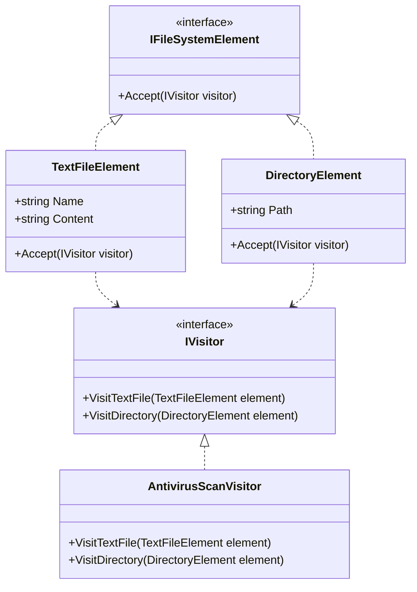

# Visitor Pattern

## 1. Intent & Core Problem
The Visitor pattern allows separating algorithms and operations from the objects and data structures on which they operate. It lets you add new operations to existing class hierarchies without modifying their source code. In classic object-oriented design, this is achieved via *double dispatch* (`element.Accept(visitor)` which invokes `visitor.Visit(element)`). In modern runtimes, pattern matching frequently achieves this with less boilerplate.

```
[Element Hierarchy: File, Directory] ──> [Accept(IVisitor)] ──> [ExportVisitor / AntivirusScanVisitor]
```

## 2. Mermaid Structural Collaboration


## 3. Applicability & Selection Rubric

### 3.1 Architectural Scope
- **Granularity**: 
- **Evolutionary Rule of Three**: Do not introduce Visitor unless the element hierarchy has 3+ stable element types and new operations are added frequently.
- **Language-First Substitution**: In modern C#, TypeScript, and Python, prefer pattern matching (switch expressions or match/case) over double-dispatch Accept/Visit classes.

### 3.2 Decision Indicators
- [X] Green Flag 1: An object structure contains many classes of elements with differing interfaces, and you need to perform operations depending on their concrete classes.
- [X] Green Flag 2: Many distinct and unrelated operations need to be performed on objects without polluting their classes with these operations.
- [X] Green Flag 3: The object structure element classes rarely or never change, but new operations over the structure are frequently defined.
- [!] Red Flag 1: The element hierarchy changes frequently, requiring updating the IVisitor interface and every concrete visitor implementation.
- [!] Red Flag 2: The language has rich pattern matching or multi-methods that eliminate the need for double-dispatch boilerplate.
- [!] Red Flag 3: The visitor requires intrusive access to private internal state of elements, breaking encapsulation.

### 3.3 Alternative Simplification
Use pattern matching (switch expression over element types) or extension methods instead of double-dispatch visitors.
## 4. Modern Idiomatic Implementations

### C# (.NET 10)
```csharp
namespace DesignPatterns.Behavioral.Visitor;

public interface IReportElement
{
    string Accept(IReportVisitor visitor);
}

public sealed record CustomerInvoice(string CustomerName, decimal AmountDue) : IReportElement
{
    public string Accept(IReportVisitor visitor) => visitor.VisitInvoice(this);
}

public sealed record PayrollEntry(string EmployeeName, decimal Salary) : IReportElement
{
    public string Accept(IReportVisitor visitor) => visitor.VisitPayroll(this);
}

public interface IReportVisitor
{
    string VisitInvoice(CustomerInvoice invoice);
    string VisitPayroll(PayrollEntry payroll);
}

// Concrete Visitor producing JSON exports
public sealed class JsonExportVisitor : IReportVisitor
{
    public string VisitInvoice(CustomerInvoice invoice) =>
        $"{{\"type\": \"invoice\", \"customer\": \"{invoice.CustomerName}\", \"amount\": {invoice.AmountDue}}}";

    public string VisitPayroll(PayrollEntry payroll) =>
        $"{{\"type\": \"payroll\", \"employee\": \"{payroll.EmployeeName}\", \"salary\": {payroll.Salary}}}";
}

// In modern C# (.NET 10), pattern matching over Discriminated Unions/Records provides a concise functional alternative:
public static class ReportExporter
{
    public static string ExportText(IReportElement element) => element switch
    {
        CustomerInvoice inv => $"Invoice for {inv.CustomerName}: ${inv.AmountDue}",
        PayrollEntry pay    => $"Payroll for {pay.EmployeeName}: ${pay.Salary}",
        _                   => throw new NotSupportedException("Unknown element")
    };
}
```

### TypeScript (Angular Standalone & Signals)
```typescript
import { Component, computed, signal } from '@angular/core';

export interface FileItem {
  kind: 'file';
  filename: string;
  sizeBytes: number;
}

export interface FolderItem {
  kind: 'folder';
  folderName: string;
  children: (FileItem | FolderItem)[];
}

export type StorageNode = FileItem | FolderItem;

// Visitor operation via functional discriminated union traversal
export function calculateStorageSize(node: StorageNode): number {
  switch (node.kind) {
    case 'file':
      return node.sizeBytes;
    case 'folder':
      return node.children.reduce((acc, child) => acc + calculateStorageSize(child), 0);
    default: {
      const _exhaustive: never = node;
      return _exhaustive;
    }
  }
}

@Component({
  selector: 'app-storage-visitor-demo',
  standalone: true,
  template: `<p>Total Calculated Disk Size: {{ totalBytes() }} bytes</p>`,
})
export class StorageVisitorDemoComponent {
  private readonly rootFolder = signal<StorageNode>({
    kind: 'folder',
    folderName: 'root',
    children: [
      { kind: 'file', filename: 'app.ts', sizeBytes: 1024 },
      { kind: 'file', filename: 'styles.css', sizeBytes: 2048 },
    ],
  });

  readonly totalBytes = computed(() => calculateStorageSize(this.rootFolder()));
}
```

### Python (3.12+ Modern Type System)
```python
from dataclasses import dataclass
from typing import Protocol

@dataclass(slots=True, frozen=True)
class Circle:
    radius: float

@dataclass(slots=True, frozen=True)
class Rectangle:
    width: float
    height: float

type Shape = Circle | Rectangle

# Modern Python 3.12+ pattern matching visitor function
def calculate_area(shape: Shape) -> float:
    match shape:
        case Circle(radius=r):
            return 3.14159 * r * r
        case Rectangle(width=w, height=h):
            return w * h

def render_svg(shape: Shape) -> str:
    match shape:
        case Circle(radius=r):
            return f'<circle r="{r}" />'
        case Rectangle(width=w, height=h):
            return f'<rect width="{w}" height="{h}" />'
```

## 5. Consequences & Trade-offs
- **Pros**:
  - Open/Closed Principle: you can introduce new operations that work with objects of distinct classes without altering these classes.
  - Single Responsibility: you can extract unrelated operations into dedicated visitor classes.
  - Accumulate state: a visitor can accumulate state as it traverses the object structure.
- **Cons**:
  - Adding a new concrete Element class is hard: every visitor class must be updated to support the new element.
  - Can break encapsulation: visitors frequently require public access to internal state of the visited elements.

## 6. Security, Misuse & Anti-patterns
- **Encapsulation Breach**: Avoid exposing sensitive internal fields as `public` just to let visitors inspect them. Prefer computing intermediate aggregates inside the element or passing visitor callback hooks.

## 7. Related Patterns
- **Composite**: Visitors can be used to apply an operation over an object structure defined by the Composite pattern.
- **Interpreter**: Visitor may be applied to interpret abstract syntax tree expressions.
