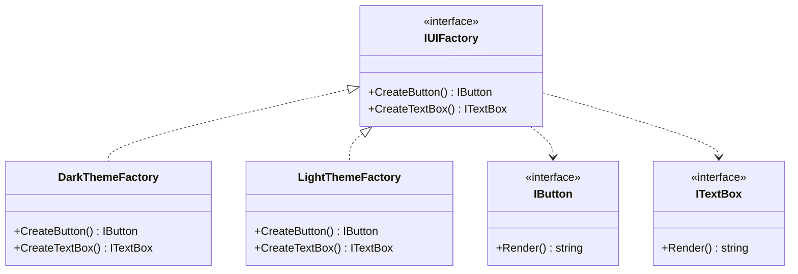

# Abstract Factory Pattern

## 1. Intent & Core Problem
The Abstract Factory pattern provides an interface for producing families of related objects (such as UI widgets, cross-platform notification components, or database drivers) without committing to concrete classes. It decouples client code from the specific types and configurations of the created products.

```
       [Client Code]
             │
             ▼
    ┌─────────────────┐
    │ IUIComponentKit │
    └────────┬────────┘
             │
     ┌───────┴───────┐
     ▼               ▼
┌──────────┐   ┌───────────┐
│ DarkKit  │   │ LightKit  │
└────┬─────┘   └─────┬─────┘
     │               │
     ▼               ▼
DarkButton &    LightButton &
DarkTextBox     LightTextBox
```

## 2. Mermaid Structural Collaboration


## 3. Applicability & Selection Rubric

### 3.1 Architectural Scope
- **Granularity**: 
- **Evolutionary Rule of Three**: Do not introduce an Abstract Factory for fewer than 3 product families or unless multi-variant runtime switching is strictly required.
- **Language-First Substitution**: When families are simple or compile-time static, prefer dependency injection registration modules or generic factories over full multi-interface factory hierarchies.

### 3.2 Decision Indicators
- [X] Green Flag 1: A system must be configured with one of multiple families of distinct, interdependent products (e.g. multi-theme UI, cross-platform OS controls).
- [X] Green Flag 2: Product family constraints must be strictly enforced so clients cannot accidentally mix-and-match incompatible components.
- [X] Green Flag 3: The creation and concrete types of product families must be completely decoupled from client subsystems.
- [!] Red Flag 1: Only a single family of products exists or will ever exist, making the abstraction ceremony redundant.
- [!] Red Flag 2: Products within the system do not share a common family lifecycle and are independently created across disparate modules.
- [!] Red Flag 3: New product kinds are frequently added, which forces changes across every existing factory interface and implementation.

### 3.3 Alternative Simplification
If only a single product family exists or instantiation logic is straightforward, use simple Factory Methods or register dependencies directly in your DI container.
## 4. Modern Idiomatic Implementations

### C# (.NET 10)
```csharp
namespace DesignPatterns.Creational.AbstractFactory;

public interface IButton
{
    string Render();
}

public interface ITextBox
{
    string Render();
}

public sealed record DarkButton : IButton
{
    public string Render() => "<button class='btn-dark'>Dark Button</button>";
}

public sealed record DarkTextBox : ITextBox
{
    public string Render() => "<input class='input-dark' placeholder='Dark Input' />";
}

public sealed record LightButton : IButton
{
    public string Render() => "<button class='btn-light'>Light Button</button>";
}

public sealed record LightTextBox : ITextBox
{
    public string Render() => "<input class='input-light' placeholder='Light Input' />";
}

public interface IThemeFactory
{
    IButton CreateButton();
    ITextBox CreateTextBox();
}

public sealed class DarkThemeFactory : IThemeFactory
{
    public IButton CreateButton() => new DarkButton();
    public ITextBox CreateTextBox() => new DarkTextBox();
}

public sealed class LightThemeFactory : IThemeFactory
{
    public IButton CreateButton() => new LightButton();
    public ITextBox CreateTextBox() => new LightTextBox();
}

public sealed class FormRenderer(IThemeFactory themeFactory)
{
    public string RenderForm()
    {
        var button = themeFactory.CreateButton();
        var textBox = themeFactory.CreateTextBox();
        return $"<form>{textBox.Render()}{button.Render()}</form>";
    }
}
```

### TypeScript (Angular Standalone & Signals)
```typescript
import { Component, InjectionToken, inject, signal } from '@angular/core';

export interface DialogActions {
  renderButton(): string;
  renderHeader(): string;
}

export class MaterialDialogKit implements DialogActions {
  renderButton(): string {
    return 'mat-raised-button primary';
  }
  renderHeader(): string {
    return 'mat-dialog-title material-typography';
  }
}

export class CupertinoDialogKit implements DialogActions {
  renderButton(): string {
    return 'ios-rounded-action-button';
  }
  renderHeader(): string {
    return 'ios-large-nav-header';
  }
}

export const DIALOG_KIT_FACTORY = new InjectionToken<DialogActions>('DIALOG_KIT_FACTORY', {
  providedIn: 'root',
  factory: () => new MaterialDialogKit(),
});

@Component({
  selector: 'app-dialog-container',
  standalone: true,
  template: `
    <div class="dialog-box">
      <h2 [class]="headerClass()">Header</h2>
      <button [class]="buttonClass()">Confirm</button>
    </div>
  `,
})
export class DialogContainerComponent {
  private readonly kit = inject(DIALOG_KIT_FACTORY);

  readonly headerClass = signal<string>(this.kit.renderHeader());
  readonly buttonClass = signal<string>(this.kit.renderButton());
}
```

### Python (3.12+ Modern Type System)
```python
from dataclasses import dataclass
from typing import Protocol

class Button(Protocol):
    def render(self) -> str: ...

class TextBox(Protocol):
    def render(self) -> str: ...

@dataclass(slots=True, frozen=True)
class DarkButton:
    def render(self) -> str:
        return "[Dark Button]"

@dataclass(slots=True, frozen=True)
class DarkTextBox:
    def render(self) -> str:
        return "[Dark Input Box]"

@dataclass(slots=True, frozen=True)
class LightButton:
    def render(self) -> str:
        return "[Light Button]"

@dataclass(slots=True, frozen=True)
class LightTextBox:
    def render(self) -> str:
        return "[Light Input Box]"

class GUIFactory(Protocol):
    def create_button(self) -> Button: ...
    def create_text_box(self) -> TextBox: ...

class DarkThemeFactory:
    def create_button(self) -> Button:
        return DarkButton()

    def create_text_box(self) -> TextBox:
        return DarkTextBox()

class LightThemeFactory:
    def create_button(self) -> Button:
        return LightButton()

    def create_text_box(self) -> TextBox:
        return LightTextBox()

class ApplicationView:
    def __init__(self, factory: GUIFactory) -> None:
        self._button = factory.create_button()
        self._text_box = factory.create_text_box()

    def draw(self) -> str:
        return f"{self._text_box.render()} | {self._button.render()}"
```

## 5. Consequences & Trade-offs
- **Pros**:
  - Isolates concrete classes from client callers.
  - Promotes consistency among products designed to operate in tandem.
  - Simplifies swapping product families at runtime or via dependency injection.
- **Cons**:
  - Adding new product variants requires modifying the abstract factory interface and every concrete factory implementation.

## 6. Security, Misuse & Anti-patterns
- **Dynamic Reflection Hazard**: Do NOT pass external user strings directly into dynamic type loaders (e.g. `Type.GetType(userInput)`) to resolve factory classes. Use closed dictionary mappings or enum discriminators.
- **State Leaks**: Factories should generally produce new instances or return immutable shared singletons. Avoid storing mutable ambient state inside the factory instance itself.

## 7. Related Patterns
- **Factory Method**: Abstract Factory is often implemented using a set of Factory Methods.
- **Singleton**: Concrete factory implementations are frequently registered as singletons in DI containers.
- **Prototype**: A factory can store a set of prototypes and clone them instead of instantiating fresh subclasses.
