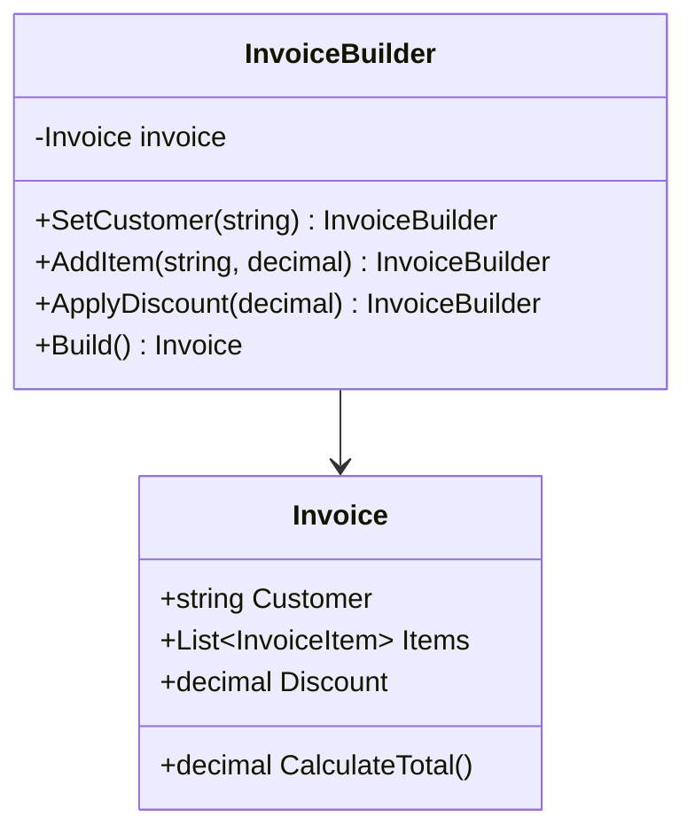

# Builder Pattern

## 1. Intent & Core Problem
The Builder pattern separates the construction steps of a complex object from its finalized representation. When creating objects requiring multiple parameters, nested configurations, or optional steps, telescoping constructors (`new Order(id, items, tax, discount, note, shipping, billing...)`) degrade readability and maintainability. Builder enables step-by-step construction and fluent method chaining.

```
[Client] ──> [Builder.SetHeader().SetBody().SetFooter()] ──> [Build()] ──> [Product Document]
```

## 2. Mermaid Structural Collaboration


## 3. Applicability & Selection Rubric

### 3.1 Architectural Scope
- **Granularity**: 
- **Evolutionary Rule of Three**: Avoid builders for objects with fewer than 4 optional configuration parameters or simple constructors.
- **Language-First Substitution**: In modern C#, Python, and TypeScript, prefer object initializers, named arguments, and records with default parameters over multi-class builders.

### 3.2 Decision Indicators
- [X] Green Flag 1: Construction involves 4+ optional parameters or complex multi-step assembly algorithms.
- [X] Green Flag 2: The target object must remain strictly immutable once constructed with all invariants verified.
- [X] Green Flag 3: Different representations or serialization structures of the same product must be constructed using a uniform process.
- [!] Red Flag 1: The object has only 2 or 3 constructor parameters, making builder classes unnecessary boilerplate.
- [!] Red Flag 2: Construction logic is trivial and does not involve multi-step validation or intermediate states.
- [!] Red Flag 3: The object is mutable and modified continuously throughout its lifecycle.

### 3.3 Alternative Simplification
Use primary constructors with default/optional arguments or fluent record with expressions instead of scaffolding dedicated Builder classes.
## 4. Modern Idiomatic Implementations

### C# (.NET 10)
```csharp
namespace DesignPatterns.Creational.Builder;

public sealed record InvoiceItem(string Description, decimal Price);

public sealed class Invoice
{
    public required string CustomerName { get; init; }
    public required IReadOnlyList<InvoiceItem> Items { get; init; }
    public decimal DiscountPercent { get; init; }

    public decimal TotalAmount
    {
        get
        {
            var raw = Items.Sum(i => i.Price);
            return raw - (raw * (DiscountPercent / 100m));
        }
    }
}

public sealed class InvoiceBuilder
{
    private string _customer = string.Empty;
    private readonly List<InvoiceItem> _items = [];
    private decimal _discount;

    public InvoiceBuilder ForCustomer(string customerName)
    {
        ArgumentException.ThrowIfNullOrWhiteSpace(customerName);
        _customer = customerName;
        return this;
    }

    public InvoiceBuilder AddItem(string description, decimal price)
    {
        ArgumentOutOfRangeException.ThrowIfNegativeOrZero(price);
        _items.Add(new InvoiceItem(description, price));
        return this;
    }

    public InvoiceBuilder WithDiscount(decimal percent)
    {
        if (percent is < 0 or > 100)
        {
            throw new ArgumentOutOfRangeException(nameof(percent), "Discount must be between 0 and 100.");
        }
        _discount = percent;
        return this;
    }

    public Invoice Build()
    {
        if (string.IsNullOrWhiteSpace(_customer))
        {
            throw new InvalidOperationException("Customer name is required before building invoice.");
        }
        if (_items.Count == 0)
        {
            throw new InvalidOperationException("Invoice must contain at least one item.");
        }

        return new Invoice
        {
            CustomerName = _customer,
            Items = _items.AsReadOnly(),
            DiscountPercent = _discount
        };
    }
}
```

### TypeScript (Angular Standalone & Signals)
```typescript
import { Component, computed, signal } from '@angular/core';

export interface ToastConfig {
  title: string;
  message: string;
  durationMs: number;
  theme: 'info' | 'success' | 'danger';
}

export class ToastBuilder {
  private title = '';
  private message = '';
  private durationMs = 3000;
  private theme: 'info' | 'success' | 'danger' = 'info';

  setTitle(title: string): this {
    this.title = title;
    return this;
  }

  setMessage(message: string): this {
    this.message = message;
    return this;
  }

  setDuration(ms: number): this {
    this.durationMs = ms;
    return this;
  }

  asSuccess(): this {
    this.theme = 'success';
    return this;
  }

  asDanger(): this {
    this.theme = 'danger';
    return this;
  }

  build(): ToastConfig {
    if (!this.title || !this.message) {
      throw new Error('Title and Message are mandatory for Toast notification.');
    }
    return {
      title: this.title,
      message: this.message,
      durationMs: this.durationMs,
      theme: this.theme,
    };
  }
}

@Component({
  selector: 'app-toast-demo',
  standalone: true,
  template: `
    <div class="toast-preview" [class]="activeToast().theme">
      <strong>{{ activeToast().title }}</strong>
      <p>{{ activeToast().message }}</p>
    </div>
  `,
})
export class ToastDemoComponent {
  readonly activeToast = signal<ToastConfig>(
    new ToastBuilder()
      .setTitle('System Notification')
      .setMessage('Operation completed successfully.')
      .asSuccess()
      .build()
  );
}
```

### Python (3.12+ Modern Type System)
```python
from dataclasses import dataclass, field

@dataclass(slots=True, frozen=True)
class QueryFilter:
    column: str
    operator: str
    value: str

@dataclass(slots=True, frozen=True)
class SqlQuery:
    table: str
    columns: list[str]
    filters: list[QueryFilter]
    limit: int | None

    def render(self) -> str:
        cols = ", ".join(self.columns) if self.columns else "*"
        query = f"SELECT {cols} FROM {self.table}"
        if self.filters:
            clauses = [f"{f.column} {f.operator} '{f.value}'" for f in self.filters]
            query += f" WHERE {' AND '.join(clauses)}"
        if self.limit is not None:
            query += f" LIMIT {self.limit}"
        return query

class QueryBuilder:
    def __init__(self, table: str) -> None:
        self._table = table
        self._columns: list[str] = []
        self._filters: list[QueryFilter] = []
        self._limit: int | None = None

    def select(self, *columns: str) -> "QueryBuilder":
        self._columns.extend(columns)
        return self

    def where(self, column: str, operator: str, value: str) -> "QueryBuilder":
        self._filters.append(QueryFilter(column=column, operator=operator, value=value))
        return self

    def limit(self, count: int) -> "QueryBuilder":
        if count <= 0:
            raise ValueError("Limit must be positive integer.")
        self._limit = count
        return self

    def build(self) -> SqlQuery:
        return SqlQuery(
            table=self._table,
            columns=list(self._columns),
            filters=list(self._filters),
            limit=self._limit,
        )
```

## 5. Consequences & Trade-offs
- **Pros**:
  - Provides fine-grained control over complex construction sequences.
  - Keeps constructed domain models immutable (`init`-only in C#, `readonly` in TS, `frozen=True` in Python).
  - Isolates construction validation logic in the builder `Build()` method.
- **Cons**:
  - Increases overall codebase size due to the creation of dedicated builder classes for products.

## 6. Security, Misuse & Anti-patterns
- **Partial State Exposure**: Never publish an incompletely initialized product before `Build()` has validated all invariant rules.
- **SQL Injection in Query Builders**: Parameterize and escape all values when building queries dynamically; never concatenate raw unvalidated strings into executable queries.

## 7. Related Patterns
- **Abstract Factory**: Often similar in intent, but Builder concentrates on constructing a single complex object step-by-step, whereas Abstract Factory concentrates on producing families of related products.
- **Composite**: Builders are often used to construct complex recursive Composite trees.
