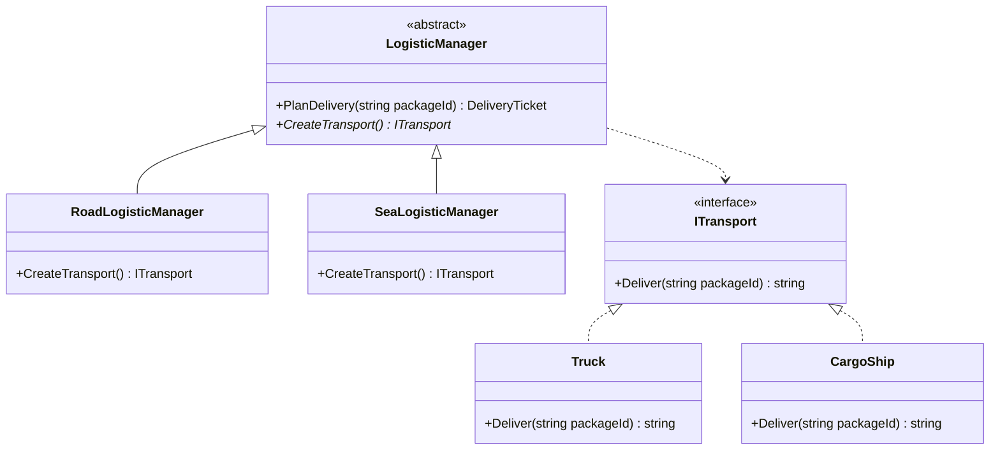

# Factory Method Pattern

## 1. Intent & Core Problem
The Factory Method pattern defines an interface or abstract method for creating an object, but allows subclasses or delegating factories to decide which concrete class to instantiate. It replaces direct constructor calls (`new ConcreteProduct()`) with polymorphic creation hooks, insulating client logic from product implementations.

```
[Application Creator] ──> [CreateTransport()] ──> [Returns ITransport]
          │
    ┌─────┴─────┐
    ▼           ▼
[TruckCreator] [ShipCreator]
    │           │
    ▼           ▼
 [Truck]     [Ship]
```

## 2. Mermaid Structural Collaboration


## 3. Applicability & Selection Rubric

### 3.1 Architectural Scope
- **Granularity**: 
- **Evolutionary Rule of Three**: Do not create factory methods for fewer than 3 concrete product variants unless dynamic type resolution is mandatory.
- **Language-First Substitution**: In modern C# and Python, prefer factory delegates (Func<T>) or match/case switch expressions over subclass hierarchies.

### 3.2 Decision Indicators
- [X] Green Flag 1: A creator class cannot anticipate the exact concrete class of objects it must instantiate at runtime.
- [X] Green Flag 2: Subclasses or factory delegates should specify the exact concrete product to instantiate.
- [X] Green Flag 3: Complex instantiation logic and dependency assembly needs to be encapsulated away from client code.
- [!] Red Flag 1: Only one concrete product variant exists with no projected domain variations.
- [!] Red Flag 2: Direct constructor instantiation does not compromise testability or loose coupling.
- [!] Red Flag 3: Subclassing creators purely to override instantiation creates an excessive parallel class hierarchy.

### 3.3 Alternative Simplification
Use direct constructor calls, static creation methods, or a simple factory lambda/delegate instead of an abstract creator hierarchy.
## 4. Modern Idiomatic Implementations

### C# (.NET 10)
```csharp
namespace DesignPatterns.Creational.FactoryMethod;

public sealed record DeliveryTicket(string PackageId, string TransportType, string TrackingCode);

public interface ITransport
{
    string TransportType { get; }
    DeliveryTicket Deliver(string packageId);
}

public sealed class Truck : ITransport
{
    public string TransportType => "Road";
    public DeliveryTicket Deliver(string packageId) =>
        new(packageId, TransportType, $"TRUCK-{Guid.NewGuid().ToString()[..8].ToUpperInvariant()}");
}

public sealed class CargoShip : ITransport
{
    public string TransportType => "Sea";
    public DeliveryTicket Deliver(string packageId) =>
        new(packageId, TransportType, $"SHIP-{Guid.NewGuid().ToString()[..8].ToUpperInvariant()}");
}

public abstract class Logistics
{
    public abstract ITransport CreateTransport();

    public DeliveryTicket PlanDelivery(string packageId)
    {
        ArgumentException.ThrowIfNullOrWhiteSpace(packageId);
        var transport = CreateTransport();
        return transport.Deliver(packageId);
    }
}

public sealed class RoadLogistics : Logistics
{
    public override ITransport CreateTransport() => new Truck();
}

public sealed class SeaLogistics : Logistics
{
    public override ITransport CreateTransport() => new CargoShip();
}
```

### TypeScript (Angular Standalone & Signals)
```typescript
import { Component, InjectionToken, inject, signal } from '@angular/core';

export interface ChartRenderer {
  render(data: number[]): string;
}

export class BarChartRenderer implements ChartRenderer {
  render(data: number[]): string {
    return `Rendering Bar Chart with ${data.length} columns`;
  }
}

export class LineChartRenderer implements ChartRenderer {
  render(data: number[]): string {
    return `Rendering Line Trend across ${data.length} datapoints`;
  }
}

export type ChartType = 'bar' | 'line';

export function createChartFactory(type: ChartType): ChartRenderer {
  switch (type) {
    case 'bar':
      return new BarChartRenderer();
    case 'line':
      return new LineChartRenderer();
    default: {
      const _exhaustive: never = type;
      throw new Error(`Unsupported chart type: ${_exhaustive}`);
    }
  }
}

@Component({
  selector: 'app-analytics-dashboard',
  standalone: true,
  template: `
    <div>
      <p>{{ output() }}</p>
      <button (click)="switchType('line')">Switch to Line</button>
    </div>
  `,
})
export class AnalyticsDashboardComponent {
  private readonly data = [10, 45, 80, 25, 90];
  readonly chartType = signal<ChartType>('bar');

  readonly output = signal<string>(
    createChartFactory(this.chartType()).render(this.data)
  );

  switchType(newType: ChartType): void {
    this.chartType.set(newType);
    this.output.set(createChartFactory(newType).render(this.data));
  }
}
```

### Python (3.12+ Modern Type System)
```python
from abc import ABC, abstractmethod
from dataclasses import dataclass
from typing import Literal

@dataclass(slots=True, frozen=True)
class NotificationPayload:
    recipient: str
    body: str

class MessageSender(ABC):
    @abstractmethod
    def send(self, payload: NotificationPayload) -> str: ...

class EmailSender(MessageSender):
    def send(self, payload: NotificationPayload) -> str:
        return f"Email dispatched to {payload.recipient}: {payload.body}"

class SmsSender(MessageSender):
    def send(self, payload: NotificationPayload) -> str:
        return f"SMS sent to {payload.recipient}: {payload.body}"

class NotificationService(ABC):
    @abstractmethod
    def create_sender(self) -> MessageSender: ...

    def notify(self, recipient: str, message: str) -> str:
        sender = self.create_sender()
        payload = NotificationPayload(recipient=recipient, body=message)
        return sender.send(payload)

class EmailNotificationService(NotificationService):
    def create_sender(self) -> MessageSender:
        return EmailSender()

class SmsNotificationService(NotificationService):
    def create_sender(self) -> MessageSender:
        return SmsSender()
```

## 5. Consequences & Trade-offs
- **Pros**:
  - Eliminates tight architectural coupling between creator and concrete products.
  - Follows Single Responsibility Principle (creation encapsulated in one place) and Open/Closed Principle (new products introduced without breaking existing code).
- **Cons**:
  - Can lead to class proliferation if subclasses are introduced merely to instantiate a single new product.

## 6. Security, Misuse & Anti-patterns
- **Dynamic Reflection Vulnerability**: Avoid instantiating classes dynamically using arbitrary untrusted strings (e.g., `Type.GetType(untrustedString)` in .NET or `importlib.import_module` in Python).
- Always use strongly-typed discriminators, enums, or sealed type unions.

## 7. Related Patterns
- **Abstract Factory**: Often built as a set of Factory Methods.
- **Template Method**: Factory Methods are frequently called inside template methods.
- **Prototype**: Does not require subclassing Creator, but requires an initialize operation on the product.
