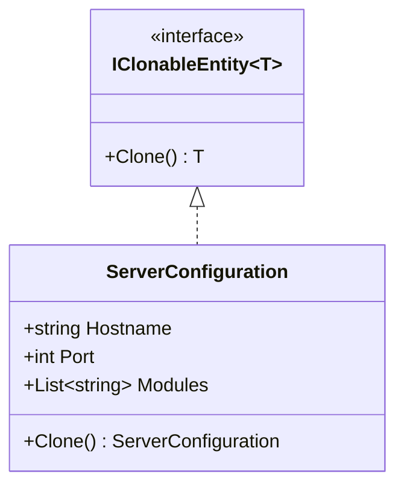

# Prototype Pattern

## 1. Intent & Core Problem
The Prototype pattern allows copying existing objects without making client code dependent on their concrete classes. It is particularly valuable when object creation is computationally expensive (e.g. database querying, complex parsing) or when configuring new instances involves duplicating a pre-configured template instance.

```
[Template Instance] ──> [.Clone()] ──> [Independent Deep/Shallow Copy]
```

## 2. Mermaid Structural Collaboration


## 3. Applicability & Selection Rubric

### 3.1 Architectural Scope
- **Granularity**: 
- **Evolutionary Rule of Three**: Do not implement prototype cloning unless object initialization is computationally expensive or instance state must be duplicated across 3+ variations.
- **Language-First Substitution**: In modern C# and Python, prefer shallow record duplication (record with syntax), dataclass copying, or serialization over custom clone trees.

### 3.2 Decision Indicators
- [X] Green Flag 1: Instantiation via constructor is computationally prohibitive, network-bound, or database-heavy.
- [X] Green Flag 2: Runtime variations of an object differ only slightly in internal state from a pre-configured template.
- [X] Green Flag 3: Dynamic class loading at runtime is avoided by cloning prototypical instances with preset configurations.
- [!] Red Flag 1: Objects contain complex circular references or file/socket handles where deep cloning causes leaks or corruption.
- [!] Red Flag 2: Object initialization is trivial and fast via normal constructors without hidden overhead.
- [!] Red Flag 3: The object graph is shallow and straightforwardly represented by immutable value objects.

### 3.3 Alternative Simplification
Use record copying (with expressions), copy constructors, or simple factory functions instead of deep prototype cloning.
## 4. Modern Idiomatic Implementations

### C# (.NET 10)
```csharp
namespace DesignPatterns.Creational.Prototype;

public sealed class DocumentSection(string title, string content)
{
    public string Title { get; set; } = title;
    public string Content { get; set; } = content;

    public DocumentSection Clone() => new(Title, Content);
}

public sealed class DocumentTemplate
{
    private const int MaxRecursionDepth = 32;

    public string Title { get; set; }
    public List<DocumentSection> Sections { get; set; }

    public DocumentTemplate(string title, IEnumerable<DocumentSection> sections)
    {
        Title = title;
        Sections = [.. sections];
    }

    public DocumentTemplate DeepClone()
    {
        var visited = new HashSet<object>(ReferenceEqualityComparer.Instance);
        return CloneInternal(visited, currentDepth: 0);
    }

    private DocumentTemplate CloneInternal(HashSet<object> visited, int currentDepth)
    {
        if (currentDepth > MaxRecursionDepth)
        {
            throw new InvalidOperationException("Recursion depth limit exceeded during deep copy.");
        }
        if (!visited.Add(this))
        {
            throw new InvalidOperationException("Cycle detected during object graph cloning.");
        }

        var clonedSections = Sections.Select(s => s.Clone()).ToList();
        return new DocumentTemplate($"{Title} (Copy)", clonedSections);
    }
}
```

### TypeScript (Angular Standalone & Signals)
```typescript
import { Component, signal } from '@angular/core';

export interface WidgetConfig {
  id: string;
  theme: string;
  dimensions: { width: number; height: number };
  tags: string[];
}

export function cloneWidgetConfig(source: WidgetConfig): WidgetConfig {
  // Cycle and structured cloning using native modern structuredClone
  const cloned = structuredClone(source);
  cloned.id = crypto.randomUUID();
  return cloned;
}

@Component({
  selector: 'app-dashboard-customizer',
  standalone: true,
  template: `
    <div>
      <p>Original: {{ defaultTemplate().id }} ({{ defaultTemplate().theme }})</p>
      <p>Cloned: {{ activeInstance().id }} ({{ activeInstance().theme }})</p>
      <button (click)="duplicate()">Duplicate Widget</button>
    </div>
  `,
})
export class DashboardCustomizerComponent {
  readonly defaultTemplate = signal<WidgetConfig>({
    id: 'tpl-default',
    theme: 'dark-neon',
    dimensions: { width: 300, height: 200 },
    tags: ['monitoring', 'metrics'],
  });

  readonly activeInstance = signal<WidgetConfig>(
    cloneWidgetConfig(this.defaultTemplate())
  );

  duplicate(): void {
    const next = cloneWidgetConfig(this.activeInstance());
    next.theme = 'custom-theme';
    this.activeInstance.set(next);
  }
}
```

### Python (3.12+ Modern Type System)
```python
import copy
from dataclasses import dataclass, field
from typing import Self

@dataclass(slots=True)
class PipelineStep:
    name: str
    command: str

@dataclass(slots=True)
class DataPipeline:
    pipeline_id: str
    steps: list[PipelineStep]
    metadata: dict[str, str] = field(default_factory=dict)

    def clone(self, new_id: str) -> Self:
        # copy.deepcopy handles identity maps and cycle detection internally via memo
        memo: dict[int, object] = {}
        cloned_steps = [copy.deepcopy(step, memo) for step in self.steps]
        cloned_metadata = copy.deepcopy(self.metadata, memo)
        return self.__class__(
            pipeline_id=new_id,
            steps=cloned_steps,
            metadata=cloned_metadata,
        )
```

## 5. Consequences & Trade-offs
- **Pros**:
  - Adds and removes products at runtime.
  - Specifies new objects by varying values or structure without class proliferation.
  - Reduces costly initialization overhead.
- **Cons**:
  - Cloning complex object graphs containing circular references, locks, or OS handles (sockets, file descriptors) is difficult and error-prone.

## 6. Security, Misuse & Anti-patterns
- **Circular Reference & Denial of Service (DoS)**: Naive recursive cloning without tracking visited object identities causes infinite recursion (`StackOverflowException`). Always track object identity and impose strict depth boundaries (max 32).
- **Prototype Pollution in JavaScript/TypeScript**: Avoid recursive object merging that assigns keys like `__proto__` or `constructor`. Prefer native `structuredClone()`.
- **Sensitive Field Leakage**: When cloning records containing credentials or auth tokens, ensure sensitive fields are scrubbed or re-authenticated.

## 7. Related Patterns
- **Abstract Factory**: Can store a set of prototypes to clone rather than instantiating products directly.
- **Composite & Decorator**: Structures that make heavy use of Composite and Decorator often benefit from Prototype cloning.
