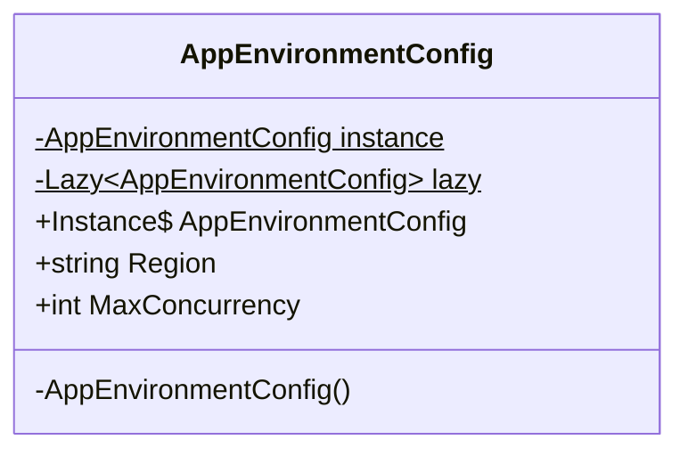

# Singleton Pattern

## 1. Intent & Core Problem
The Singleton pattern ensures that a class has only one single instance across the entire application lifecycle and provides a unified, thread-safe access point to it. It is commonly used for shared hardware drivers, thread pools, logging configurations, and central registries.

```
[Thread 1] ──┐
[Thread 2] ──┼──> [Thread-Safe Lazy Instance] ──> [Immutable Shared State]
[Thread 3] ──┘
```

## 2. Mermaid Structural Collaboration


## 3. Applicability & Selection Rubric

### 3.1 Architectural Scope
- **Granularity**: 
- **Evolutionary Rule of Three**: Never create a classic static singleton when a dependency injection container can manage a single instance lifetime.
- **Language-First Substitution**: Prefer registering instances as singletons in DI containers (services.AddSingleton<T>(), Angular providedIn: root) rather than writing manual private-constructor classes.

### 3.2 Decision Indicators
- [X] Green Flag 1: Exactly one physical hardware resource or centralized coordinator (e.g. thread pool, hardware sensor bus) must be controlled.
- [X] Green Flag 2: Strict access control and centralized coordination across multiple concurrent threads is required.
- [X] Green Flag 3: Instance creation must be thread-safe, lazy, and immutable after initialization.
- [!] Red Flag 1: Used as a disguised global variable containing mutable state that pollutes unit tests and concurrency.
- [!] Red Flag 2: Tightly couples callers to a concrete class, preventing substitution with mocks in unit tests.
- [!] Red Flag 3: Multi-tenant or partitioned architectures where different scopes require isolated configurations.

### 3.3 Alternative Simplification
Register the class with a singleton lifetime in a modern DI container or pass the dependency explicitly via primary constructors.
## 4. Modern Idiomatic Implementations

### C# (.NET 10)
```csharp
namespace DesignPatterns.Creational.Singleton;

public sealed class AppConfigManager
{
    private static readonly Lazy<AppConfigManager> _instance =
        new(() => new AppConfigManager(), LazyThreadSafetyMode.ExecutionAndPublication);

    public static AppConfigManager Instance => _instance.Value;

    public string EnvironmentName { get; }
    public int MaxParallelWorkers { get; }
    public DateTime InitializedAtUtc { get; }

    private AppConfigManager()
    {
        EnvironmentName = "Production";
        MaxParallelWorkers = 16;
        InitializedAtUtc = DateTime.UtcNow;
    }
}

// In modern ASP.NET Core (.NET 10), Singletons are idiomatic when managed via Dependency Injection:
// builder.Services.AddSingleton<IAppConfig, AppConfigManager>();
```

### TypeScript (Angular Standalone & Signals)
```typescript
import { Injectable, computed, signal } from '@angular/core';

export interface AppTelemetryState {
  sessionId: string;
  isOnline: boolean;
  eventCount: number;
}

@Injectable({
  providedIn: 'root', // Guaranteed single application-wide instance
})
export class AppTelemetryService {
  readonly #state = signal<AppTelemetryState>({
    sessionId: crypto.randomUUID(),
    isOnline: true,
    eventCount: 0,
  });

  // Expose state as read-only signal to prevent arbitrary external mutation
  readonly telemetry = this.#state.asReadonly();
  readonly isHealthy = computed(() => this.#state().isOnline && this.#state().eventCount < 10000);

  recordEvent(): void {
    this.#state.update((curr) => ({
      ...curr,
      eventCount: curr.eventCount + 1,
    }));
  }
}
```

### Python (3.12+ Modern Type System)
```python
import threading
from dataclasses import dataclass
from datetime import datetime, timezone

class TelemetryRegistry:
    _instance: "TelemetryRegistry | None" = None
    _lock = threading.Lock()

    def __new__(cls) -> "TelemetryRegistry":
        if cls._instance is None:
            with cls._lock:
                if cls._instance is None:
                    instance = super().__new__(cls)
                    instance._initialized_at = datetime.now(timezone.utc)
                    instance._active_metric_count = 0
                    cls._instance = instance
        return cls._instance

    @property
    def initialized_at(self) -> datetime:
        return self._initialized_at

    @property
    def active_metric_count(self) -> int:
        return self._active_metric_count

    def increment(self) -> None:
        with self._lock:
            self._active_metric_count += 1
```

## 5. Consequences & Trade-offs
- **Pros**:
  - Controlled access to sole instance.
  - Reduced namespace pollution compared to loose global variables.
  - Can be lazily initialized on first access.
- **Cons**:
  - Introduces tight global coupling.
  - High risk of test pollution: state retained across test runs causes order-dependent failures.
  - Violates the Single Responsibility Principle (controls both its business logic and its lifecycle).

## 6. Security, Misuse & Anti-patterns
- **Cross-Session / Multi-Tenant State Poisoning**: Never store mutable per-request user context (e.g. `CurrentUserId`, `AuthToken`) in a singleton. Tenant A can leak authorization context into Tenant B.
- **Thread Safety Invariants**: In multi-threaded environments, naive double-checked locking without volatile / memory barriers allows access to partially initialized objects. In .NET use `Lazy<T>(LazyThreadSafetyMode.ExecutionAndPublication)`. In Python, use `threading.Lock()`.
- **Prefer DI Container Scoping**: In modern frameworks, prefer registering classes as singletons inside the DI container (`builder.Services.AddSingleton<T>()`) rather than hand-rolling private static singletons.

## 7. Related Patterns
- **Abstract Factory, Builder, Prototype**: Can each be implemented as Singletons.
- **Facade**: Often implemented as a Singleton because only one Facade object is required.
