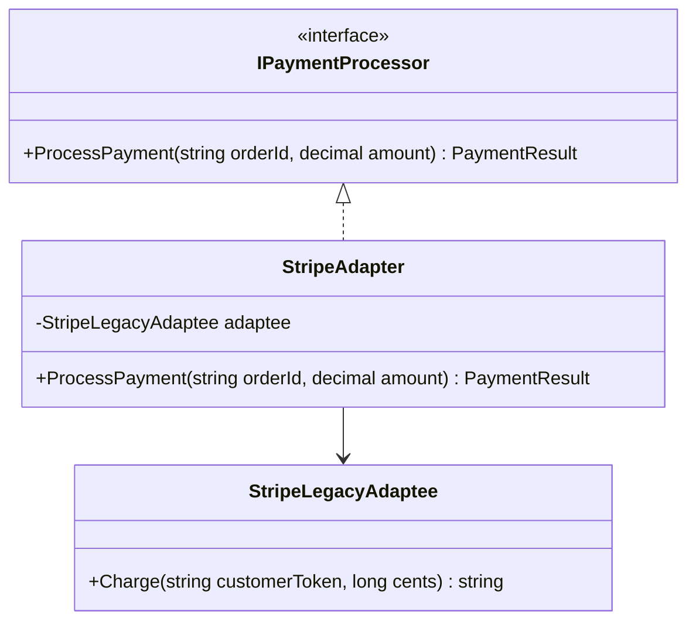

# Adapter Pattern

## 1. Intent & Core Problem
The Adapter pattern allows classes with incompatible interfaces to collaborate. It wraps an existing object (the *Adaptee*) in an object that implements the target interface required by the client, translating incoming calls, arguments, and return types seamlessly without modifying original source code.

```
[Client] ──> [ITargetPaymentGateway.Pay()] ──> [Adapter] ──> [LegacyVendorService.ChargeCard()]
```

## 2. Mermaid Structural Collaboration


## 3. Applicability & Selection Rubric

### 3.1 Architectural Scope
- **Granularity**: 
- **Evolutionary Rule of Three**: Do not introduce an adapter for a single one-off translation that can be handled with an inline conversion method.
- **Language-First Substitution**: Prefer mapping functions, extension methods, or structural subtyping (typing.Protocol) over adapter classes when contracts are simple.

### 3.2 Decision Indicators
- [X] Green Flag 1: Integrating a third-party library or legacy subsystem whose public interface contradicts your domain contract.
- [X] Green Flag 2: Multiple heterogeneous service providers must be consumed through a standardized internal interface.
- [X] Green Flag 3: Adapting legacy code without modifying its source or violating the Open/Closed Principle.
- [!] Red Flag 1: You have control over both interfaces and can refactor them directly into alignment.
- [!] Red Flag 2: Interface differences are merely naming discrepancies that can be resolved with a simple lambda or alias.
- [!] Red Flag 3: The adaptee requires extensive two-way synchronization or incompatible behavioral semantics.

### 3.3 Alternative Simplification
Use a simple mapping function, extension method, or inline transformation delegate instead of a formal Adapter class.
## 4. Modern Idiomatic Implementations

### C# (.NET 10)
```csharp
namespace DesignPatterns.Structural.Adapter;

public sealed record PaymentResult(string TransactionId, bool Succeeded, string Message);

public interface IPaymentGateway
{
    PaymentResult Pay(string orderId, decimal amountInDollars);
}

// Incompatible legacy service
public sealed class LegacyBankService
{
    public (int StatusCode, string Reference) ExecuteWireTransfer(string account, long amountInCents)
    {
        return (StatusCode: 200, Reference: $"WIRE-{Guid.NewGuid().ToString()[..6]}");
    }
}

// Modern adapter utilizing primary constructors
public sealed class LegacyBankAdapter(LegacyBankService legacyService, string targetAccount) : IPaymentGateway
{
    public PaymentResult Pay(string orderId, decimal amountInDollars)
    {
        ArgumentOutOfRangeException.ThrowIfNegativeOrZero(amountInDollars);
        long cents = (long)(amountInDollars * 100);

        var (statusCode, reference) = legacyService.ExecuteWireTransfer(targetAccount, cents);
        bool success = statusCode == 200;

        return new PaymentResult(reference, success, success ? "Payment succeeded via wire adapter." : "Payment failed.");
    }
}
```

### TypeScript (Angular Standalone & Signals)
```typescript
import { Component, Injectable, inject, signal } from '@angular/core';

export interface UserSummary {
  fullName: string;
  email: string;
}

// Third-party API response shape
export interface ThirdPartyUserPayload {
  first_name: string;
  last_name: string;
  contact: {
    electronic_mail: string;
  };
}

@Injectable({
  providedIn: 'root',
})
export class UserDataAdapterService {
  adapt(payload: ThirdPartyUserPayload): UserSummary {
    return {
      fullName: `${payload.first_name} ${payload.last_name}`.trim(),
      email: payload.contact.electronic_mail,
    };
  }
}

@Component({
  selector: 'app-user-profile-view',
  standalone: true,
  template: `
    <div>
      <h3>{{ user().fullName }}</h3>
      <p>Contact: {{ user().email }}</p>
    </div>
  `,
})
export class UserProfileViewComponent {
  private readonly adapter = inject(UserDataAdapterService);

  readonly user = signal<UserSummary>(
    this.adapter.adapt({
      first_name: 'Ada',
      last_name: 'Lovelace',
      contact: { electronic_mail: 'ada@computing.org' },
    })
  );
}
```

### Python (3.12+ Modern Type System)
```python
from dataclasses import dataclass
from typing import Protocol

@dataclass(slots=True, frozen=True)
class LogEvent:
    severity: str
    message: str

class ModernLogger(Protocol):
    def log(self, event: LogEvent) -> None: ...

# Incompatible legacy logging system
class LegacySyslogService:
    def write_syslog(self, priority: int, text: str) -> None:
        pass

class SyslogAdapter:
    _SEVERITY_MAP = {
        "DEBUG": 7,
        "INFO": 6,
        "WARNING": 4,
        "ERROR": 3,
        "CRITICAL": 2,
    }

    def __init__(self, syslog_service: LegacySyslogService) -> None:
        self._syslog = syslog_service

    def log(self, event: LogEvent) -> None:
        priority = self._SEVERITY_MAP.get(event.severity.upper(), 6)
        self._syslog.write_syslog(priority=priority, text=f"[SYSTEM] {event.message}")
```

## 5. Consequences & Trade-offs
- **Pros**:
  - Single Responsibility: Separates the data or interface conversion code from primary business logic.
  - Open/Closed Principle: Introduces new adapters without breaking existing client code.
- **Cons**:
  - Increases overall code complexity by introducing intermediate forwarding layers.

## 6. Security, Misuse & Anti-patterns
- **Data Truncation / Overflows**: When adapting numeric units (e.g. converting float dollars to integer cents), beware of floating-point inaccuracies or integer overflow vulnerabilities.
- **Leaky Exceptions**: Ensure exceptions thrown by the underlying Adaptee are caught and translated into domain-specific exceptions expected by the client interface.

## 7. Related Patterns
- **Bridge**: Has a similar structure but is designed upfront to separate an abstraction from its implementation; Adapter is retrofitted to make unrelated classes work together.
- **Decorator**: Enhances an object without changing its interface; Adapter changes the interface.
- **Proxy**: Provides the exact same interface; Adapter provides a different interface.
