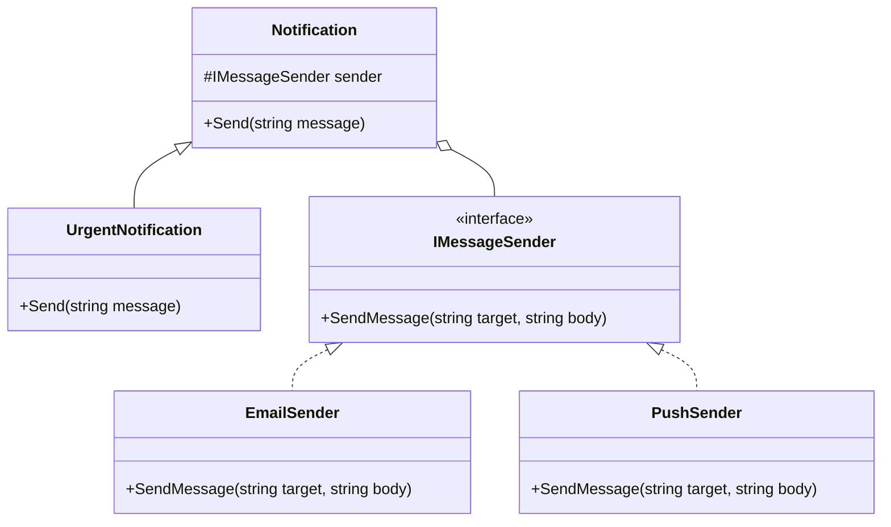

# Bridge Pattern

## 1. Intent & Core Problem
The Bridge pattern decouples an abstraction from its underlying implementation, allowing both class hierarchies to evolve and vary independently without resulting in an exponential Cartesian product of subclasses ($M \times N$ explosion). For example, rather than creating `WindowsVectorRenderer`, `WindowsRasterRenderer`, `LinuxVectorRenderer`, and `LinuxRasterRenderer`, Bridge separates `Shape` (abstraction) from `Renderer` (implementation).

```
   [Abstraction Hierarchy]            [Implementation Hierarchy]
           Shape                              IRenderer
          ┌──┴──┐                              ┌──┴──┐
       Circle  Square                     DirectX   Vulkan
          │       │                          ▲         ▲
          └───────┼──────────────────────────┴─────────┘
                  └─── Bridge has-a reference
```

## 2. Mermaid Structural Collaboration


## 3. Applicability & Selection Rubric

### 3.1 Architectural Scope
- **Granularity**: 
- **Evolutionary Rule of Three**: Do not introduce a Bridge unless both the abstraction and implementation hierarchies independently have 3+ concrete variants.
- **Language-First Substitution**: In modern OOP, prefer composition and dependency injection of service interfaces over formal multi-tier Bridge hierarchies.

### 3.2 Decision Indicators
- [X] Green Flag 1: You must avoid a permanent binding between an abstraction and its implementation (e.g. cross-platform renderers with multiple window managers).
- [X] Green Flag 2: Both abstractions and implementations should be extensible independently by subclassing without Cartesian product class explosion.
- [X] Green Flag 3: Changes in the implementation of an abstraction must have zero impact on client code.
- [!] Red Flag 1: There is only one implementation and no future requirement for alternative implementations.
- [!] Red Flag 2: The abstraction and implementation are tightly coupled by domain invariants that cannot be separated.
- [!] Red Flag 3: Introducing the bridge results in excessive indirection for a simple, single-platform component.

### 3.3 Alternative Simplification
Use standard interface-based dependency injection or compose concrete strategy components instead of a formal Bridge hierarchy.
## 4. Modern Idiomatic Implementations

### C# (.NET 10)
```csharp
namespace DesignPatterns.Structural.Bridge;

public interface IMessageChannel
{
    void Send(string recipient, string title, string payload);
}

public sealed class EmailChannel : IMessageChannel
{
    public void Send(string recipient, string title, string payload) =>
        Console.WriteLine($"[EMAIL to {recipient}] {title}: {payload}");
}

public sealed class SmsChannel : IMessageChannel
{
    public void Send(string recipient, string title, string payload) =>
        Console.WriteLine($"[SMS to {recipient}] {title}: {payload}");
}

// Abstraction
public abstract class Notification(IMessageChannel channel)
{
    protected readonly IMessageChannel Channel = channel;
    public abstract void Notify(string recipient, string message);
}

// Refined Abstractions
public sealed class StandardNotification(IMessageChannel channel) : Notification(channel)
{
    public override void Notify(string recipient, string message) =>
        Channel.Send(recipient, "Standard Notice", message);
}

public sealed class UrgentAlertNotification(IMessageChannel channel) : Notification(channel)
{
    public override void Notify(string recipient, string message) =>
        Channel.Send(recipient, "CRITICAL ALERT", $"!!! {message.ToUpperInvariant()} !!!");
}
```

### TypeScript (Angular Standalone & Signals)
```typescript
import { Component, Injectable, InjectionToken, inject, signal } from '@angular/core';

export interface StorageEngine {
  read(key: string): string | null;
  write(key: string, value: string): void;
}

export class LocalStorageEngine implements StorageEngine {
  read(key: string): string | null {
    return localStorage.getItem(key);
  }
  write(key: string, value: string): void {
    localStorage.setItem(key, value);
  }
}

export class MemoryStorageEngine implements StorageEngine {
  private readonly store = new Map<string, string>();
  read(key: string): string | null {
    return this.store.get(key) ?? null;
  }
  write(key: string, value: string): void {
    this.store.set(key, value);
  }
}

// Refined Abstraction
export class CacheRepository {
  constructor(private readonly engine: StorageEngine) {}

  getJSON<T>(key: string): T | null {
    const raw = this.engine.read(key);
    return raw ? (JSON.parse(raw) as T) : null;
  }

  setJSON<T>(key: string, data: T): void {
    this.engine.write(key, JSON.stringify(data));
  }
}

export const STORAGE_ENGINE_TOKEN = new InjectionToken<StorageEngine>('STORAGE_ENGINE', {
  providedIn: 'root',
  factory: () => new MemoryStorageEngine(),
});

@Component({
  selector: 'app-storage-bridge-demo',
  standalone: true,
  template: `<div>Storage engine active</div>`,
})
export class StorageBridgeDemoComponent {
  private readonly engine = inject(STORAGE_ENGINE_TOKEN);
  private readonly cache = new CacheRepository(this.engine);
}
```

### Python (3.12+ Modern Type System)
```python
from abc import ABC, abstractmethod
from typing import Protocol

class DatabaseDriver(Protocol):
    def execute_query(self, sql: str) -> list[dict[str, str]]: ...

class PostgresDriver:
    def execute_query(self, sql: str) -> list[dict[str, str]]:
        return [{"status": "ok", "engine": "PostgreSQL", "query": sql}]

class MongoDriver:
    def execute_query(self, sql: str) -> list[dict[str, str]]:
        return [{"status": "ok", "engine": "MongoDB", "query": sql}]

class Report(ABC):
    def __init__(self, driver: DatabaseDriver) -> None:
        self._driver = driver

    @abstractmethod
    def generate(self) -> str: ...

class FinancialReport(Report):
    def generate(self) -> str:
        results = self._driver.execute_query("SELECT sum(amount) FROM transactions")
        return f"Financial Report: {results}"

class AuditReport(Report):
    def generate(self) -> str:
        results = self._driver.execute_query("SELECT * FROM audit_logs ORDER BY timestamp")
        return f"Audit Report: {results}"
```

## 5. Consequences & Trade-offs
- **Pros**:
  - Decouples interface and implementation hierarchies.
  - Improves extensibility: both dimensions can be extended independently.
  - Shields clients from implementation changes.
- **Cons**:
  - Introduces initial architectural complexity; overkill if the implementation is unlikely to ever vary.

## 6. Security, Misuse & Anti-patterns
- **Unbounded Implementation Switching**: Switching implementations at runtime must verify that pending transactions or unsaved buffers in the prior implementation are securely flushed or aborted.

## 7. Related Patterns
- **Abstract Factory**: Can create and configure a particular Bridge setup.
- **Adapter**: Geared toward making unrelated classes work together after they were engineered; Bridge is designed upfront to let abstractions and implementations vary independently.
