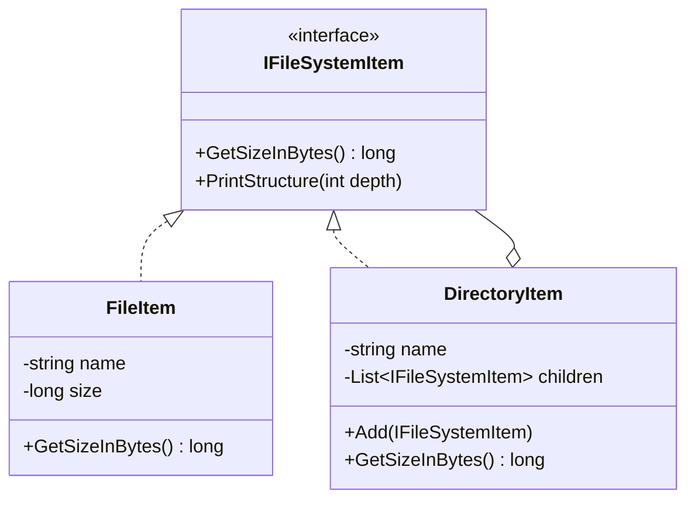

# Composite Pattern

## 1. Intent & Core Problem
The Composite pattern lets you compose objects into tree-like structures to represent part-whole hierarchies. Clients can interact with individual primitive items (leaves) and collections of items (composites) uniformly through a shared interface, eliminating branchy type checks (`if (isCollection) ... else ...`).

```
                [Root Box: Composite]
                ┌─────────┴─────────┐
         [Product A: Leaf]   [Sub-Box: Composite]
                             ┌───────┴───────┐
                      [Product B: Leaf] [Product C: Leaf]
```

## 2. Mermaid Structural Collaboration


## 3. Applicability & Selection Rubric

### 3.1 Architectural Scope
- **Granularity**: 
- **Evolutionary Rule of Three**: Do not use Composite unless the domain inherently represents a recursive tree structure with 3+ depth or node types.
- **Language-First Substitution**: Prefer modern recursive functional traversals or algebraic data types over rigid class hierarchies where supported.

### 3.2 Decision Indicators
- [X] Green Flag 1: The domain model represents a part-whole hierarchy of objects (e.g. UI widgets, file system directories, organizational charts).
- [X] Green Flag 2: Clients must treat individual objects and compositions of objects uniformly through a common interface.
- [X] Green Flag 3: Complex nested tree structures require recursive evaluation (calculating total price, rendering layout).
- [!] Red Flag 1: The structure is a flat list rather than a true hierarchy, making composite nodes an overcomplication.
- [!] Red Flag 2: Leaf nodes and composite nodes have vastly different capabilities that cannot be expressed cleanly in a common interface.
- [!] Red Flag 3: The tree contains circular links that would cause infinite loops without cycle detection guards.

### 3.3 Alternative Simplification
Use a flat list with parent-child references or modern recursive functions over algebraic data structures.
## 4. Modern Idiomatic Implementations

### C# (.NET 10)
```csharp
namespace DesignPatterns.Structural.Composite;

public interface IFileSystemItem
{
    string Name { get; }
    long GetSizeInBytes();
}

public sealed record FileItem(string Name, long Size) : IFileSystemItem
{
    public long GetSizeInBytes() => Size;
}

public sealed class DirectoryItem(string name) : IFileSystemItem
{
    private readonly List<IFileSystemItem> _children = [];

    public string Name { get; } = name;

    public void Add(IFileSystemItem item)
    {
        ArgumentNullException.ThrowIfNull(item);
        _children.Add(item);
    }

    public long GetSizeInBytes()
    {
        return _children.Sum(item => item.GetSizeInBytes());
    }
}
```

### TypeScript (Angular Standalone & Signals)
```typescript
import { Component, computed, signal } from '@angular/core';

export interface MenuEntry {
  title: string;
  countBadges(): number;
}

export class LeafMenuItem implements MenuEntry {
  constructor(public readonly title: string, public readonly badgeCount: number = 0) {}

  countBadges(): number {
    return this.badgeCount;
  }
}

export class GroupMenuItem implements MenuEntry {
  private readonly children: MenuEntry[] = [];

  constructor(public readonly title: string) {}

  add(entry: MenuEntry): this {
    this.children.push(entry);
    return this;
  }

  countBadges(): number {
    return this.children.reduce((acc, curr) => acc + curr.countBadges(), 0);
  }
}

@Component({
  selector: 'app-menu-tree',
  standalone: true,
  template: `
    <div>
      <h4>Menu Notifications</h4>
      <p>Total Unread Items: {{ totalUnread() }}</p>
    </div>
  `,
})
export class MenuTreeComponent {
  readonly rootMenu = signal<GroupMenuItem>(
    new GroupMenuItem('Navigation')
      .add(new LeafMenuItem('Dashboard', 0))
      .add(
        new GroupMenuItem('Messages')
          .add(new LeafMenuItem('Inbox', 5))
          .add(new LeafMenuItem('Archived', 2))
      )
  );

  readonly totalUnread = computed(() => this.rootMenu().countBadges());
}
```

### Python (3.12+ Modern Type System)
```python
from typing import Protocol

class OrganizationUnit(Protocol):
    @property
    def name(self) -> str: ...
    def get_monthly_budget(self) -> float: ...

class Employee:
    def __init__(self, name: str, salary: float) -> None:
        self._name = name
        self._salary = salary

    @property
    def name(self) -> str:
        return self._name

    def get_monthly_budget(self) -> float:
        return self._salary

class Department:
    def __init__(self, name: str) -> None:
        self._name = name
        self._members: list[OrganizationUnit] = []

    @property
    def name(self) -> str:
        return self._name

    def add(self, unit: OrganizationUnit) -> None:
        self._members.append(unit)

    def get_monthly_budget(self) -> float:
        return sum(member.get_monthly_budget() for member in self._members)
```

## 5. Consequences & Trade-offs
- **Pros**:
  - Defines class hierarchies consisting of primitive objects and composite objects.
  - Simplifies the client: clients treat composite structures and individual objects identically.
  - Makes it easy to add new kinds of components without modifying client code.
- **Cons**:
  - Can make the design overly general: hard to restrict what kind of components can be added as children to a composite at compile time.

## 6. Security, Misuse & Anti-patterns
- **Cyclic Graphs and Stack Overflow**: If a composite node is inadvertently added as a child of one of its own descendants, any recursive operation (e.g. `GetSizeInBytes()`) results in infinite recursion and fatal stack overflow. Always validate that a node is not an ancestor before adding it to a composite.

## 7. Related Patterns
- **Chain of Responsibility**: Often combined with Composite; a component can pass requests up to its parent chain.
- **Decorator**: Frequently used in conjunction with Composite. When decorators and composites are used together, they usually have a common parent class.
- **Visitor**: Used to apply operations over composite trees without modifying the classes.
