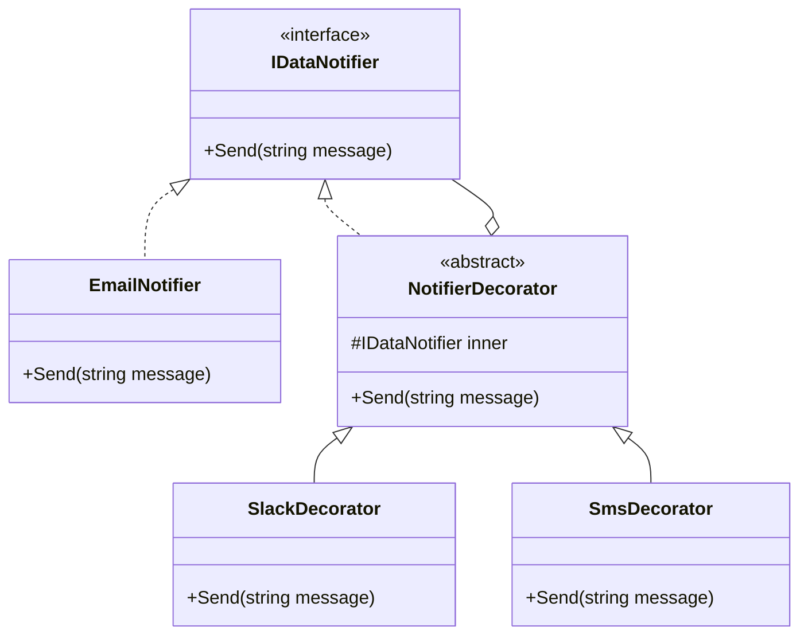

# Decorator Pattern

## 1. Intent & Core Problem
The Decorator pattern allows adding new behavior or responsibilities to individual objects dynamically without altering the underlying class or subclassing it. In complex systems, subclassing leads to a combinatorial explosion of static classes (e.g. `EncryptedCompressedLoggedStream`, `CompressedStream`, `LoggedStream`). Decorator wraps objects in layers of decorators that implement the same target interface.

```
[Client] ──> [LoggingDecorator] ──> [EncryptionDecorator] ──> [CoreFileStream]
```

## 2. Mermaid Structural Collaboration


## 3. Applicability & Selection Rubric

### 3.1 Architectural Scope
- **Granularity**: 
- **Evolutionary Rule of Three**: Do not introduce decorators for fewer than 3 orthogonal cross-cutting behaviors or unless runtime combinatorics are required.
- **Language-First Substitution**: Prefer middleware pipelines, method interceptors, or higher-order functions over deeply nested decorator wrapper objects.

### 3.2 Decision Indicators
- [X] Green Flag 1: Adding responsibilities to individual objects dynamically and transparently without affecting other instances.
- [X] Green Flag 2: Extending functionality through subclassing is impractical due to combinatoric explosion of subclasses.
- [X] Green Flag 3: Cross-cutting concerns (caching, logging, telemetry, retry policies) must be composable in arbitrary orders.
- [!] Red Flag 1: Only a single static extension is needed, which is simpler to implement directly or via inheritance.
- [!] Red Flag 2: The component interface is wide with dozens of methods, forcing the decorator to write tedious pass-through boilerplate.
- [!] Red Flag 3: Client code relies on the concrete identity or internal state of the wrapped component.

### 3.3 Alternative Simplification
Use pipeline middleware, extension methods, or wrap functionality in a simple higher-order function.
## 4. Modern Idiomatic Implementations

### C# (.NET 10)
```csharp
namespace DesignPatterns.Structural.Decorator;

public interface IDataStream
{
    string Read();
    void Write(string data);
}

public sealed class MemoryDataStream : IDataStream
{
    private string _buffer = string.Empty;

    public string Read() => _buffer;
    public void Write(string data) => _buffer = data;
}

// Transparent base decorator
public abstract class DataStreamDecorator(IDataStream innerStream) : IDataStream
{
    protected readonly IDataStream Inner = innerStream;

    public virtual string Read() => Inner.Read();
    public virtual void Write(string data) => Inner.Write(data);
}

public sealed class EncryptionDecorator(IDataStream innerStream) : DataStreamDecorator(innerStream)
{
    public override void Write(string data)
    {
        var encoded = Convert.ToBase64String(System.Text.Encoding.UTF8.GetBytes(data));
        Inner.Write($"[ENC]{encoded}");
    }

    public override string Read()
    {
        var raw = Inner.Read();
        if (raw.StartsWith("[ENC]", StringComparison.Ordinal))
        {
            var bytes = Convert.FromBase64String(raw[5..]);
            return System.Text.Encoding.UTF8.GetString(bytes);
        }
        return raw;
    }
}
```

### TypeScript (Angular Standalone & Signals)
```typescript
import { Component, Injectable, inject, signal } from '@angular/core';

export interface DataFetchService {
  fetch(endpoint: string): string;
}

@Injectable({
  providedIn: 'root',
})
export class BaseHttpFetchService implements DataFetchService {
  fetch(endpoint: string): string {
    return `Payload from ${endpoint}`;
  }
}

// Functional / wrapper decorator for caching
export class CachedFetchDecorator implements DataFetchService {
  private readonly cache = new Map<string, string>();

  constructor(private readonly inner: DataFetchService) {}

  fetch(endpoint: string): string {
    const cached = this.cache.get(endpoint);
    if (cached) {
      return `[CACHED] ${cached}`;
    }
    const fresh = this.inner.fetch(endpoint);
    this.cache.set(endpoint, fresh);
    return fresh;
  }
}

@Component({
  selector: 'app-decorator-demo',
  standalone: true,
  template: `<p>{{ display() }}</p>`,
})
export class DecoratorDemoComponent {
  private readonly baseService = inject(BaseHttpFetchService);
  private readonly decorated = new CachedFetchDecorator(this.baseService);

  readonly display = signal<string>(this.decorated.fetch('/api/profile'));
}
```

### Python (3.12+ Modern Type System)
```python
from typing import Protocol

class TextRenderer(Protocol):
    def render(self) -> str: ...

class PlainText:
    def __init__(self, content: str) -> None:
        self._content = content

    def render(self) -> str:
        return self._content

class BoldDecorator:
    def __init__(self, inner: TextRenderer) -> None:
        self._inner = inner

    def render(self) -> str:
        return f"<b>{self._inner.render()}</b>"

class ItalicDecorator:
    def __init__(self, inner: TextRenderer) -> None:
        self._inner = inner

    def render(self) -> str:
        return f"<i>{self._inner.render()}</i>"
```

## 5. Consequences & Trade-offs
- **Pros**:
  - More flexibility than static inheritance.
  - Avoids feature-laden classes high up in the hierarchy.
  - Supports open-ended combinations of independent concerns (caching, logging, encryption, metrics).
- **Cons**:
  - A decorator and its wrapped component are not identical (breaks reference equality checks `==`).
  - Lots of small objects that all look alike make debugging through nested wrappers challenging.

## 6. Security, Misuse & Anti-patterns
- **Sensitive Data Logging**: Logging decorators must sanitize or redact sensitive data (passwords, tokens, PII) before writing to audit logs.
- **Ordering Hazards**: The order in which decorators are chained is significant (e.g. encrypting before compressing degrades compression ratios; compressing before encrypting is optimal).

## 7. Related Patterns
- **Adapter**: Changes the interface of its subject; Decorator changes its responsibilities without altering interface.
- **Composite**: A decorator can be viewed as a composite with only one component; however, a decorator adds responsibilities, whereas a composite aggregates.
- **Strategy**: Decorator changes an object's skin; Strategy changes its guts.
