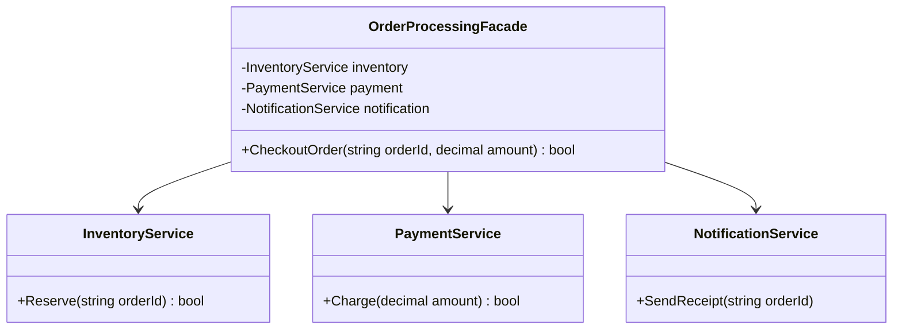

# Facade Pattern

## 1. Intent & Core Problem
The Facade pattern provides a simplified, unified interface to a complex system of classes, libraries, or frameworks. Subsystems typically contain dozens of interdependent classes (e.g. video encoders, audio mixers, file writers, codec decoders). The Facade shields the client from the intricate interactions and wiring of these components by offering a clean, high-level API.

```
                  ┌──────────────────────┐
                  │ OrderCheckoutFacade  │
                  └──────────┬───────────┘
                             │ Coordinates
        ┌────────────────────┼────────────────────┐
        ▼                    ▼                    ▼
[InventorySystem]    [PaymentProcessor]   [ShippingDispatcher]
```

## 2. Mermaid Structural Collaboration


## 3. Applicability & Selection Rubric

### 3.1 Architectural Scope
- **Granularity**: 
- **Evolutionary Rule of Three**: Do not introduce a Facade for subsystems with fewer than 3 cooperating classes or trivial interactions.
- **Language-First Substitution**: In modern modular architectures, prefer dedicated API services or coordinator classes injected via DI.

### 3.2 Decision Indicators
- [X] Green Flag 1: A complex subsystem with numerous interdependent classes needs a simple, unified entry point for clients.
- [X] Green Flag 2: Decoupling client code from subsystem implementation details to allow internal refactoring without breaking callers.
- [X] Green Flag 3: Layering an architecture into distinct tiers, using facades as the communication contract between layers.
- [!] Red Flag 1: The subsystem has only 1 or 2 straightforward classes that clients can easily consume directly.
- [!] Red Flag 2: The facade becomes a God Class that attempts to expose every granular feature of the underlying subsystem.
- [!] Red Flag 3: Clients require fine-grained low-level customization that the facade actively obstructs.

### 3.3 Alternative Simplification
Let clients interact directly with the 1 or 2 relevant subsystem classes or inject a targeted helper service.
## 4. Modern Idiomatic Implementations

### C# (.NET 10)
```csharp
namespace DesignPatterns.Structural.Facade;

public sealed record OrderSummary(string OrderId, bool Success, string StatusMessage);

public sealed class InventoryService
{
    public bool CheckAndLockStock(string itemId, int quantity) => true;
}

public sealed class BillingService
{
    public bool ChargeCard(string customerId, decimal amount) => true;
}

public sealed class ShippingService
{
    public string SchedulePickup(string itemId, int quantity) => $"TRACK-{Guid.NewGuid().ToString()[..8]}";
}

// High-level Facade
public sealed class OrderFulfillmentFacade(
    InventoryService inventory,
    BillingService billing,
    ShippingService shipping)
{
    public OrderSummary ProcessOrder(string orderId, string customerId, string itemId, int quantity, decimal amount)
    {
        ArgumentException.ThrowIfNullOrWhiteSpace(orderId);

        if (!inventory.CheckAndLockStock(itemId, quantity))
        {
            return new OrderSummary(orderId, false, "Stock insufficient.");
        }

        if (!billing.ChargeCard(customerId, amount))
        {
            return new OrderSummary(orderId, false, "Payment declined.");
        }

        var trackingNumber = shipping.SchedulePickup(itemId, quantity);
        return new OrderSummary(orderId, true, $"Order fulfilled. Tracking: {trackingNumber}");
    }
}
```

### TypeScript (Angular Standalone & Signals)
```typescript
import { Component, Injectable, inject, signal } from '@angular/core';

@Injectable({ providedIn: 'root' })
export class AudioDecoder {
  decode(stream: string): string {
    return `Decoded(${stream})`;
  }
}

@Injectable({ providedIn: 'root' })
export class VideoFilter {
  applyFilters(raw: string): string {
    return `Filtered(${raw})`;
  }
}

@Injectable({ providedIn: 'root' })
export class MediaStreamFacade {
  private readonly decoder = inject(AudioDecoder);
  private readonly filter = inject(VideoFilter);

  prepareMediaPlayback(sourceUrl: string): string {
    const audio = this.decoder.decode(sourceUrl);
    const video = this.filter.applyFilters(sourceUrl);
    return `StreamReady: ${audio} + ${video}`;
  }
}

@Component({
  selector: 'app-media-player',
  standalone: true,
  template: `<p>Status: {{ status() }}</p>`,
})
export class MediaPlayerComponent {
  private readonly mediaFacade = inject(MediaStreamFacade);
  readonly status = signal<string>(this.mediaFacade.prepareMediaPlayback('stream://video.mp4'));
}
```

### Python (3.12+ Modern Type System)
```python
from dataclasses import dataclass

@dataclass(slots=True, frozen=True)
class ConversionResult:
    filename: str
    format: str
    status: str

class VideoCodecParser:
    def parse_header(self, filename: str) -> str:
        return "mp4_h264"

class AudioTranscoder:
    def transcode_audio(self, bitrate_kbps: int) -> bool:
        return True

class VideoCompressor:
    def compress(self, level: int) -> bool:
        return True

class VideoConverterFacade:
    def __init__(self) -> None:
        self._parser = VideoCodecParser()
        self._transcoder = AudioTranscoder()
        self._compressor = VideoCompressor()

    def convert_video(self, source_path: str, target_format: str) -> ConversionResult:
        _ = self._parser.parse_header(source_path)
        self._transcoder.transcode_audio(bitrate_kbps=192)
        self._compressor.compress(level=5)
        return ConversionResult(
            filename=source_path,
            format=target_format,
            status="SUCCESS",
        )
```

## 5. Consequences & Trade-offs
- **Pros**:
  - Shields clients from complex subsystem components, reducing the number of objects clients must know about.
  - Promotes weak coupling between the subsystem and its clients.
  - Does not prevent applications from using subsystem classes directly if they need advanced flexibility.
- **Cons**:
  - A facade can easily become a "God Object" coupled to all classes of an application if not kept bounded.

## 6. Security, Misuse & Anti-patterns
- **God Object Anti-pattern**: Avoid bundling unrelated domain operations into a single massive facade. Partition facades by cohesive feature areas (e.g. `PaymentFacade`, `MediaStreamFacade`).
- **Authorization Gaps**: Ensure security and authorization checks are enforced within the subsystem or consistently at the facade entry point before dispatching to underlying services.

## 7. Related Patterns
- **Abstract Factory**: Can be used with Facade to provide an interface for creating subsystem objects in a subsystem-independent way.
- **Mediator**: Similar to Facade in that it abstracts the interaction of existing classes; however, Mediator's purpose is to coordinate communication between colleagues (bidirectional), while Facade abstracts a subsystem from external clients (unidirectional).
- **Singleton**: Typically only one Facade object is required, so facades are often singletons.
