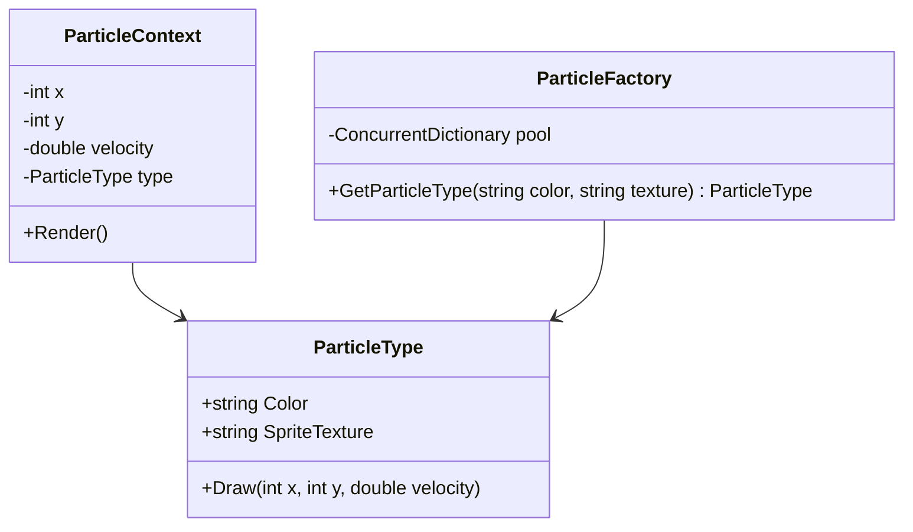

# Flyweight Pattern

## 1. Intent & Core Problem
The Flyweight pattern minimizes memory usage and object allocation overhead by sharing common, immutable state (*intrinsic state*) across thousands or millions of fine-grained objects, while storing or passing context-dependent, unique data (*extrinsic state*) from the outside during method calls.

```
[Extrinsic State: Coordinates (X, Y), Scale]
                      │
                      ▼ Passed at runtime
              [Flyweight Object]
     (Contains Intrinsic Immutable State: Mesh, Texture)
```

## 2. Mermaid Structural Collaboration


## 3. Applicability & Selection Rubric

### 3.1 Architectural Scope
- **Granularity**: 
- **Evolutionary Rule of Three**: Do not introduce Flyweight unless profiling proves memory exhaustion from 1,000+ duplicate instances.
- **Language-First Substitution**: Prefer intern pools, readonly struct / value types, or enum lookup tables over complex Flyweight factories.

### 3.2 Decision Indicators
- [X] Green Flag 1: The application uses a massive number of objects (e.g. 10,000+ glyphs, particles, map tiles) causing measurable RAM pressure.
- [X] Green Flag 2: Object state can be clearly separated into immutable intrinsic state and context-dependent extrinsic state.
- [X] Green Flag 3: Many groups of objects can be replaced by relatively few shared instances once extrinsic state is extracted.
- [!] Red Flag 1: The application creates only dozens or hundreds of objects where memory savings are negligible.
- [!] Red Flag 2: Intrinsic state is mutable, creating catastrophic shared-state race conditions and bugs.
- [!] Red Flag 3: The CPU overhead of managing extrinsic state and lookups exceeds the benefit of memory conservation.

### 3.3 Alternative Simplification
Use value types / records, shared static dictionaries, or cache references in a simple lookup map.
## 4. Modern Idiomatic Implementations

### C# (.NET 10)
```csharp
namespace DesignPatterns.Structural.Flyweight;

using System.Collections.Concurrent;

// Intrinsic state: strictly immutable record
public sealed record TreeType(string Name, string Color, string Texture)
{
    public void Display(int x, int y, double height)
    {
        Console.WriteLine($"[Tree '{Name}' Color={Color}] at ({x},{y}) Height={height}m");
    }
}

// Thread-safe Flyweight Factory
public sealed class TreeFactory
{
    private static readonly ConcurrentDictionary<string, TreeType> _types = new();

    public static TreeType GetTreeType(string name, string color, string texture)
    {
        var key = $"{name}_{color}_{texture}";
        return _types.GetOrAdd(key, _ => new TreeType(name, color, texture));
    }

    public static int TotalSharedTypesCount => _types.Count;
}

// Extrinsic state context
public sealed record PlantedTree(int X, int Y, double Height, TreeType Type)
{
    public void Render() => Type.Display(X, Y, Height);
}
```

### TypeScript (Angular Standalone & Signals)
```typescript
import { Component, Injectable, signal } from '@angular/core';

// Intrinsic immutable state
export interface CharacterFormatFlyweight {
  fontFamily: string;
  fontSize: number;
  isBold: boolean;
}

@Injectable({ providedIn: 'root' })
export class CharacterFormatFactory {
  private readonly pool = new Map<string, CharacterFormatFlyweight>();

  getFormat(fontFamily: string, fontSize: number, isBold: boolean): CharacterFormatFlyweight {
    const key = `${fontFamily}_${fontSize}_${isBold}`;
    let format = this.pool.get(key);
    if (!format) {
      format = Object.freeze({ fontFamily, fontSize, isBold });
      this.pool.set(key, format);
    }
    return format;
  }

  get poolSize(): number {
    return this.pool.size;
  }
}

// Extrinsic context: actual character and position
export interface FormattedCharacter {
  char: string;
  positionIndex: number;
  format: CharacterFormatFlyweight;
}

@Component({
  selector: 'app-text-editor-preview',
  standalone: true,
  template: `<div>Active Shared Formats: {{ poolCount() }}</div>`,
})
export class TextEditorPreviewComponent {
  constructor(private readonly factory: CharacterFormatFactory) {}

  readonly poolCount = signal<number>(this.factory.poolSize);
}
```

### Python (3.12+ Modern Type System)
```python
from dataclasses import dataclass
from typing import ClassVar

# Intrinsic state: strictly frozen dataclass
@dataclass(slots=True, frozen=True)
class TerrainType:
    name: str
    texture: str
    movement_cost: int

    def render(self, x: int, y: int) -> str:
        return f"{self.name} Tile at ({x}, {y}) [Cost: {self.movement_cost}]"

class TerrainFactory:
    _pool: ClassVar[dict[str, TerrainType]] = {}

    @classmethod
    def get_terrain(cls, name: str, texture: str, movement_cost: int) -> TerrainType:
        key = f"{name}_{texture}_{movement_cost}"
        if key not in cls._pool:
            cls._pool[key] = TerrainType(
                name=name,
                texture=texture,
                movement_cost=movement_cost,
            )
        return cls._pool[key]
```

## 5. Consequences & Trade-offs
- **Pros**:
  - Dramatic reduction in RAM and heap allocations when managing millions of similar entities.
- **Cons**:
  - Introduces run-time costs associated with transferring, finding, and computing extrinsic state.
  - Complicates code structure by forcing a strict division between intrinsic and extrinsic data.

## 6. Security, Misuse & Anti-patterns
- **Extrinsic State Mutation Hazards**: Intrinsic state stored on a flyweight MUST be strictly immutable (`readonly record`, `Object.freeze`, `frozen=True`). If a caller modifies an intrinsic field, it mutates the state for every other entity referencing that flyweight across the entire application.
- **Unbounded Memory Pools**: If flyweight keys are generated dynamically from arbitrary user input without limits, the factory dictionary can grow indefinitely (unbounded cache DoS). Use LRU eviction or closed domain keys.

## 7. Related Patterns
- **Composite**: Flyweight is often combined with Composite to implement a directed acyclic graph with shared leaf nodes.
- **State & Strategy**: Flyweight explains how and when State and Strategy objects can be shared among multiple contexts.
