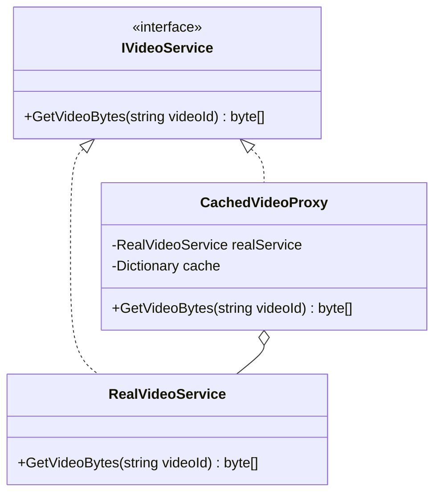

# Proxy Pattern

## 1. Intent & Core Problem
The Proxy pattern provides a surrogate, placeholder, or wrapper object that controls access to an underlying real subject. Proxies can perform lazy loading (Virtual Proxy), manage access control and authorization (Protection Proxy), cache expensive results (Caching Proxy), or handle remote network communication (Remote Proxy) while exposing the identical target interface.

```
[Client] ──> [ProtectionProxy.FetchDocument()]
                     │
         [Authorized?] ──Yes──> [RealDocumentServer.FetchDocument()]
                     │
                    No ──> [Throws UnauthorizedAccessException]
```

## 2. Mermaid Structural Collaboration


## 3. Applicability & Selection Rubric

### 3.1 Architectural Scope
- **Granularity**: 
- **Evolutionary Rule of Three**: Do not introduce a Proxy for trivial operations that can be handled by inline checks or standard DI decorators.
- **Language-First Substitution**: In modern C# and Python, prefer Lazy<T>, properties, or HTTP client interceptors over manual proxy classes.

### 3.2 Decision Indicators
- [X] Green Flag 1: Lazy initialization (virtual proxy) is needed for heavy, memory-intensive objects created only on-demand.
- [X] Green Flag 2: Access control and authorization checks (protection proxy) must intercept calls before touching the real subject.
- [X] Green Flag 3: Remote service invocation (remote proxy) or response caching (caching proxy) must remain transparent to the client.
- [!] Red Flag 1: The subject object is lightweight and fast to instantiate, rendering lazy loading useless.
- [!] Red Flag 2: Interception concerns are better handled by infrastructure-level middleware or AOP frameworks.
- [!] Red Flag 3: The proxy introduces noticeable latency or obscures critical failure modes from the caller.

### 3.3 Alternative Simplification
Use built-in Lazy<T>, HTTP interceptors, or straightforward method decorators instead of manual proxy boilerplate.
## 4. Modern Idiomatic Implementations

### C# (.NET 10)
```csharp
namespace DesignPatterns.Structural.Proxy;

public interface IDocumentVault
{
    string RetrieveDocument(string docId, string userRole);
}

public sealed class RealDocumentVault : IDocumentVault
{
    public string RetrieveDocument(string docId, string userRole) =>
        $"CONFIDENTIAL_CONTENT_{docId}_{DateTime.UtcNow.Ticks}";
}

// Protection Proxy controlling RBAC authorization
public sealed class ProtectedDocumentProxy(RealDocumentVault realVault) : IDocumentVault
{
    private static readonly HashSet<string> AllowedRoles = ["Admin", "Auditor"];

    public string RetrieveDocument(string docId, string userRole)
    {
        ArgumentException.ThrowIfNullOrWhiteSpace(docId);

        if (!AllowedRoles.Contains(userRole))
        {
            throw new UnauthorizedAccessException($"Role '{userRole}' is not authorized to access document '{docId}'.");
        }

        return realVault.RetrieveDocument(docId, userRole);
    }
}
```

### TypeScript (Angular Standalone & Signals)
```typescript
import { Component, Injectable, inject, signal } from '@angular/core';

export interface SensitiveReportService {
  getFinancialReport(): string;
}

@Injectable({ providedIn: 'root' })
export class RealFinancialReportService implements SensitiveReportService {
  getFinancialReport(): string {
    return 'Q3 Revenue: $4,200,000 | Net Margin: 28%';
  }
}

// Protection and Caching Proxy
@Injectable({ providedIn: 'root' })
export class FinancialReportProxy implements SensitiveReportService {
  private readonly realService = inject(RealFinancialReportService);
  private cachedReport: string | null = null;
  private currentUserRole = 'Viewer';

  setRole(role: string): void {
    this.currentUserRole = role;
  }

  getFinancialReport(): string {
    if (this.currentUserRole !== 'Manager' && this.currentUserRole !== 'Admin') {
      throw new Error(`Access Denied: Role '${this.currentUserRole}' lacks required permissions.`);
    }

    if (!this.cachedReport) {
      this.cachedReport = this.realService.getFinancialReport();
    }
    return `[CACHED PROXY] ${this.cachedReport}`;
  }
}

@Component({
  selector: 'app-report-viewer',
  standalone: true,
  template: `<p>{{ reportData() }}</p>`,
})
export class ReportViewerComponent {
  private readonly proxy = inject(FinancialReportProxy);
  readonly reportData = signal<string>('Not Loaded');

  load(): void {
    this.proxy.setRole('Manager');
    this.reportData.set(this.proxy.getFinancialReport());
  }
}
```

### Python (3.12+ Modern Type System)
```python
from typing import Protocol

class ExpensiveResource(Protocol):
    def fetch_data(self) -> str: ...

class RealHeavyResource:
    def __init__(self) -> None:
        # Simulates costly disk or remote connection initialization
        self._data = "Massive dataset loaded from cold storage"

    def fetch_data(self) -> str:
        return self._data

# Virtual / Lazy Loading Proxy
class LazyResourceProxy:
    def __init__(self) -> None:
        self._real_subject: RealHeavyResource | None = None

    def fetch_data(self) -> str:
        if self._real_subject is None:
            self._real_subject = RealHeavyResource()
        return self._real_subject.fetch_data()
```

## 5. Consequences & Trade-offs
- **Pros**:
  - Controls lifecycle and access of the service object without clients knowing.
  - Virtual proxy works when the service object is not ready or not yet initialized.
  - Open/Closed Principle: introduces new proxies without altering real services or clients.
- **Cons**:
  - Introduces latency and extra indirection into requests.

## 6. Security, Misuse & Anti-patterns
- **Authorization Bypass**: Ensure client code cannot circumvent the proxy to call the `RealSubject` directly. In modern DI containers, register the `Proxy` as the public interface service and keep the `RealSubject` internal or unexposed.
- **Cache Poisoning**: In caching proxies, ensure the cache key includes tenant/user isolation boundaries where data is permissioned.

## 7. Related Patterns
- **Adapter**: Provides a different interface to the object it adapts; Proxy provides the exact same interface.
- **Decorator**: Has similar implementation mechanics, but Decorator adds responsibilities, whereas Proxy controls access.
- **Facade**: Abstracts a subsystem of objects; Proxy substitutes a single object.
