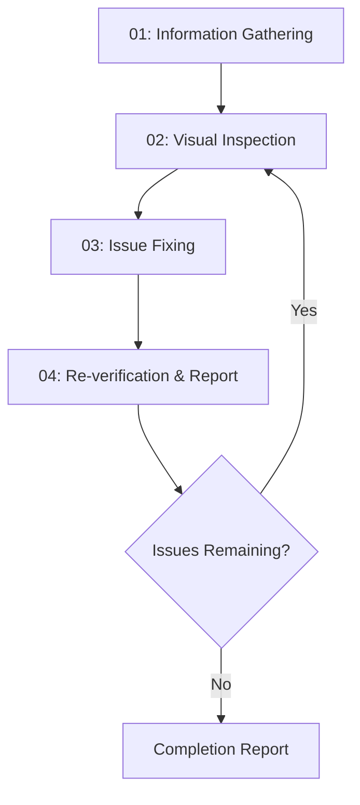

# Web Design Reviewer (`web-design-reviewer` — Progressive Disclosure Router)

Performs visual inspection and validation of live website design quality, identifying and fixing layout, responsive, accessibility, and visual consistency issues at the source code level.
Enforces `Single-Reference Lock`: load one `workflows/NN-*/workflow.md` phase file (and one `references/*.md` guide when needed) at a time.

## Scope of Application

- Static sites (HTML/CSS/JS), SPAs (React/Vue/Angular/Svelte), Full-stack frameworks (Next.js/Nuxt/SvelteKit), CMS platforms, and any web application.

## Prerequisites

1. **Target website running**: Local dev server (`http://localhost:3000`), staging, or production (read-only).
2. **Browser automation available**: Screenshot capture, page navigation, and DOM snapshot retrieval.
3. **Workspace source access**: Required when applying source-level fixes (confirm with user before major changes; pause after 3 failed fix attempts).

## Workflow Overview



## Workflow Routing Table

| Phase | Workflow / Reference | Scope |
|---|---|---|
| **01** | [01-information-gathering](workflows/01-information-gathering/workflow.md) | URL confirmation, framework/styling detection (`package.json`, Tailwind, Next, Vite), scope definition. |
| **02** | [02-visual-inspection](workflows/02-visual-inspection/workflow.md) | Page traversal, Layout/Responsive/A11y/Consistency audit across `375/768/1280/1920px` viewports, Playwright MCP setup. |
| **03** | [03-issue-fixing](workflows/03-issue-fixing/workflow.md) | `P1`/`P2`/`P3` prioritization, `tokensave-first` source lookup, minimal non-breaking fixes, DO/DON'T rules. |
| **04** | [04-reverification-and-reporting](workflows/04-reverification-and-reporting/workflow.md) | HMR/reload verification loop (3-attempt user escalation gate) and `# Web Design Review Results` report. |
| **Ref** | [visual-checklist.md](references/visual-checklist.md) · [framework-fixes.md](references/framework-fixes.md) | Detailed visual inspection checklist and framework-specific CSS/component fix recipes. |

## Formal Requirements (EARS)

- The web-design-reviewer skill SHALL evaluate layout, responsiveness across `375px`, `768px`, `1280px`, and `1920px` viewports, accessibility, and visual consistency before resolving source paths via the `tokensave-first` rule.
- WHEN a remediation requires major architectural refactoring or multi-component edits, the web-design-reviewer workflow SHALL confirm impact scope with the user prior to changing source files.
- IF a visual defect persists after more than 3 fix attempts, THEN the web-design-reviewer workflow SHALL stop automated edits and escalate to the user.

## BDD Scenarios

```gherkin
Feature: Responsive Web Design Review

  @REQ-WDR-001
  Scenario: Visual inspection verifies responsive viewports and records compliant results
    Given a running web application and confirmed inspection scope
    When the reviewer evaluates responsive viewport measurements and styling consistency
    Then the inspection report summarizes verified layout compliance

  @REQ-WDR-002
  Scenario: Persistent defect escalates after three failed remediation attempts
    Given a reported layout defect that remains unresolved after three fix cycles
    When the re-verification cycle completes the third attempt
    Then the reviewer halts automated source changes and requests user guidance
```
