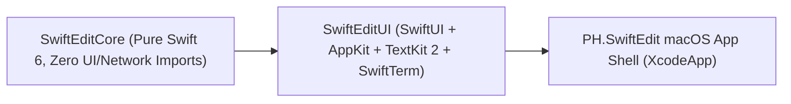

# SwiftEdit User Guide

Welcome to the official documentation for **SwiftEdit**, a lightweight, fast, and private native text editor for macOS written in Swift 6.

SwiftEdit is built directly on Apple frameworks (**SwiftUI**, **AppKit**, and **TextKit 2**) for editing **Markdown**, **YAML**, **log files**, and **plain text** with a high-contrast black-and-white editor canvas (`21:1` contrast ratio), neutral chrome with purple accents, an integrated live log viewer, and an embedded GPU-accelerated terminal.


---

## Functional: Table of Contents

| Chapter | Document | Topics Covered |
| :--- | :--- | :--- |
| **0. Overview** | [00-index.md](00-index.md) | Introduction, requirements, installation, updates, and architecture overview |
| **1. Workspace & Navigation** | [01-workspace-and-navigation.md](01-workspace-and-navigation.md) | Window anatomy, tabs, Folder Navigator, Drag & Drop, Recent Files, Duplicate Document, Session Recovery, Document Navigator, Distraction-Free mode |
| **2. Editing & Highlighting** | [02-editing-and-highlighting.md](02-editing-and-highlighting.md) | TextKit 2 editor, zoom, word wrap, double-click cycle, secondary occurrence highlights, brackets, ghost-text completion, `Cmd+Return` palette, Find & Replace, File Compare |
| **3. Markdown & YAML** | [03-markdown-and-yaml.md](03-markdown-and-yaml.md) | GFM authoring, adaptive lists, table navigation, AST formatter, 26-rule linter & quick fixes, native offline preview, YAML frontmatter Properties panel, native YAML support |
| **4. Logs & Terminal** | [04-logs-and-terminal.md](04-logs-and-terminal.md) | `.log` syntax highlighting, lock-free Live Log Tail (`Direct` & `Inverse`), secondary occurrence highlights in logs, >64 MiB tail-only mode, embedded terminal (`Cmd+J`) |
| **5. Settings, Shortcuts & Security** | [05-settings-shortcuts-and-security.md](05-settings-shortcuts-and-security.md) | Preferences (`~/.SwiftEdit/settings.json`), Light/Dark/Auto themes, typography & OpenDyslexic, complete keyboard shortcuts catalog, offline privacy & security model |

---

## Functional: System Requirements

- **Operating System**: macOS 26 or later on Apple silicon (`arm64`).
- **Building from Source**: Xcode 26 / Swift 6.2 or later.
- **Storage**: `SwiftEdit.app` is a compact native bundle (~6.3 MB in Release) with zero external runtime services.

---

## Functional: Installation & Updates

### Automated Install or Update Script

Releases are published on GitHub Releases as `PH.SwiftEdit-<version>-macOS-arm64.zip` alongside a matching `.sha256` checksum:

```bash
./Scripts/install-from-github.sh --remove-quarantine
# Pin a specific release:
./Scripts/install-from-github.sh --version v0.1.5 --remove-quarantine
# Preview resolved URLs and actions without downloading:
./Scripts/install-from-github.sh --dry-run
```

The installer verifies the SHA-256 digest before replacing `/Applications/SwiftEdit.app`, closes any running instance first, preserves quarantine-free status on updates, and relaunches `SwiftEdit.app` unless `--no-relaunch` is passed.

### Manual Installation

1. Download the `.zip` archive and its `.sha256` checksum file from the release page and verify integrity:

   ```bash
   shasum -a 256 -c PH.SwiftEdit-<version>-macOS-arm64.zip.sha256
   ```

2. Unzip the archive and move `SwiftEdit.app` into `/Applications`.
3. On first launch of an ad-hoc build, macOS Gatekeeper may ask for confirmation. Open the app once, click **OK**, then approve it in **System Settings → Privacy & Security → Open Anyway**, or strip the quarantine attribute after verifying the checksum:

   ```bash
   xattr -dr com.apple.quarantine /Applications/SwiftEdit.app
   open /Applications/SwiftEdit.app
   ```

### In-App Updates

Choose **SwiftEdit → Check for Updates…** to query GitHub Releases (`paonath/PH.SwiftEdit`). When a newer version is available, SwiftEdit downloads the archive, verifies its SHA-256 checksum, quits the running instance, swaps `SwiftEdit.app` atomically, preserves quarantine-free status if previously unquarantined, and relaunches automatically.

---

## Technical: Architecture Overview

SwiftEdit separates pure domain logic from macOS presentation across two Swift Package Manager targets (`Package.swift#L24-L51`):



| Module | Path | Responsibilities |
| :--- | :--- | :--- |
| `SwiftEditCore` | `Sources/SwiftEditCore/` | Document codec (`UTF-8`/`UTF-16`, `LF`/`CRLF`/`CR`), sessions, binary quarantine, Markdown/YAML/Log highlighters, 26-rule Markdown linter, YAML linter, Myers diff, search, word completion, word occurrence scanner, lock-free `LogTailSession`, tab & recovery state |
| `SwiftEditUI` | `Sources/SwiftEditUI/` | `SwiftEditWorkbenchModel`, `TextKit2EditorView`, `LineNumberGutterView`, `MarkdownNativePreviewView`, `PropertiesPanelView`, `LogTailPanelView`, `EmbeddedTerminalEmulatorView`, `HelpDocumentationView`, semantic themes, bundled `OpenDyslexic` & `Help` resources |
| `XcodeApp` | `XcodeApp/` | macOS application entry point, Hardened Runtime entitlements, Info.plist, and `AppIcon.appiconset` |

### Onboard Documentation Access

This entire guide is bundled inside `SwiftEdit.app` under `Sources/SwiftEditUI/Resources/Help/` and can be read offline at any time from **Help → SwiftEdit Help** (`Shift+Cmd+?`).
