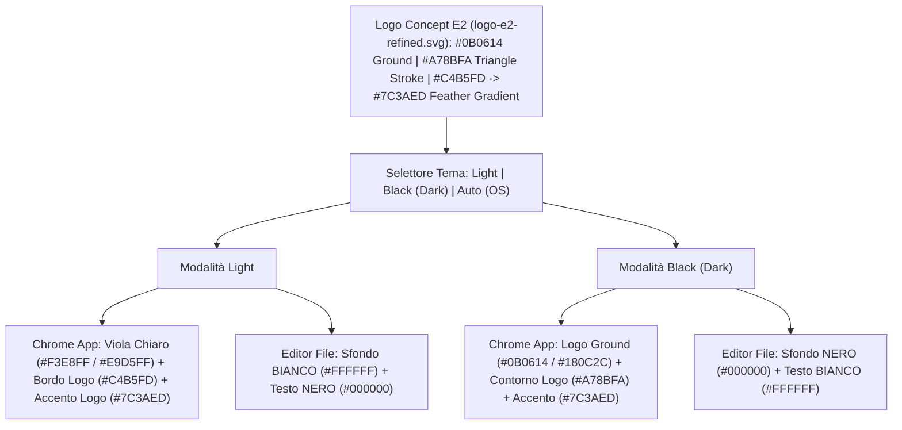

# Specifica Brand Icone, Schemi Colori Viola, Layout Minimal & Preview UI — `PH.SwiftEdit`

| Redattore | Data Creazione | Versione | Destinazione `docs/` |
|---|---|---|---|
| **Paolo Innocenti** | **2026-11-17 15:14:00 UTC** | **1.2.0** | `docs/design/color-schemes-and-zed-layout.md` |

## 1. Identità Brand & Analisi Tecnica del Set Icone Ufficiale (`Concept E2`)

Il brand visivo di `PH.SwiftEdit` è ancorato al **Logo Concept E2** ([logo-e2-refined.svg](assets/logo-e2-refined.svg) / [logo-e2-refined-512.png](assets/logo-e2-refined-512.png)) e documentato in [app-icons-riepilogo.md](assets/app-icons-riepilogo.md):
- **Geometria SVG (`viewBox="0 0 512 512"`)**:
  - **Sfondo (`logo-ground`)**: squircle `512×512 px` (`rx="96"`) in **Deep Violet `#0B0614`** (quasi nero con sottotono viola profondo).
  - **Triangolo Rovesciato (`M56 96 H456 L256 460 Z`)**: base superiore orizzontale di `400 px` (`x: 56..456`, `y: 96`) e vertice inferiore a `(256, 460)` (altezza `364 px`, lati obliqui `~415.4 px`, scarto `~4%` dall'equilatero matematico, con `stroke="#A78BFA"`, `stroke-width="16"`, `stroke-linejoin="round"`).
  - **Piuma Stilizzata (`Swift` + `Edit`)**: piuma con punta ricurva superiore destra e stelo posizionato a `~14 px` dal lato sinistro del triangolo (`transform="translate(262 250) scale(0.74) translate(-300 -305)"`), riempita con gradiente verticale lineare **`#C4B5FD` (`offset="0"`) → `#7C3AED` (`offset="1"`)** e intagliata in negativo (`#0B0614`) da rachide centrale (`stroke-width="7"`) e **19 barbe** (`11` a sinistra, `8` a destra, `stroke-width="9"`).

### 1.1 Analisi Tecnica del Set `macos/AppIcon.appiconset` (`10` PNG + `Contents.json`)
Percorso: [assets/app-icons/macos/AppIcon.appiconset/Contents.json](assets/app-icons/macos/AppIcon.appiconset/Contents.json)

| File | Dimensione Nominale | Scala | Risoluzione Effettiva (`sips`) | Canale Alpha (`hasAlpha`) | Griglia & Note Ottiche |
|---|---|---|---|---|---|
| `icon_16x16.png` | `16x16 pt` | `1x` | `16 × 16 px` | `yes` (margine esterno trasparente) | Griglia macOS (`824/1024`); a `16 px` le 19 barbe si fondono nella silhouette viola |
| `icon_16x16@2x.png` | `16x16 pt` | `2x` | `32 × 32 px` | `yes` | Nitido su display Retina per barra menu/Finder lista |
| `icon_32x32.png` | `32x32 pt` | `1x` | `32 × 32 px` | `yes` | Identico in pixel a `16x16@2x` (`32 × 32 px`) |
| `icon_32x32@2x.png` | `32x32 pt` | `2x` | `64 × 64 px` | `yes` | Barbe della piuma chiaramente distinguibili |
| `icon_128x128.png` | `128x128 pt` | `1x` | `128 × 128 px` | `yes` | Icona Dock/Finder standard |
| `icon_128x128@2x.png` | `128x128 pt` | `2x` | `256 × 256 px` | `yes` | Alta definizione Retina |
| `icon_256x256.png` | `256x256 pt` | `1x` | `256 × 256 px` | `yes` | Finestra Informazioni / About |
| `icon_256x256@2x.png` | `256x256 pt` | `2x` | `512 × 512 px` | `yes` | Risoluzione equivalente all'anteprima `logo-e2-refined-512.png` con margine macOS |
| `icon_512x512.png` | `512x512 pt` | `1x` | `512 × 512 px` | `yes` | Identico in pixel a `256x256@2x` (`512 × 512 px`) |
| `icon_512x512@2x.png` | `512x512 pt` | `2x` | `1024 × 1024 px` | `yes` | Master macOS: squircle `824 × 824 px` centrato con `100 px` di margine trasparente |

### 1.2 Analisi Tecnica del Set `ios/AppIcon.appiconset` (`8` PNG per `9` slot in `Contents.json`)
Percorso: [assets/app-icons/ios/AppIcon.appiconset/Contents.json](assets/app-icons/ios/AppIcon.appiconset/Contents.json)

| File | Slot `Contents.json` (`idiom` / `size` / `scale`) | Risoluzione Effettiva (`sips`) | Canale Alpha (`hasAlpha`) | Conformità iOS / App Store |
|---|---|---|---|---|
| `AppIcon-40.png` | `iphone` `20x20` `@2x` (Notifiche) | `40 × 40 px` | `no` (opaco `#0B0614`) | Piena tela quadrata senza trasparenza (mascherata da iOS) |
| `AppIcon-60.png` | `iphone` `20x20` `@3x` (Notifiche) | `60 × 60 px` | `no` | Opaco conforme |
| `AppIcon-58.png` | `iphone` `29x29` `@2x` (Impostazioni) | `58 × 58 px` | `no` | Opaco conforme |
| `AppIcon-87.png` | `iphone` `29x29` `@3x` (Impostazioni) | `87 × 87 px` | `no` | Opaco conforme |
| `AppIcon-80.png` | `iphone` `40x40` `@2x` (Spotlight) | `80 × 80 px` | `no` | Opaco conforme |
| `AppIcon-120.png` | `iphone` `40x40` `@3x` (Spotlight) **+** `60x60` `@2x` (Home) | `120 × 120 px` | `no` | Condiviso correttamente su 2 slot `120 px` |
| `AppIcon-180.png` | `iphone` `60x60` `@3x` (Home Screen iPhone Pro/Max) | `180 × 180 px` | `no` | Opaco conforme |
| `AppIcon-1024.png` | `ios-marketing` `1024x1024` `@1x` (App Store) | `1024 × 1024 px` | `no` | Zero canale alpha, pronto per validazione App Store Connect |

---

## 2. Armonizzazione Cromatico-Strutturale: Palette Logo E2 + Chrome Viola + Editor Puro B/W (`21:1`)

I **4 colori sorgente** estratti da `logo-e2-refined.svg` (`#0B0614`, `#7C3AED`, `#A78BFA`, `#C4B5FD`) costituiscono i **Brand Anchor Tokens** da cui deriva l'intero tema di `PH.SwiftEdit`:
- **Struttura dell'App in Viola (`Purple`)**: l'intero guscio applicativo (*Window Title/Tab Bar*, *Sidebar Folder Navigator*, *Status Bar*, *Bordi*, *Badge* e *Focus Ring*) usa i token Viola del Logo E2 in modalità **`Light`**, **`Black` (Dark)** e **`Auto` (Sistema Operativo)**.
- **Area di Editing del File ad Altissimo Contrasto (`21:1` Puro)**:
  - **Modalità `Light`**: l'area centrale di **EDITOR del file** ha obbligatoriamente **sfondo BIANCO puro (`#FFFFFF`)** e **carattere NERO puro (`#000000`)**.
  - **Modalità `Dark` (`Black`)**: i colori dell'area di **EDITOR del file** sono **invertiti** — **sfondo NERO puro (`#000000`)** e **carattere BIANCO puro (`#FFFFFF`)**.



---

## 3. Tabella Token Semantici (`Brand Logo E2` + `Light` vs `Black` / `Dark`)

| Token Semantico (`SwiftEditUI`) | Ruolo Architetturale & Legame con `logo-e2-refined.svg` | Valore `Light` Mode | Valore `Black` (Dark) Mode | Contrasto / Note (`UI-001..004`) |
|---|---|---|---|---|
| `brand.logo.ground` | Sfondo squircle del Logo Concept E2 (`<rect fill="#0B0614">`) | `#0B0614` *(Icon Ground)* | `#0B0614` *(Window Chrome Ground)* | Colore madre del guscio Dark |
| `brand.logo.triangleStroke` | Contorno triangolo rovesciato (`<path stroke="#A78BFA">`) | `#7C3AED` *(Adattato per contrasto su chiaro)* | `#A78BFA` *(Esatto SVG)* | Icone attive, gutter Dark, focus ring |
| `brand.logo.featherGradient` | Gradiente verticale piuma (`#C4B5FD` → `#7C3AED`) | `#C4B5FD` → `#7C3AED` | `#C4B5FD` → `#7C3AED` | Badge brand, spilla Pin Tab, highlight |
| `chrome.window.background` | Barra titolo e sfondo principale del guscio app | `#F3E8FF` *(Purple 100)* | `#0B0614` *(Esatto `logo-ground` SVG)* | Continuità totale tra icona macOS e finestra Dark |
| `chrome.sidebar.background` | Sidebar Folder Navigator collassabile (con file nascosti) | `#EDE0FF` *(Purple 150)* | `#140A24` *(Deep Violet 950)* | Distinto dall'editor centrale `#000000` |
| `chrome.tabbar.background` | Striscia Tab con supporto Pin | `#E9D5FF` *(Purple 200)* | `#180C2C` *(Deep Violet 925)* | Ospita tab aperti, `Untitled` e `Pinned` |
| `chrome.tab.active.background` | Tab attivo selezionato | `#FFFFFF` *(Bianco puro)* | `#000000` *(Nero puro)* | Si fonde senza cuciture con l'editor |
| `chrome.tab.pinned.badge` | Icona spilla (`Pin`) e indicatore tab modificato (`*`) | `#7C3AED` *(Esatto stop finale piuma SVG)* | `#C4B5FD` *(Esatto stop iniziale piuma SVG)* | Evidenziazione immediata stato Pin |
| `chrome.statusbar.background` | Barra di stato inferiore (Encoding, CRLF/LF, Lint, Zoom %) | `#7C3AED` *(Esatto stop finale piuma SVG)* | `#2E1065` *(Violet 950)* | Testo `#FFFFFF` (`>= 7:1` WCAG AAA) |
| `chrome.accent.primary` | Focus ring, pulsanti attivi, cursore ricerca, badge Zoom | `#7C3AED` *(Esatto `#7C3AED` SVG)* | `#A78BFA` *(Esatto `#A78BFA` SVG)* | Armonia 1:1 con `logo-e2-refined.svg` |
| `chrome.border.hairline` | Separatori `1pt` tra sidebar, tab bar ed editor | `#C4B5FD` *(Esatto `#C4B5FD` SVG)* | `#3B1D6E` *(Violet 800)* | Griglia `4pt` minimale |
| **`editor.canvas.background`** | **Sfondo area centrale di editing del file** | **`#FFFFFF` *(Bianco Puro)*** | **`#000000` *(Nero Puro)*** | **Inversione obbligatoria Light/Dark (`UI-002`)** |
| **`editor.canvas.foreground`** | **Carattere principale del testo nell'editor** | **`#000000` *(Nero Puro)*** | **`#FFFFFF` *(Bianco Puro)*** | **Rapporto di contrasto `21:1` assoluto** |
| `editor.gutter.foreground` | Numeri di riga e indicatori folding Markdown | `#5B21B6` *(Violet 800)* | `#A78BFA` *(Esatto `#A78BFA` SVG)* | Leggibile su `#FFFFFF` e `#000000` (`>= 4.8:1`) |
| `editor.selection.background` | Selezione testo attiva (inclusa duplicazione `Cmd+D`) | `#DDD6FE` *(Violet 200)* | `#3B0764` *(Purple 950)* | Mantiene leggibile il testo selezionato |
| `editor.bracket.match` | Evidenziazione parentesi bilanciate `(){}[]` | `#EDE9FE` + bordo `#7C3AED` | `#2E1065` + bordo `#A78BFA` | Rettangolo `1pt` attorno a apertura/chiusura |
| `editor.bracket.unbalanced` | Parentesi spaiata / non bilanciata | `#FEE2E2` + bordo `#DC2626` | `#450A0A` + bordo `#F87171` | Segnalazione immediata errore `(){}[]` |
| `editor.diff.inserted` | Righe/token aggiunti in **File Compare** | `#DCFCE7` (testo `#000000`) | `#052E16` (testo `#FFFFFF`) | Vista Side-by-Side / Inline |
| `editor.diff.removed` | Righe/token rimossi in **File Compare** | `#FEE2E2` (testo `#000000`) | `#450A0A` (testo `#FFFFFF`) | Vista Side-by-Side / Inline |
| `banner.binary.warning` | Banner file binario aperto in sola lettura testo | `#FEF3C7` + bordo `#D97706` | `#451A03` + bordo `#F59E0B` | **Save & Pin disabilitati, zero persistenza** |

---

## 4. Anatomia del Layout Minimal & Modalità Zoom

```
+--------------------------------------------------------------------------------------------------+
| [● ● ●] [🪶] [Sidebar ◧] PH.SwiftEdit — workspace/                  [Light|Black|Auto] [Zoom 125%]| <- Chrome Viola (#0B0614 / #F3E8FF)
+----------------------+---------------------------------------------------------------------------+
| FOLDER NAVIGATOR     | [📌 Constitution.md] [README.md *] [Untitled-1 *] [⚠️ payload.bin (RO)] [+] | <- Tab Bar con Pin
| ▾ PH.SwiftEdit       +---------------------------------------------------------------------------+
|   📄 .gitignore    • | ⚠️ FILE BINARIO: Vista ispettiva testo sola-lettura (Salvataggio e Pin    | <- Solo su binari
|   📄 .env          • |    disabilitati; il file non verrà mantenuto in memoria/tab alla chiusura)|
|   📄 .myspec...    • +---------------------------------------------------------------------------+
|   ▸ openspec/        |  1 | # PH.SwiftEdit                                                       |
|   ▸ Sources/         |  2 | Minimal & Light Text Editor in **Swift 6** ({[ bilanciato ]})        | <- EDITOR FILE:
|   📄 README.md       |  3 |                                                                      |    Light: #FFFFFF bg
|   📄 payload.bin     |  4 | - [x] Markdown Linting & Format Section / Format Document            |           #000000 text
|                      |  5 | - [x] Cmd+D: duplica riga o selezione su nuova riga dopo cursore     |    Black: #000000 bg
| (Mostra anche file   |  6 |                                                                      |           #FFFFFF text
|  e cartelle nascosti)|    |                                                                      |
+----------------------+---------------------------------------------------------------------------+
| 📁 feature/FirstStub | Markdown (Lint: 0 warning) | Match: () {} [] | UTF-8 | LF | Ln 5, Col 18 | 🔍 125% | <- Status Bar Viola (#7C3AED)
+--------------------------------------------------------------------------------------------------+
```

### Specifiche Comportamentali Layout, Icone & Zoom (`UI-001..012`)
1. **Integrazione `AppIcon.appiconset` in Xcode (`AR-001`, `UI-001`, `SDD-003`)**:
   - Il target macOS importa `app-icons/macos/AppIcon.appiconset` in `Assets.xcassets/AppIcon.appiconset`; il futuro target iPhone importa `app-icons/ios/AppIcon.appiconset`.
   - Il file vettoriale master `logo-e2-refined.svg` viene preservato in `docs/design/assets/logo-e2-refined.svg` (e usato anche per l'header About Box di `PH.SwiftEdit`).
2. **Modalità Zoom dell'Editor (`UI-004`)**:
   - **Text/Viewport Zoom (`50%..300%`, step `10%`)**: `Cmd++` / `Cmd+-` / `Cmd+0` (reset `100%`) e pinch-to-zoom su trackpad senza alterare il file salvato.
   - **Editor Pane Focus Zoom (`Option+1`, Distraction-Free)**: collassa temporaneamente Folder Navigator e pannelli secondari portando il canvas Bianco/Nero a tutto schermo.
3. **Gestione Tab con Pin & Quarantena File Binari (`BC-008`, `DATA-003..006`, `UI-008`)**:
   - Pin Tab (`📌`), ripristino automatico allo startup e autosave atomico in `Application Support/PH.SwiftEdit/SessionRecovery/` con unlink immediato alla chiusura del tab e GC all'avvio.
   - I **file binari** (inclusi i `.png` se cliccati nel Folder Navigator!) vengono mostrati in vista ispettiva testo **sola-lettura** con banner d'avviso: **mai salvabili (`DomainError.binaryFileSaveForbidden`)**, **mai pinnabili** e **mai mantenuti in memoria/tab/sessione**.

---

## 5. Indice Completo Asset & Immagini di Preview (`docs/design/assets/`)

1. **Logo Master & Set Icone Ufficiali App (`Concept E2`)**:
   - Sorgente SVG: [logo-e2-refined.svg](assets/logo-e2-refined.svg)
   - Anteprima `512×512 px`: [logo-e2-refined-512.png](assets/logo-e2-refined-512.png)
   - Riepilogo Requisiti Icone: [app-icons-riepilogo.md](assets/app-icons-riepilogo.md)
   - Set Xcode macOS (`10` PNG + `Contents.json`): [macos/AppIcon.appiconset](assets/app-icons/macos/AppIcon.appiconset/Contents.json)
   - Set Xcode iPhone (`8` PNG + `Contents.json`): [ios/AppIcon.appiconset](assets/app-icons/ios/AppIcon.appiconset/Contents.json)
2. **Mockup UI Pre-Sviluppo**:
   - Modalità `Black` (Dark): [preview-dark-black-purple.png](assets/preview-dark-black-purple.png)
   - Modalità `Light` + Warning File Binario: [preview-light-purple.png](assets/preview-light-purple.png)
   - Vista `File Compare` + Zoom `150%`: [preview-file-compare-diff.png](assets/preview-file-compare-diff.png)
