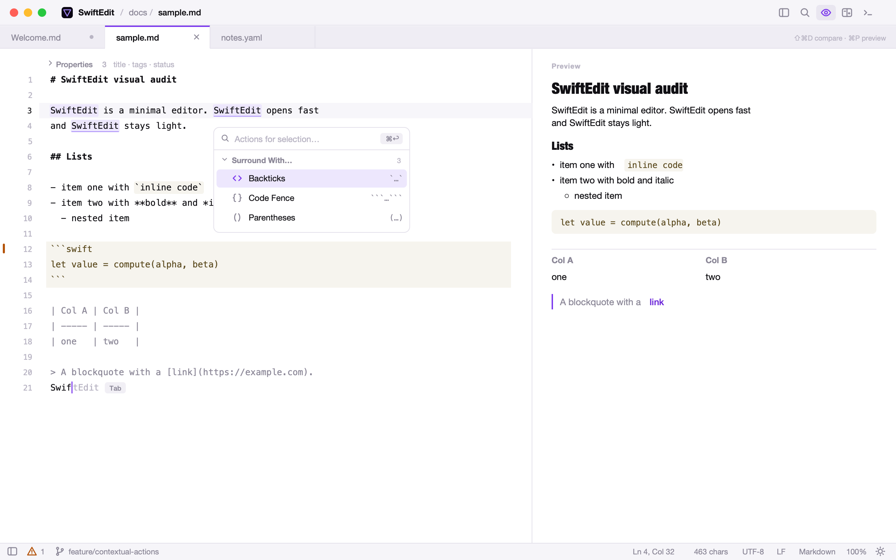
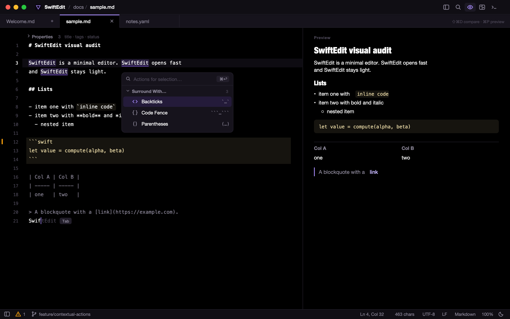

# Rivisitazione grafica: inventario visivo, correzioni integrate e set icone

## Functional: Stato in sintesi

- **Tutte le correzioni sono integrate**: bug visivi V-01..V-03 e migliorie R-01..R-10, compreso il set di icone.
- **Il logo Concept E2 non è cambiato** (`SwiftEditBrandLogoView`, `AppIcon.appiconset`, schermata About).
- **Constitution v1.7.0**: UI-001 passa da "Purple chrome" a "chrome neutro minimale con accenti viola" e cita il set `AppIcon`.
- Verifica: 379 test verdi, 32 snapshot "dopo" (16 stati × Light e Dark).

## Functional: Mockup di riferimento

| Light | Dark |
|---|---|
|  |  |

I mockup ([mockup-light.svg](mockup-light.svg), [mockup-dark.svg](mockup-dark.svg)) sono il riferimento.
L'implementazione li segue con due differenze volute:

- **Branch git nella status bar:** non c'è, perché l'app non ha un'integrazione git (resta in backlog).
- **Ghost text:** niente keycap "Tab" accanto al suggerimento. L'hint sta nel CheatSheet e nella label VoiceOver, così il testo non viene coperto.

## Functional: Inventario delle superfici visive (prima / dopo)

| Superficie | Prima | Dopo | Correzioni |
|---|---|---|---|
| Workbench (header, tab, gutter, status bar) | [L](before/light-01-workbench.png) · [D](before/dark-01-workbench.png) | [L](after/light-01-workbench.png) · [D](after/dark-01-workbench.png) | R-01, R-02, R-03, R-04, R-05, V-01, V-02 |
| Occorrenze della selezione | [L](before/light-02-occurrences.png) · [D](before/dark-02-occurrences.png) | [L](after/light-02-occurrences.png) · [D](after/dark-02-occurrences.png) | token neutri |
| Proprietà YAML + Preview | [L](before/light-03-preview-properties.png) · [D](before/dark-03-preview-properties.png) | [L](after/light-03-preview-properties.png) · [D](after/dark-03-preview-properties.png) | R-06, R-07 |
| Menu header (logo) | [L](before/light-04-header-menu.png) · [D](before/dark-04-header-menu.png) | [L](after/light-04-header-menu.png) · [D](after/dark-04-header-menu.png) | R-09, V-03 |
| Sidebar / Folder Navigator | [L](before/light-05-sidebar.png) · [D](before/dark-05-sidebar.png) | [L](after/light-05-sidebar.png) · [D](after/dark-05-sidebar.png) | R-08 |
| Palette `⌘↩` (ElementContextualMenu) | [L](before/light-06-contextual-menu.png) · [D](before/dark-06-contextual-menu.png) | [L](after/light-06-contextual-menu.png) · [D](after/dark-06-contextual-menu.png) | icone, `accentSoftSurface` |
| Barra Find/Replace + Compare | — | [L](after/light-07-find-compare.png) · [D](after/dark-07-find-compare.png) | icone ↑/↓, controlli compatti, etichetta Compare |
| Document Navigator (`⌥\`) | — | [L](after/light-08-navigator.png) · [D](after/dark-08-navigator.png) | stile palette, altezza adattiva |
| CheatSheet | — | [L](after/light-09-cheatsheet.png) · [D](after/dark-09-cheatsheet.png) | `⇧⌘W` Close, `⌘W` Word Wrap |
| About (logo invariato) | — | [L](after/light-10-about.png) · [D](after/dark-10-about.png) | solo token |
| Popover diagnostiche | — | [L](after/light-11-diagnostics.png) · [D](after/dark-11-diagnostics.png) | icone warning/error |
| Help | — | [L](after/light-12-help.png) · [D](after/dark-12-help.png) | solo token |
| Set icone `AppIcon` | — | [L](after/light-13-icons.png) · [D](after/dark-13-icons.png) | 50 icone a linea |
| Pannello shortcuts a destra (`⌥⌘/`) | — | [L](after/light-14-shortcuts-panel.png) · [D](after/dark-14-shortcuts-panel.png) | spec 021: ricerca, righe cliccabili |
| Palette `⌘↩` senza selezione | — | [L](after/light-15-contextual-no-selection.png) · [D](after/dark-15-contextual-no-selection.png) | spec 021: Duplicate Document |
| Header + menu SwiftEdit al 150% | — | [L](after/light-16-zoom150-menu.png) · [D](after/dark-16-zoom150-menu.png) | spec 021: icone accanto al menu, titolo a destra, scala con lo zoom |

Le superfici seguenti non sono negli snapshot, ma usano gli stessi token e icone:

- pannello Terminale (`⌘J`) e pannello Log tail (`⌘L`);
- Settings (Fonts, Terminal, Updates) e finestra Update;
- banner binario e banner BiDi;
- palette del menu contestuale.

## Functional: Correzioni integrate

| ID | Problema | Correzione | Dove |
|---|---|---|---|
| V-01 | `⚠ ⚠ Lint: 1` (doppia icona) | L'etichetta del Core è solo testo (`Lint: N`); la status bar disegna un'unica icona più il conteggio | `MarkdownQuickFixResolver.swift`, `SwiftEditRootView.statusBar` |
| V-02 | Il marker lint copriva il numero di riga ("1 5") | Colonna diagnostica separata a sinistra (16 pt) e numero allineato a destra con `fixedSize` | `LineNumberGutterView.swift`, `ZoomedChromeMetrics.gutterWidth` |
| V-03 | Proprietà "vuote" con menu header aperto | **Falso positivo**: il menu (312 pt) copriva semplicemente quell'area; nessuna modifica | — |
| R-01 | Chrome a tre tinte lavanda + status bar viola saturo | Header e status bar `#F6F5F9`/`#100E14`, tab strip `#EFEDF4`/`#16131C`, sidebar `#F3F2F7`/`#0C0B10`; accento viola solo su caret, focus, tab attiva, toggle | `PurpleThemeAndZoom.swift` |
| R-02 | Zoom e Light/Dark/Auto sempre nell'header | Header = logo + breadcrumb `cartella / file` + cluster (sidebar, find, preview, compare, terminale); zoom e tema nella status bar | `toolbarBar`, `statusBar` |
| R-03 | Tab a pillola con pin, `<`, `>` e `×` sempre visibili | Tab piatte, linea accento di 2 pt sulla tab attiva, `×` solo su tab attiva o in hover, pallino per i file non salvati, pin come piccolo indicatore; riordino e pin restano nel menu contestuale e nel drag | `tabBar` |
| R-04 | Rail di 24 pt con un'unica icona | Rimossa; toggle sidebar nell'header, nella status bar e con `⌘B` | `layoutContent` |
| R-05 | Gutter viola e bordato | Gutter fuso con il canvas, numeri grigi (`#6E6A7A`/`#7D7889`), riga attiva più contrastata | `LineNumberGutterView.swift` |
| R-06 | Proprietà centrate a forma di tab, `⊖` lontano dai valori | Riga di disclosure allineata alla colonna del testo con anteprima delle chiavi; valori larghi al massimo 420 pt con `⊖` accanto; `+` per aggiungere | `PropertiesPanelView.swift` |
| R-07 | "Native Preview (Zero-WebKit)" | Etichetta `PREVIEW`, canvas dell'editor, titoli semibold con spaziatura | `MarkdownNativePreviewView.swift` |
| R-08 | Divider di 5 pt, stato vuoto senza azione | Hairline di 1 pt (area di presa 6 pt); stato vuoto con "Open Folder… ⇧⌘O"; icone file neutre, cartelle in accento | `sidebarView` |
| R-09 | Evidenziazione piena e keycap viola | `accentSoftSurface`, keycap neutri, ombra | `HeaderBrandSubmenuView.swift` |
| R-10 | Codice inline color oliva in dark | `#24221C` / `#17150F` (contrasto ≥ 4.5:1 mantenuto) | `PurpleThemeAndZoom.swift` |
| Extra | Divisori viola con Reduce Transparency attivo | Divisore ad alto contrasto in grigio neutro `#858191` / `#6F6A7E` (≥ 3:1) | `hairlineBorder` |

## Technical: Set icone `AppIcon`

- **Implementazione:** [AppIcons.swift](../../../Sources/SwiftEditUI/Theme/AppIcons.swift). Sono 50 icone a linea originali, disegnate nel codice su griglia 24×24 con tratto di 2 unità (≈ 1,33 pt a 16 pt), cap e join arrotondati.
- **Nessun asset né dipendenza:** niente download, niente licenze di terze parti, niente asset catalog.
- **Uso:** `AppIconView(.folder, size: 14)`. È decorativa per default; `label:` la rende leggibile da VoiceOver.
- **Core:** le azioni di `SwiftEditCore` (es. `ElementContextualAction.iconName`) referenziano le icone per nome semantico (`rawValue`).
- **Fitness:** `Redesign020Tests.nNoSFSymbolsInSwiftEditUI` vieta `Image(systemName:)`, `systemImage:` e `NSImage(systemSymbolName:)` in `SwiftEditUI`; `pEveryIconHasGeometryInsideGrid` verifica la geometria di ogni icona.

```swift
Button(action: { model.toggleDiffPane() }) {
    AppIconView(.diff, size: 15)
}
.help("Toggle File Compare (⇧⌘D)")
.accessibilityLabel("Toggle File Compare")
```

## Technical: Token (UI-001 v1.7.0)

| Token | Light | Dark | Ruolo |
|---|---|---|---|
| `topBarSurface` = `statusBarSurface` | `#F6F5F9` | `#100E14` | header e status bar |
| `tabBarSurface` | `#EFEDF4` | `#16131C` | tab inattive |
| `sidebarSurface` | `#F3F2F7` | `#0C0B10` | Folder Navigator |
| `hairlineBorder` | `#E3E0EA` (alto contrasto `#858191`) | `#25212D` (alto contrasto `#6F6A7E`) | divisori da 1 pt |
| `secondaryForeground` = `statusBarForeground` | `#5E5A6B` | `#A29EAE` | testo attenuato (≥ 4.5:1) |
| `gutterForeground` | `#6E6A7A` | `#7D7889` | numeri di riga (≥ 4.5:1) |
| `accentSoftSurface` (nuovo) | `#EDE7FD` | `#241B3A` | righe evidenziate, toggle attivi |
| `chromeAccent` | `#7C3AED` | `#A78BFA` | invariato |
| `editorCanvas*` | `#FFFFFF`/`#000000` | `#000000`/`#FFFFFF` | invariato (UI-002) |

I nuovi minimi di contrasto (status bar, gutter, testo secondario, `accentSoftSurface`, accento sull'header) sono verificati da `exhaustivePairedForegroundAndBorderContrastAudit`.

## Technical: Verifica

```bash
swift test
```

```bash
SWIFTEDIT_VISUAL_AUDIT_DIR="$PWD/.tmp/output/visual" swift test --filter VisualAuditSnapshotTests
```

## Functional: Backlog residuo

- Indicatore del branch git nella status bar (serve un'integrazione git di sola lettura).
- Snapshot automatici del pannello Terminale: il render offscreen avvierebbe una sessione PTY reale.
- Il frontmatter compare come testo nella Preview: comportamento esistente, da valutare a parte.
