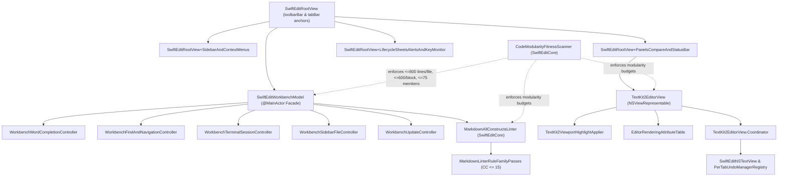

# Design: Workbench, TextKit 2 Editor, and Markdown Linter Modular Decomposition

## Context
`PH.SwiftEdit` grew across 25 specifications (`000..024`) while concentrating new features into two main UI files and one core linter method:
- `Sources/SwiftEditUI/Views/SwiftEditRootView.swift` (`4,523` lines): embeds `SwiftEditWorkbenchModel` (`~3,035` lines, `282+` members, `136+` methods) and `SwiftEditRootView` (`~1,300` lines, `43+` members), with `fan_in: 47` and `fan_out: 31`.
- `Sources/SwiftEditUI/Views/TextKit2EditorView.swift` (`1,939` lines): embeds `PerTabUndoManagerRegistry`, `SwiftEditNSTextView`, `GhostCompletionView`, `TextKit2EditorView`, `TextKit2EditorView.Coordinator` (`68+` members), `applyNonMutatingHighlightsIfNeeded` (cyclomatic complexity `31`), `EditorRenderingFonts`, `EditorRenderingAttributeTable`, and `EditorRenderingAttributes`.
- `Sources/SwiftEditCore/MarkdownLintAndFormat/MarkdownAllConstructsLinter.swift` (`829` lines): contains `diagnostics(index:securityOnly:deadlineExceeded:)` (`287` lines, cyclomatic complexity `56`, cognitive complexity `232`, `CRAP: 3192.0`).

Existing static regression suites (`AuditFindingsRegressionTests.f03TabStripIconButtonsUseMinimumHitTarget`, `Integrations021Tests.pHeaderOrder`, `TranslucentHeaderBrandSubmenuTests`, `FullAppSemanticThemingAndWindowSyncTests`) inspect `Sources/SwiftEditUI/Views/SwiftEditRootView.swift` and all `.swift` files under `Sources/SwiftEditUI/Views/` directly (`[TEST-006]`).

## Goals / Non-Goals
- Goals:
  - Partition `SwiftEditWorkbenchModel`, `SwiftEditRootView`, `TextKit2EditorView` (`Coordinator`), and `MarkdownAllConstructsLinter.diagnostics` into cohesive, single-responsibility modules and pure pass evaluators (`[AR-001]`, `[AR-006]`, `[AR-009]`, `[AR-010]`, `[BC-001]`, `[UI-005]`, `[UI-006]`, `[UI-007]`).
  - Maintain 100% source and behavioral compatibility on `SwiftEditWorkbenchModel`, `SwiftEditRootView`, `TextKit2EditorView`, and `MarkdownAllConstructsLinter` public/internal entry points so all existing `SwiftEditTests` suites pass without weakening any assertion (`[TEST-001]`, `[TEST-005]`, `[TEST-008]`).
  - Enforce an automated `CodeModularityFitnessScanner` gate in `SwiftEditCore` verifying file lines `<= 800`, nominal declaration/extension block lines `<= 600`, and declared members per block `<= 75` across `Sources/SwiftEditCore` and `Sources/SwiftEditUI`, with canonical symlink confinement (`[TEST-006]`, `[SEC-003]`, `[SEC-012]`).
- Non-Goals:
  - Altering user-facing UI layout, theme tokens, keyboard shortcuts, or any of the 26 `.allConstructs` Markdown lint rules.
  - Introducing speculative 1:1 protocol hierarchies for internal UI sub-controllers where no external I/O seam or `Rule of Three (>= 3 variants)` applies (`[AR-009]`).

## Architecture Memory & Module Boundaries (AR-###)
- **AR-001**: `SwiftEditCore` (`Sources/SwiftEditCore/ArchitectureFitness/` and `Sources/SwiftEditCore/MarkdownLintAndFormat/`) remains pure `Foundation` + `Markdown` across `.macOS(.v26)` and `.iOS(.v26)`. `SwiftEditUI` (`Sources/SwiftEditUI/Workbench/` and `Sources/SwiftEditUI/Views/`) depends inward on `SwiftEditCore` and confines `AppKit`/`SwiftUI`/TextKit 2 state to `@MainActor` (`[AR-001]`, `[AR-002]`, `[AR-006]`, `[AR-010]`).
- **AR-018**: `SwiftEditWorkbenchModel` acts as a `@MainActor` coordinating facade delegating domain sub-workflows to `WorkbenchWordCompletionController`, `WorkbenchFindAndNavigationController`, `WorkbenchTerminalSessionController`, `WorkbenchSidebarFileController`, and `WorkbenchUpdateController` while exchanging immutable `(DocumentID, BufferRevision)` value snapshots with `SwiftEditCore` (`[AR-008]`, `[BC-004]`, `[UI-005]`).

## Constitutional Alignment & Module Boundaries (AR-### / UI-### / DATA-### / API-###)
- **Single-Reference Lock**:
  - `openspec/constitution/01-architecture/dependency-and-layering.md` (`AR-006..AR-010`)
  - `openspec/constitution/02-domain/bounded-context-ownership.md` (`BC-001..BC-004`)
  - `openspec/constitution/03-ui-ux/component-state-and-forms.md` (`UI-005..UI-008`)
  - `openspec/constitution/06-testing-fitness/architecture-fitness-and-quality.md` (`TEST-005..TEST-008`)
  - `openspec/constitution/07-security-privacy/stride-and-gdpr-privacy.md` (`SEC-009..SEC-012`)
  - `openspec/constitution/08-sdd-governance/artifact-traceability.md` (`SDD-001..SDD-004`)

## Decisions
- **Decision 1 — Facade + Focused `@MainActor` Sub-Controllers + Domain Extensions for `SwiftEditWorkbenchModel` (`KISS` + `SRP`)**:
  - *Rationale*: Moving `SwiftEditWorkbenchModel` into `Sources/SwiftEditUI/Workbench/SwiftEditWorkbenchModel.swift` (`<= 550` lines, `<= 65` stored properties/initializers) while extracting self-contained sub-controllers (`WorkbenchWordCompletionController`, `WorkbenchFindAndNavigationController`, `WorkbenchTerminalSessionController`, `WorkbenchSidebarFileController`, `WorkbenchUpdateController`) and domain extension files (`+WorkspaceAndSidebar.swift`, `+DocumentLifecycleAndSave.swift`, `+FindReplaceAndNavigation.swift`, `+MarkdownLintPreviewAndFrontmatter.swift`, `+TerminalLogAndUpdates.swift`, `+ContextualMenuAndShortcuts.swift`) allows direct unit testing of each sub-controller without breaking a single existing caller or `@Test` suite (`[AR-009]`, `[AR-010]`, `[UI-005]`).
  - *Alternatives Considered*: Breaking `SwiftEditWorkbenchModel` into unrelated root `@Environment` objects requiring changes across every view and 40+ test files (rejected: violates KISS and causes massive test churn).
- **Decision 2 — Preserve `toolbarBar` and `tabBar` Anchors Inside `SwiftEditRootView.swift`**:
  - *Rationale*: `AuditFindingsRegressionTests` (`F-017-03`) and `Integrations021Tests` (`P-HDR2`) read `Sources/SwiftEditUI/Views/SwiftEditRootView.swift` and slice from `"private var tabBar: some View"` and `"private var toolbarBar: some View"`. Keeping the core root layout, `toolbarBar`, and `tabBar` in `SwiftEditRootView.swift` (`<= 600` lines) while moving sidebar/context-menus, panels/compare/status-bar, and lifecycle/sheets/alerts/keyboard-monitor into `SwiftEditRootView+*.swift` satisfies all static tests without modifying existing test expectations (`[UI-001]`, `[TEST-006]`).
- **Decision 3 — Extract `TextKit2ViewportHighlightApplier` and Dedicated Editor Component Files**:
  - *Rationale*: Separating `SwiftEditNSTextViewAndUndoRegistry.swift`, `EditorRenderingAttributes.swift`, `TextKit2ViewportHighlightApplier.swift`, `TextKit2EditorCoordinator.swift`, and `TextKit2EditorCoordinator+GhostCompletionAndCommands.swift` isolates AppKit `NSTextView` drawing, cached GFM font/attribute tables, viewport highlight transactions (`UI-007`), and delegate coordination into files `<= 600` lines each (`[UI-006]`, `[UI-007]`).
- **Decision 4 — Pure Rule-Family Evaluators in `MarkdownLinterRuleFamilyPasses.swift`**:
  - *Rationale*: Splitting the 287-line `diagnostics(index:securityOnly:deadlineExceeded:)` loop into composable family evaluators (fence/frontmatter state & code block rules, heading rules, list/blockquote rules, table/HR/whitespace rules, document boundary rules, and inline link/image security scan) via a light `MarkdownLinterPassContext` struct drops per-method cyclomatic complexity from `56` to `<= 15` with zero heap overhead (`[BC-001]`, `[BC-002]`, `[SEC-012]`).
- **Decision 5 — `CodeModularityFitnessScanner` in `SwiftEditCore/ArchitectureFitness`**:
  - *Rationale*: A pure-`Foundation`, comment/string-aware brace-depth Swift declaration scanner in `Sources/SwiftEditCore/ArchitectureFitness/CodeModularityFitnessScanner.swift` provides deterministic enforcement of `maxFileLines = 800`, `maxNominalBlockLines = 600`, and `maxNominalMembers = 75` during `swift test`, while enforcing canonical symlink confinement (`resolvingSymlinksInPath`) and `4 MiB` file size caps (`[TEST-006]`, `[SEC-003]`, `[SEC-012]`).

## Risks / Trade-offs
- **`private` Access Control Across Extracted Extension Files** -> Swift `private` members declared in `SwiftEditWorkbenchModel.swift`, `SwiftEditRootView.swift`, or `TextKit2EditorCoordinator.swift` are invisible to separate `+*.swift` files. *Mitigation*: Promote cross-file internal helpers and stored properties accessed by sibling extension files within `SwiftEditUI` to `internal` (default access) or `package`, keeping external module encapsulation intact.
- **Static Theme Token & Accessibility Scans on `Sources/SwiftEditUI/Views/`** -> `FullAppSemanticThemingAndWindowSyncTests` and `AuditFindingsRegressionTests` scan every `.swift` file in `Sources/SwiftEditUI/Views/`. *Mitigation*: Ensure all extracted `SwiftEditRootView+*.swift` and `TextKit2Editor*` files in `Sources/SwiftEditUI/Views/` use `PurpleThemePalette` tokens and labeled icon buttons exclusively (`[UI-001]`, `[TEST-006]`).
- **False Positives on Braces or `func`/`var` Keywords Inside String Literals or Comments** -> `CodeModularityFitnessScanner` could miscount braces or member declarations if raw lines are scanned naively. *Mitigation*: Reuse comment- and string-literal stripping logic (`ArchitectureImportScanner` style) before tracking nominal declaration brace depth and top-level member declarations.

## Migration Plan
1. Introduce `CodeModularityFitnessScanner` in `Sources/SwiftEditCore/ArchitectureFitness/` and verify its positive, negative, and security boundary unit tests.
2. Refactor `MarkdownAllConstructsLinter.swift` into modular rule-family passes in `MarkdownLinterRuleFamilyPasses.swift` and verify all existing and new 26-rule and security linter tests.
3. Extract `@MainActor` workbench sub-controllers and `SwiftEditWorkbenchModel+*.swift` extensions under `Sources/SwiftEditUI/Workbench/`, followed by `SwiftEditRootView+*.swift` extensions under `Sources/SwiftEditUI/Views/`.
4. Decompose `TextKit2EditorView.swift` into `SwiftEditNSTextViewAndUndoRegistry.swift`, `EditorRenderingAttributes.swift`, `TextKit2ViewportHighlightApplier.swift`, `TextKit2EditorCoordinator.swift`, and `TextKit2EditorCoordinator+GhostCompletionAndCommands.swift`.
5. Run the live `CodeModularityFitnessScanner` test across `Sources/SwiftEditCore` and `Sources/SwiftEditUI` and execute `swift test --parallel` (`[TEST-008]`).

## Security Review
- Reviewer: cyber-security-expert
- Date: 2026-11-24
- Status: approved
- Verdict: approved # approved | changes-required
- Open items: none
