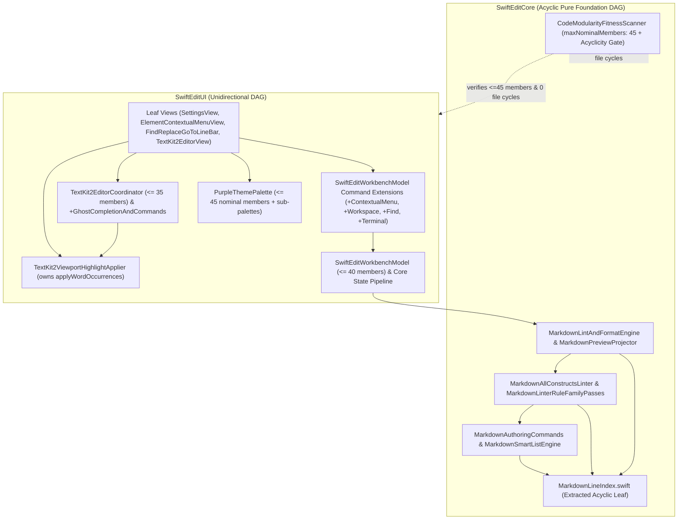

# Design: God-Class Member Flattening, File-Level Acyclicity, and Recursion Elimination

## Context
Following specification `025-workbench-editor-and-linter-modular-decomposition`, all production `.swift` files comply with the `800`-line file cap and `600`-line nominal block cap, but TokenSave graph analysis (`quality_signal = 7526`, `acyclicity = 0.6079`, `129` edges in cycles) identified three remaining structural issues:
1. **Point 1 — Nominal God-Classes (`tokensave_god_class`)**:
   - `SwiftEditWorkbenchModel` (`Sources/SwiftEditUI/Workbench/SwiftEditWorkbenchModel.swift`) declares `80` members in its primary class block (`CodeModularityFitnessScanner` previously counted `74` because `isMemberDeclaration` skipped `@ObservationIgnored` lines containing `(` or `{`).
   - `PurpleThemePalette` (`Sources/SwiftEditUI/Theme/PurpleThemeAndZoom.swift`) declares `72` members in its primary struct block.
   - `TextKit2EditorView.Coordinator` (`Sources/SwiftEditUI/Views/TextKit2EditorCoordinator.swift`) declares `61` members (`48` properties + `13` methods).
2. **Point 2 — File-Level Circular Dependencies (`tokensave_circular`: 4 cycles, 129 cycle edges)**:
   - **SCC 1 (41 production files + 1 test file)**: Driven by (a) upward name-collision edges from `SwiftEditCore` into `SwiftEditUI` (`PerTabUndoManagerRegistry.removeAll`, `SettingsView.rows`, `KeyboardShortcutsCheatSheetView.matches`), (b) `MarkdownLineIndex` being co-located inside `MarkdownSyntaxHighlighter.swift` instead of a leaf file, and (c) bidirectional calls between `SwiftEditWorkbenchModel+*.swift` extensions and view files (`ElementContextualMenuView`, `FindReplaceGoToLineBar`, `EmbeddedTerminalEmulatorView`).
   - **SCC 2 (`TextKit2EditorCoordinator.swift` ↔ `TextKit2EditorCoordinator+GhostCompletionAndCommands.swift`)**: `textView(_:doCommandBy:)` calls `handleListIndent` across the file split while `applyProgrammaticTextUpdate` calls `invalidateLineIndex` / `currentNativeText` / `updateNativeTextMirror`.
   - **SCC 3 (`TextKit2EditorView.swift` ↔ `TextKit2ViewportHighlightApplier.swift`)**: `makeNSView`/`updateNSView` calls `applyStylingIfNeeded` while `applyNonMutatingHighlightsIfNeeded` calls back to `TextKit2EditorView.applyWordOccurrences`.
   - **Cycle 4 (`RecentFilesStore.swift` ↔ `RecentFilesStoreTests.swift`)**: `RecentFilesStore.now` closure invocation collides with `RecentFilesStoreTests.now()`.
3. **Point 3 — Call-Graph Recursion Loops (`tokensave_recursion`: 20 cycles in `Sources/`)**:
   - Length-2 mutual recursion `performUpdateCheck` ↔ `checkForUpdates` in `SwiftEditWorkbenchModel+TerminalLogAndUpdates.swift` (caused by `GitHubReleaseUpdateChecker.checkForUpdates(currentVersion:)` sharing the method name of `SwiftEditWorkbenchModel.checkForUpdates()`).
   - True recursive `NSView`/`CALayer` tree walks (`markSubviewsAndLayersNeedsDisplay` and `markLayerTreeNeedsDisplay` in `SwiftEditNSTextViewAndUndoRegistry.swift`) and wrapper self-loop name collisions in `PreferencesProviding.swift`, `DesktopWorkspaceIntegrating.swift`, `SettingsView.swift`, and `SwiftEditWorkbenchModel+ContextualMenuAndShortcuts.swift`.

## Goals / Non-Goals
- Goals:
  - Flatten every nominal declaration block across `Sources/SwiftEditCore` and `Sources/SwiftEditUI` to `<= 45` declared members (`SwiftEditWorkbenchModel <= 40`, `TextKit2EditorView.Coordinator <= 35`, `PurpleThemePalette <= 45`) and enforce `maxNominalMembers = 45` in `CodeModularityFitnessScanner` with accurate attribute-aware member detection (`[AR-006]`, `[TEST-006]`).
  - Eliminate all 4 file-level dependency cycles so `tokensave_circular` reports `0` cycles (`acyclicity = 1.0`, `edges_in_cycles = 0`) and `CodeModularityFitnessScanner.verifyAcyclicFileGraph` enforces acyclic layering (`[AR-006]`, `[BC-001]`, `[UI-005]`).
  - Eliminate the `performUpdateCheck` ↔ `checkForUpdates` mutual recursion cycle, replace recursive `NSView`/`CALayer` display invalidation with a bounded iterative worklist (`maxVisitedNodes = 4_096`), and disambiguate wrapper self-loops (`[UI-007]`, `[SEC-012]`).
  - Preserve 100% public and package-level source compatibility across all existing `SwiftEditTests` suites (`[TEST-001]`, `[TEST-008]`).
- Non-Goals:
  - Altering any user-visible theme color hex value, keyboard shortcut, or Markdown lint rule behavior.
  - Introducing speculative 1:1 protocol abstractions that violate `AR-009` (`Rule of Three`).

## Architecture Memory & Module Boundaries (AR-###)
- **AR-001**: `SwiftEditCore` (`ArchitectureFitness`, `DocumentCore`, `LogSupport`, `MarkdownLintAndFormat`, `SearchDiffAndBracketEngine`, `WorkspaceAndTabSession`) remains pure `Foundation` + `Markdown` with zero upward references or call-graph edges into `SwiftEditUI` or `Tests/` (`[AR-001]`, `[AR-006]`).
- **AR-018**: `SwiftEditWorkbenchModel` coordinates `@MainActor` sub-controllers and cohesive state structs while domain extension files follow a strict unidirectional call DAG from high-level command/action facades down to core document/diagnostics state helpers (`[AR-008]`, `[AR-010]`, `[UI-005]`).

## Constitutional Alignment & Module Boundaries (AR-### / UI-### / DATA-### / API-###)
- **Single-Reference Lock**:
  - `openspec/constitution/01-architecture/dependency-and-layering.md` (`AR-006..AR-010`)
  - `openspec/constitution/02-domain/bounded-context-ownership.md` (`BC-001..BC-004`)
  - `openspec/constitution/03-ui-ux/brand-and-theme-tokens.md` (`UI-001..UI-004`)
  - `openspec/constitution/03-ui-ux/component-state-and-forms.md` (`UI-005..UI-008`)
  - `openspec/constitution/06-testing-fitness/architecture-fitness-and-quality.md` (`TEST-005..TEST-008`)
  - `openspec/constitution/07-security-privacy/stride-and-gdpr-privacy.md` (`SEC-009..SEC-012`)

## Decisions
- **Decision 1 — Flatten `SwiftEditWorkbenchModel` (`<= 40`), `Coordinator` (`<= 35`), and `PurpleThemePalette` (`<= 45`) via Cohesive Value/State Grouping + Extension Accessors (`KISS` + `SRP`)**:
  - *Rationale*: Both TokenSave (`tokensave_god_class`) and `CodeModularityFitnessScanner` measure the member count declared inside each nominal `class`/`struct` declaration block. By grouping `SwiftEditWorkbenchModel`'s auxiliary state (e.g., workspace/folder dialog state, sheet presentation flags, compare/log-tail session maps, and window callbacks) into cohesive value/state structs on `WorkbenchRenderCaches` / `WorkbenchPresentationModels.swift` and exposing backward-compatible computed forwarding properties inside the existing domain extension files (`+AppearanceAndPreferences.swift`, `+WorkspaceAndSidebar.swift`, `+DocumentLifecycleAndSave.swift`, `+FindReplaceAndNavigation.swift`, `+MarkdownLintPreviewAndFrontmatter.swift`, `+TerminalLogAndUpdates.swift`, `+ContextualMenuAndShortcuts.swift`), `SwiftEditWorkbenchModel` drops from `80` nominal members to `<= 40` with zero breaking changes to any caller. The same pattern drops `TextKit2EditorView.Coordinator` from `61` to `<= 35` members and `PurpleThemePalette` from `72` to `<= 45` members (`[AR-009]`, `[AR-010]`, `[UI-001]`, `[UI-005]`).
- **Decision 2 — Extract `MarkdownLineIndex.swift` Leaf Module and Disambiguate Cross-Layer Method Collisions**:
  - *Rationale*: Extracting `MarkdownLineIndex` and `SyntaxHighlightSpan` from `MarkdownSyntaxHighlighter.swift` into `Sources/SwiftEditCore/MarkdownLintAndFormat/MarkdownLineIndex.swift` removes 14 incoming cross-file edges into `MarkdownSyntaxHighlighter.swift`, turning `MarkdownLintAndFormat` and `YAMLSupport` into a strict DAG. Disambiguating `PerTabUndoManagerRegistry.clearAllUndoManagers()` (instead of `removeAll()`), `RecentFilesStore.clockNow`, and private view helpers (`settingPickerRows`, `shortcutEntryMatches`) eliminates every false upward `SwiftEditCore -> SwiftEditUI` and `Sources -> Tests` edge in the static call graph (`[AR-006]`, `[BC-001]`).
- **Decision 3 — Stratify `SwiftEditWorkbenchModel+*.swift`, `Views/`, and `TextKit2Editor*` into a Unidirectional File DAG**:
  - *Rationale*: Moving `TextKit2EditorView.applyWordOccurrences` into `TextKit2ViewportHighlightApplier.swift` breaks SCC 3; consolidating `Coordinator` line-index/native-text helpers and command handlers unidirectionally between `TextKit2EditorCoordinator.swift` and `TextKit2EditorCoordinator+GhostCompletionAndCommands.swift` breaks SCC 2; moving model/registry state methods called by `SwiftEditWorkbenchModel` out of leaf view files (`ElementContextualMenuView.swift`, `FindReplaceGoToLineBar.swift`, `EmbeddedTerminalEmulatorView.swift`) and ordering `SwiftEditWorkbenchModel+*.swift` extensions from high-level dispatchers down to core lifecycle/diagnostics helpers eliminates SCC 1 (`[AR-006]`, `[UI-005]`, `[UI-007]`).
- **Decision 4 — Disambiguate `evaluateReleaseUpdate` and Replace Recursive View/Layer Walks with Bounded Iterative Worklists**:
  - *Rationale*: Renaming `GitHubReleaseUpdateChecker.checkForUpdates(currentVersion:)` to `evaluateReleaseUpdate(currentVersion:)` eliminates the `performUpdateCheck` ↔ `checkForUpdates` cycle in `tokensave_recursion`. Converting `markSubviewsAndLayersNeedsDisplay` and `markLayerTreeNeedsDisplay` in `SwiftEditNSTextViewAndUndoRegistry.swift` from recursive methods to iterative stack worklists bounded by `maxVisitedNodes = 4_096` (with `ObjectIdentifier` visited tracking) removes both recursive self-loops and any risk of `CWE-674` stack overflow (`[UI-007]`, `[SEC-012]`).

## Risks / Trade-offs
- **Swift `@Observable` Observation Tracking When Forwarding Stored Properties** -> If an `@Observable` stored property on `SwiftEditWorkbenchModel` is moved into a non-`@Observable` `@ObservationIgnored` container, SwiftUI views might lose fine-grained observation tracking. *Mitigation*: Keep either `@Observable` sub-controllers or stored value-group structs directly tracked by `@Observable` on `SwiftEditWorkbenchModel` (Swift's `@Observable` macro tracks mutations to value-type `struct` properties stored on an `@Observable` class automatically when mutated through computed `get`/`set` forwarding properties!), and move `@ObservationIgnored` closures/helpers into `deps`/`caches` (`[AR-010]`, `[UI-005]`).
- **Static Regression Tests Scanning File Paths or Symbol Names** -> Existing fitness tests inspect specific file names or method signatures. *Mitigation*: Keep all public API signatures (`checkForUpdates()`, `performUpdateCheck(...)`, `PurpleThemePalette` token properties, `SwiftEditWorkbenchModel` properties) intact and run the full `swift test --parallel` suite after each step (`[TEST-006]`, `[TEST-008]`).

## Migration Plan
1. Update `CodeModularityFitnessScanner` (`maxNominalMembers: 45`, attribute-aware member detection, and `verifyAcyclicFileGraph`) and author `[RED]` unit tests.
2. Flatten `SwiftEditWorkbenchModel` (`<= 40` members), `TextKit2EditorView.Coordinator` (`<= 35` members), and `PurpleThemePalette` (`<= 45` members) to turn the `45`-member fitness gate `[GREEN]`.
3. Extract `Sources/SwiftEditCore/MarkdownLintAndFormat/MarkdownLineIndex.swift`, disambiguate cross-layer method collisions, break SCC 1, SCC 2, SCC 3, and Cycle 4, and verify `0` circular cycles.
4. Eliminate the `performUpdateCheck` ↔ `checkForUpdates` cycle, convert `markSubviewsAndLayersNeedsDisplay` and `markLayerTreeNeedsDisplay` to bounded iterative worklists (`maxVisitedNodes: 4_096`), and disambiguate wrapper self-loops.
5. Run `swift test --parallel` and re-verify via TokenSave (`tokensave_god_class`, `tokensave_circular`, `tokensave_recursion`, `tokensave_health`).

## Security Review
- Reviewer: cyber-security-expert
- Date: 2026-11-24
- Status: approved
- Verdict: approved # approved | changes-required
- Open items: none
