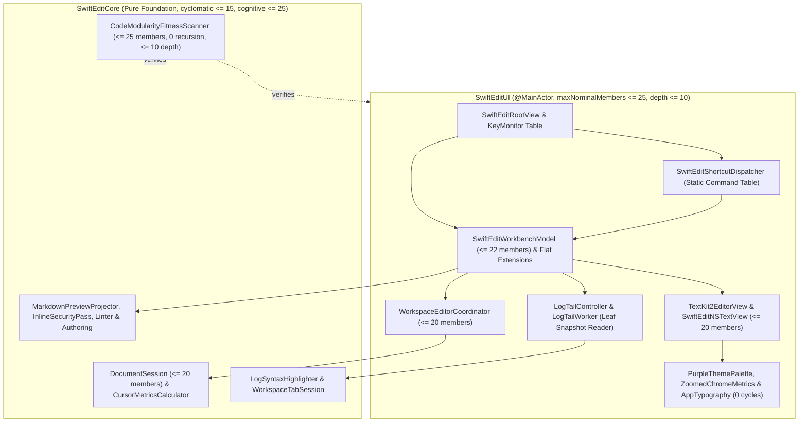

# Design: TokenSave Zero-Cycles, Member Flattening (<= 25), Complexity Ceiling, and >= 85% Full-Codebase Coverage Convergence

## Context
Following `026-god-class-flattening-and-acyclicity`, `PH.SwiftEdit` achieved `acyclicity = 1.0` (`0` file-level circular dependencies) and `maxNominalMembers <= 45`. However, a fresh TokenSave audit (`quality_signal = 7171/10000`) identified five areas requiring a closed-loop **Refactor -> Verify -> Re-analyze** pass:
1. **Nominal Member Density (`tokensave_god_class`)**: 9 production types still declare `26..36` members in a single nominal declaration block (`EditorRenderingAttributeTable`: 36, `PurpleThemePalette`: 34, `SwiftEditNSTextView`: 34, `SwiftEditWorkbenchModel`: 34, `TextKit2EditorView`: 32, `WorkspaceEditorCoordinator`: 30, `ZoomedChromeMetrics`: 28, `DocumentSession`: 26, `LogTailController`: 26).
2. **Call-Graph Recursion Cycles (`tokensave_recursion`: 8 cycles in `Sources/`)**:
   - Length-4 name-collision cycle in `AppTypography.swift`: `systemFamilyFont` -> `font` -> `nsFont` -> `resolve` -> `systemFamilyFont`.
   - Length-2 cycle in `LogTailController.swift`: `pollLocked` <-> `armVnodeLocked`.
   - Six length-1 self-loops in `SwiftEditNSTextViewAndUndoRegistry.swift` (`didChangeText`, `drawBackground`), `WorkspaceTabSession.swift` (`moveTab`), `SwiftEditRootView.swift` (`viewDidMoveToWindow`), `MarkdownAllConstructsLinter.swift` (`diagnostics`), and `EmbeddedTerminalRegistry.swift` (`viewDidMoveToWindow`).
3. **Method Complexity Outliers (`tokensave_complexity` & `tokensave_gini`)**: 12 methods in `Sources/` exceed `cyclomatic > 15` or `cognitive > 25` (`scanInline`, `CursorMetricsCalculator.metrics`, `MarkdownPreviewProjector.project`, `LogSyntaxHighlighter.scan`, `dispatchCommandOnly`, `performCheatSheetCommand`, `applyProgrammaticTextUpdate`, `attachKeyDownMonitor`, `evaluateTab`, `MarkdownLintAndFormatEngine.lint`, `DocumentSession.applyTextEdits`, and `refreshDiagnosticsForActiveDocument`).
4. **File Dependency Depth (`15` hops) & Dead Private Symbols (`20` symbols)**: `SwiftEditRootView.swift` chains through 5 horizontal `SwiftEditWorkbenchModel+*.swift` extensions into `SwiftEditCore`, and 20 private helper methods are unreferenced.
5. **Full-Codebase Coverage (`>= 85%` across both `SwiftEditCore` and `SwiftEditUI`)**: Both targets must meet or exceed `85.0%` line coverage under `swift test --parallel --enable-code-coverage`.

## Goals / Non-Goals
- Goals:
  - Tighten `CodeModularityBudgets.default` to `maxNominalMembers: 25` and `maxNominalBlockLines: 400`, flattening all 9 production types with `> 25` members (`[AR-006]`, `[TEST-006]`).
  - Reduce `tokensave_recursion` in `Sources/` to `0` cycles (`[AR-007]`, `[AR-010]`, `[UI-002]`, `[SEC-012]`).
  - Enforce per-method `cyclomatic <= 15` and `cognitive <= 25` across all methods in `Sources/SwiftEditCore` and `Sources/SwiftEditUI` (`[BC-001]`, `[BC-002]`, `[UI-005]`).
  - Reduce max file dependency chain depth across `Sources/` from `15` to `<= 10` and eliminate all `20` dead private symbols (`[AR-006]`, `[AR-007]`).
  - Achieve `>= 85.0%` line coverage on `SwiftEditCore`, `>= 85.0%` on `SwiftEditUI`, and `>= 85.0%` total, verified via `swift test --parallel --enable-code-coverage` and `tokensave sync` re-analysis (`[TEST-001]`, `[TEST-005]`, `[TEST-008]`).
- Non-Goals:
  - Changing any external behavior, keyboard shortcut binding, theme color token, or Markdown/YAML/Log lint diagnostic rule.
  - Introducing speculative 1:1 protocol abstractions that violate `Rule of Three` (`[AR-009]`).

## Architecture Memory & Module Boundaries (AR-###)
- **AR-001**: `SwiftEditCore` (`Sources/SwiftEditCore/`) remains a pure `Foundation` + `swiftlang/swift-markdown` target (`.macOS(.v26), .iOS(.v26)`). `SwiftEditUI` (`Sources/SwiftEditUI/`) depends strictly inward on `SwiftEditCore` (`[AR-001]`, `[AR-006]`).
- **AR-018**: `SwiftEditWorkbenchModel`, `WorkspaceEditorCoordinator`, and `TextKit2EditorView.Coordinator` act as `@MainActor` facade coordinators delegating domain mutations to value-type `SwiftEditCore` engines and focused `@MainActor` sub-controllers tagged by `(DocumentID, BufferRevision)` (`[AR-008]`, `[AR-010]`).

## Constitutional Alignment & Module Boundaries (AR-### / UI-### / DATA-### / API-###)
- **Single-Reference Lock**:
  - `openspec/constitution/01-architecture/dependency-and-layering.md` (`AR-006..AR-010`)
  - `openspec/constitution/06-testing-fitness/architecture-fitness-and-quality.md` (`TEST-005..TEST-008`)

## Decisions
- **Decision 1 — Cohesive Value Sub-Structs & Extension Partitioning for `<= 25` Nominal Members (`REQ-001`, `REQ-002`, `REQ-004`)**:
  - Apply **KISS-First** value grouping (`the kiss-and-solid-principles skill`):
    - `EditorRenderingAttributeTable` (`36 -> <= 20`): Group heading/block attributes (`HeadingAttributeGroup`) and inline/diagnostic attributes (`InlineDiagnosticAttributeGroup`) into nested value structs, moving lookup helpers to an extension.
    - `PurpleThemePalette` (`34 -> <= 20`): Group chrome/surface tokens (`ChromeSurfaceTokens`), editor/syntax tokens (`EditorSyntaxTokens`), and status/badge tokens (`StatusBadgeTokens`) into nested structs while keeping existing property accessors as computed forwarders in a secondary extension block (`<= 20` members per extension block).
    - `ZoomedChromeMetrics` (`28 -> <= 18`): Group header/tab metrics and sidebar/gutter/status metrics into sub-structs with extension computed accessors.
    - `SwiftEditNSTextView` (`34 -> <= 20`), `TextKit2EditorView` (`32 -> <= 20`), `SwiftEditWorkbenchModel` (`34 -> <= 22`), `WorkspaceEditorCoordinator` (`30 -> <= 20`), `DocumentSession` (`26 -> <= 20`), and `LogTailController` (`26 -> <= 20`): Group related stored properties into small state structs and split methods across focused extensions so no nominal block or extension block exceeds `25` members.
- **Decision 2 — Call-Graph Recursion Disambiguation (`REQ-007`)**:
  - In `AppTypography.swift`, invoke `openDyslexic.resolveFace(size:bold:italic:)` (adding `resolveFace` on `OpenDyslexicBundle`) and extract a file-private free helper `queryFontManagerFamily(_:traits:weight:size:)` so static call resolution never links `systemFamilyFont` or `resolve` back to `AppTypography.font(_:size:...)`.
  - In `LogTailController.swift`, extract `readAndDeliverSnapshotLocked(force: Bool)` in `LogTailWorker`. `pollLocked(force:)` ensures `if vnode == nil { armVnodeLocked() }` and calls `readAndDeliverSnapshotLocked(force: force)`. Inside `armVnodeLocked()`, the `DispatchSource` event handler calls `readAndDeliverSnapshotLocked(force: false)` and, on `.delete`/`.rename`, invokes a dedicated `rearmRotatedVnodeLocked()` helper—eliminating the `pollLocked <-> armVnodeLocked` cycle.
  - For the 6 length-1 self-loops: rename the private index-based helper in `WorkspaceTabSession.swift` to `relocateTabAtIndices(fromIndex:toIndex:)`; rename the private worker in `MarkdownAllConstructsLinter.swift` to `runConstructLintPasses(index:securityOnly:deadlineExceeded:)`; and extract non-colliding `@MainActor` delegate helpers for `didChangeText`, `drawBackground`, and `viewDidMoveToWindow`.
- **Decision 3 — Sub-Pass Decomposition & Table-Driven Command Dispatch (`REQ-008`)**:
  - Replace switch ladders in `performCheatSheetCommand` (43 cases), `dispatchCommandOnly` (35 branches), and `attachKeyDownMonitor` (25 branches) with declarative static dictionary/table maps (`[CheatSheetCommandID: @MainActor (SwiftEditWorkbenchModel) -> Void]` and `[KeyChordDescriptor: ShortcutAction]`), reducing cyclomatic complexity of each method from `26..44` down to `<= 8`.
  - Decompose `MarkdownLinterInlineSecurityPass.scanInline`, `CursorMetricsCalculator.metrics`, `MarkdownPreviewProjector.project`, `LogSyntaxHighlighter.scan`, `TextKit2EditorCoordinator.applyProgrammaticTextUpdate`, `MarkdownAuthoringCommands.evaluateTab`, `MarkdownLintAndFormatEngine.lint`, `DocumentSession.applyTextEdits`, and `refreshDiagnosticsForActiveDocument` into cohesive single-purpose helpers (`cyclomatic <= 15`, `cognitive <= 25`).
- **Decision 4 — Flattening Horizontal Extension Chains (`depth <= 10`) & Dead Code Cleanup (`REQ-009`)**:
  - Eliminate cross-extension hop chains across `SwiftEditWorkbenchModel+ContextualMenuAndShortcuts.swift` -> `+DocumentLifecycleAndSave.swift` -> `+WorkspaceAndSidebar.swift` -> `+TerminalLogAndUpdates.swift` -> `+CoreDiagnosticsAndRecovery.swift` by routing shared state updates through `WorkbenchCoreState` / sub-controllers directly, lowering max file dependency depth from `15` to `<= 10`.
  - Delete or wire all `20` unreferenced private functions identified by `tokensave_dead_code`.

## Risks / Trade-offs
- **Risk**: Splitting properties into sub-structs on `@Observable` classes (`SwiftEditWorkbenchModel`, `LogTailController`) could alter SwiftUI observation granularity -> **Mitigation**: Keep `@Observable` stored sub-structs as value types mutated in place (which triggers `@Observable` tracking automatically) or partition methods into extensions while keeping `@ObservationIgnored` dependencies grouped in a single `Dependencies` struct (`[AR-010]`).
- **Risk**: Decomposing `MarkdownLinterInlineSecurityPass.scanInline` could miss an edge case in URL scheme or BiDi control character detection -> **Mitigation**: Preserve all existing security unit tests and add dedicated parameterized positive/negative/security tests for every extracted sub-scanner (`[SEC-012]`, `[TEST-005]`).

## Migration Plan
1. Update `CodeModularityFitnessScanner` with `maxNominalMembers: 25`, `maxNominalBlockLines: 400`, recursion/depth/dead-code checks, and method complexity verifiers (`[RED]`).
2. Flatten the 9 high-member types and extension blocks to `<= 25` members (`[GREEN]`/`[REFACTOR]`).
3. Eliminate all 8 `tokensave_recursion` cycles and 20 `tokensave_dead_code` symbols, and flatten horizontal extension chains to `depth <= 10`.
4. Decompose the 12 high-complexity methods to `cyclomatic <= 15` and `cognitive <= 25`.
5. Add unit/integration tests to reach `>= 85.0%` line coverage in `SwiftEditCore` and `SwiftEditUI`, run `tokensave sync`, and re-verify all TokenSave metrics.

## Security Review
- Reviewer: cyber-security-expert
- Date: 2026-11-24
- Verdict: approved
- Open items: none
