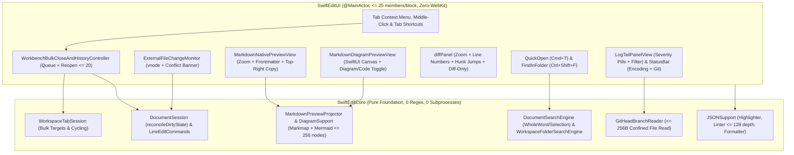

# Design: Clean & Bulk Tab Operations, Zoomed Preview & Diff, Code Copy, Native Mermaid/Markmap, Disk Watcher, Folder Search, JSON & Editor Suite

## Context
Baseline `tokensave` inspection on `PH.SwiftEdit` (`main`, post-`027`) confirms:
- `tokensave_circular`: `cycle_count = 0` (`Acyclicity = 1.0`).
- `tokensave_god_class(path="Sources", limit=5)`: `SwiftEditRootView` (`24`), `WorkbenchRenderCaches` (`24`), `EmbeddedTerminalRegistry` (`23`), `SettingsViewModel` (`22`), `JSONPreferencesStore` (`21`) — right below `CodeModularityBudgets.default.maxNominalMembers = 25`.
- `tokensave_complexity(path="Sources", limit=5)`: maximum `cognitive_complexity = 14` (`MarkdownSmartNewlineEngine.evaluateNewline`), within `cyclomatic <= 15` and `cognitive <= 25`.

Because existing top-level types (`SwiftEditRootView`, `SwiftEditWorkbenchModel`, `ZoomedChromeMetrics`, `DocumentSession`) sit near the `<= 25` nominal member ceiling, all net-new domain engines and UI sub-controllers MUST live in dedicated, small, acyclic files (`<= 20` members per declaration/extension block) wired into `WorkbenchDomainControllers` and `SwiftEditCore`.

### Technical Feasibility Verification: Markmap / Mindmaps & Mermaid in Native Preview
- **Why `WKWebView` + `mermaid.js` / `markmap-view` was rejected**: `Constitution.md` (`AR-002`, `AR-005`, `SEC-004`) strictly forbids `WebKit`, network sockets, and unratified third-party packages, and `ConstitutionGovernanceValidator` enforces those invariants in CI. Bundling minified JS + `WKWebView` would also add ~3 MB to the compact ~6.3 MB `.app` bundle and expand the XSS/IPC attack surface.
- **Why Native Pure-Swift + SwiftUI `Canvas` is 100% feasible and superior**:
  - **Markmap & Mindmaps** (```` ```markmap ````, ```` ```mindmap ````, ```` ```mermaid\nmindmap ````) are pure hierarchical trees (ATX headings `#..######` and/or indented list/text nodes). An `O(N)` iterative parser in `SwiftEditCore` (`maxNodes = 256`, `maxDepth = 12`) computes deterministic horizontal tidy-tree coordinates (`x` by depth, `y` by subtree leaf span) rendered in SwiftUI `Canvas` with smooth cubic Bézier curves and `PurpleThemePalette` accents.
  - **Core Mermaid** (`flowchart`/`graph` `TD`/`TB`/`LR`/`RL`/`BT` with shapes & subgraphs, `sequenceDiagram` with participants/lifelines/arrows, and `stateDiagram`/`stateDiagram-v2`) maps cleanly to an iterative layered DAG ranker (cycle-broken via visited DFS tags, `CWE-674` safe) and timeline lane layout in `SwiftEditCore`, drawn crisp at any zoom (`50%..300%`) on SwiftUI `Canvas`. Any unsupported diagram keyword (`gantt`, `pie`, `gitGraph`) or over-budget graph (`> 256` nodes) degrades gracefully to the syntax-styled monospaced code block with its top-right **Copy to Clipboard** button.

## Goals / Non-Goals
- Goals:
  - Instant confirmation-free close on clean and baseline-reverted tabs (`REQ-001`), plus right-click bulk close (*Right*, *Other*, *Unpinned*, *All*), middle-click close, `Shift+Cmd+T` reopen (`<= 20`), and tab shortcuts (`REQ-002`).
  - Linear `50%..300%` zoom across `MarkdownNativePreviewView` and `diffPanel`/`compareHeader`, structured YAML frontmatter card, mandatory top-right **Copy to Clipboard** button on all fenced code blocks (`REQ-003`), native Zero-WebKit Markmap/Mindmap & core Mermaid `Canvas` diagrams (`REQ-004`), and Diff line numbers + `F7`/`Shift+F7` hunk navigation + *Only Differences* filter (`REQ-005`).
  - Confined external disk watcher with clean auto-reload & dirty conflict banner (`REQ-006`), `Cmd+T` Quick Open & `Ctrl+Shift+F` literal Find in Folder (`REQ-007`), Whole-Word / `3 of 12` / In-Selection Find & Replace (`REQ-008`), atomic Line Edit commands + Trim Trailing Whitespace (`REQ-009`), native `.json`/`.jsonl` highlighting/lint/format (`REQ-010`), non-destructive Log Tail severity/text filters (`REQ-011`), and status-bar selection/word counts, Encoding menu, confined `.git/HEAD` badge, and `docs/analysis/app-gap-analysis.md` + Guide sync (`REQ-012`).
- Non-Goals:
  - Standalone Markdown -> HTML / PDF export (item #11, explicitly excluded by user decision and retained as future backlog in `app-gap-analysis.md`).
  - Any `BC-005` forbidden IDE capability (LSP, compilers/debuggers, SQLite/CoreData, `WebKit`).

## Architecture Memory & Module Boundaries (AR-###)
- **AR-001**: All parsers, layout math, searchers, line editors, JSON engines, and `.git/HEAD` readers reside in pure `Foundation` `SwiftEditCore` (`Sources/SwiftEditCore/`); `AppKit`/`SwiftUI`/`Canvas` views and `DispatchSource` file monitors reside in `@MainActor` `SwiftEditUI` (`Sources/SwiftEditUI/`) (`[AR-001]`, `[AR-002]`, `[AR-006]`).
- **AR-018**: `SwiftEditWorkbenchModel` delegates bulk close & closed-tab ring history to `WorkbenchBulkCloseAndHistoryController` and disk watching to `ExternalFileChangeMonitor` inside `WorkbenchDomainControllers`, keeping every nominal and extension block `<= 25` members and file dependency depth `<= 10` (`[AR-008]`, `[AR-010]`, `[TEST-006]`).

## Constitutional Alignment & Module Boundaries (AR-### / UI-### / DATA-### / API-###)
- **Single-Reference Lock**:
  - `openspec/constitution/01-architecture/module-topology.md` (`AR-001..AR-005`)
  - `openspec/constitution/03-ui-ux/design-system-and-tokens.md` (`UI-001..UI-004`)
  - `openspec/constitution/07-security-privacy/authn-authz-and-boundaries.md` (`SEC-001..SEC-004`)



## Decisions
- **Decision 1 — Baseline Dirty Reconciliation & Tab Bulk/History Controller (`REQ-001`, `REQ-002`)**:
  - `newUntitledTab()` passes `isDirty: false`; `DocumentSession.reconcileDirtyState(against:)` sets `isDirty = (text != baseline.text || lineEnding != baseline.lineEnding)`.
  - `WorkbenchBulkCloseAndHistoryController` owns `pendingQueue: [DocumentID]`, `forcePinned: Bool`, and `recentlyClosedURLs: [URL]` (`maxCount = 20`), keeping `SwiftEditWorkbenchModel` member count unchanged while routing every close through unified `.recovery` unlink, `LogTailController.stop()`, and `undoRegistry` cleanup.
- **Decision 2 — Preview Zoom, Frontmatter Card, Top-Right Code Copy & Native Diagram Engine (`REQ-003`, `REQ-004`)**:
  - Extend `GFMPreviewBlock` with `.frontmatter(properties: [(key: String, value: String)], sourceLine: Int)` and enrich `.code(language: String?, text: String, sourceLine: Int)` with the normalized fence info string (`swift`, `mermaid`, `markmap`, `mindmap`).
  - Every `.code` block in `MarkdownNativePreviewView` renders a header/overlay in its **top-right corner** containing the optional language badge and a **Copy to Clipboard** button (`>= 24 pt` target, invoking `clipboardWriter(text)` and showing a `1.5 s` checkmark/ `"Copied"` badge).
  - When `language` is `markmap`, `mindmap`, or `mermaid` and `MarkdownDiagramParser.parse(language:source:)` returns `.diagram(MarkdownDiagramModel)`, `MarkdownDiagramPreviewView` renders the vector diagram on SwiftUI `Canvas` scaled by `chromeMetrics.factor` (`50%..300%`) with a top-right `Diagram | Code` segmented toggle beside the **Copy to Clipboard** button; when `.unsupportedOrOversized`, it renders the standard `.code` block with Copy button.
- **Decision 3 — Zoomed Diff View With Line Numbers, Hunk Cursor & Context Folding (`REQ-005`)**:
  - `DiffPaneCoordinator` precomputes `hunkStartRowIndices: [Int]` and `filteredRows(onlyDifferences: Bool, contextLines: Int = 2)` in `O(R)`; `diffPanel` renders zoomed `.editor` monospaced line-number gutters (`lhsLineNumber` / `rhsLineNumber`) and text, plus `Previous / Next Change` (`F7` / `Shift+F7`) `ScrollViewReader` jumps.
- **Decision 4 — Confined Disk Watcher, Folder Search, Search Bar, Line Tools, JSON, Log Filters & Status Bar (`REQ-006`..`REQ-012`)**:
  - `ExternalFileChangeMonitor` tracks per-tab `(modificationDate, fileSize, contentSHA256Prefix)` and `O_EVTONLY | O_CLOEXEC` vnode sources inside granted scope: clean tabs reload seamlessly; dirty tabs set `pendingDiskConflictTabIDs` showing `Reload from Disk / Keep Mine / Compare`.
  - `WorkspaceFolderSearchEngine` performs iterative breadth-first directory traversal (`maxFiles = 10_000`, `EscapingSymlinkPolicy.skipAndReport`, binary `8 KiB` NUL skip) for `Cmd+T` Quick Open and zero-regex UTF-8/UTF-16 literal/whole-word `Ctrl+Shift+F` search (`maxMatches = 5_000`).
  - `DocumentSearchEngine` adds `isWholeWord` (Unicode scalar identifier boundary check) and `searchRange: TextRange?`; `LineEditCommands` implements pure `TextEdit` batches for Move/Delete/Join/Sort/Trim; `JSONSupport` provides zero-regex `JSONSyntaxHighlighter`, iterative `JSONStructureLinter` (`maxDepth = 128`), and deterministic `JSONSerialization` / token-preserving formatting; `LogTailBuffer` adds non-destructive `projected(count:mode:minSeverity:query:)`; `GitHeadBranchReader` parses `ref: refs/heads/<branch>` or short SHA from `<= 256` confined bytes of `.git/HEAD`.

## Risks / Trade-offs
- **Risk**: Large feature surface could push existing files over `maxNominalMembers: 25` or `maxFileLines: 800` -> **Mitigation**: Isolate every new subsystem (`DiagramSupport/`, `JSONSupport/`, `LineEditCommands`, `GitHeadBranchReader`, `WorkspaceFolderSearchEngine`, `ExternalFileChangeMonitor`, `WorkbenchBulkCloseAndHistoryController`) in dedicated small files and run `CodeModularityFitnessTests` after every unit (`[TEST-006]`).
- **Risk**: Complex or exotic Mermaid diagrams (`gantt`, `erDiagram`, HTML labels) -> **Mitigation**: Scope native rendering explicitly to Markmap/Mindmaps and core Mermaid (`flowchart`/`graph`, `sequenceDiagram`, `stateDiagram`) with an iterative cycle-safe layout, falling back cleanly to the zoom-scaled monospaced source view + Copy button on unsupported syntax (`[UI-007]`, `[SEC-012]`).

## Migration Plan
1. `Unit 1`: Clean/baseline-reverted tab close (`REQ-001`) + bulk tab context actions, `Shift+Cmd+T` reopen, middle-click & tab cycling shortcuts (`REQ-002`).
2. `Unit 2`: Zoomed Markdown Preview, YAML frontmatter card, mandatory top-right Copy to Clipboard on fenced blocks (`REQ-003`), and native SwiftUI `Canvas` Markmap/Mindmap & Mermaid rendering (`REQ-004`).
3. `Unit 3`: Zoomed Diff View with line numbers, `F7`/`Shift+F7` hunk navigation, and *Only Differences* filter (`REQ-005`).
4. `Unit 4`: Confined `ExternalFileChangeMonitor` auto-reload, dirty conflict banner, and `Revert to Saved` (`REQ-006`).
5. `Unit 5`: Confined `Cmd+T` Quick Open, `Ctrl+Shift+F` literal Find in Folder (`REQ-007`), and enhanced Whole-Word / `3 of 12` / Selection Find & Replace (`REQ-008`).
6. `Unit 6`: Atomic `LineEditCommands` + `trimTrailingWhitespaceOnSave` (`REQ-009`) and native `.json`/`.jsonl` highlighting, linting, and Pretty-Print/Minify (`REQ-010`).
7. `Unit 7`: Non-destructive `LogTailPanelView` severity pills & substring filter (`REQ-011`), status-bar selection/word metrics, Encoding menu, confined `.git/HEAD` badge, and `docs/analysis/app-gap-analysis.md` + User Guide sync (`REQ-012`), followed by full `>= 85%` coverage and `tokensave sync` verification.

## Security Review
- Reviewer: cyber-security-expert
- Date: 2026-11-25
- Verdict: approved
- Open items: none
