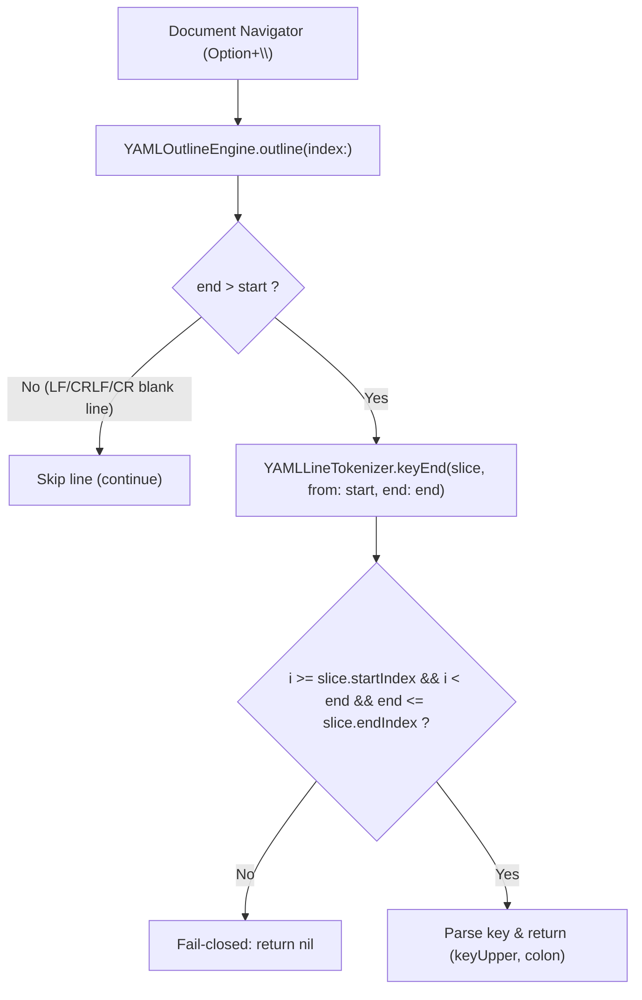

# Design: YAML Outline Empty-Line Crash Fix and Tokenizer Bounds Hardening

## Context
Baseline `tokensave` inspection on `Sources/SwiftEditCore/MarkdownLintAndFormat/YAMLSupport/`:
- `YAMLLineTokenizer.swift`: `tokens` (`cyclomatic = 6`, `cognitive = 5`), `keyEnd` (`line 109`), `quotedEnd` (`line 122`), `inspectStructure` (`line 48`).
- `YAMLOutlineEngine.swift`: `outline(index:)` (`42` lines total, `0` cycles).

In `0.1.8-beta1`, `YAMLOutlineEngine.outline(index:)` checked `first != space && first != tab && first != hash` before computing `end`, omitting `guard end > start else { continue }`. Consequently, any blank line (`\n`, `\r\n`, or `\r`) passed an empty slice `units[start..<start]` to `YAMLLineTokenizer.keyEnd(slice, from: start, end: start)`, which immediately subscripted `line[i]` at `YAMLLineTokenizer.swift:110` and crashed with `EXC_BREAKPOINT (SIGTRAP)`.

## Goals / Non-Goals
- Goals:
  - Skip empty lines (`guard end > start else { continue }`) in `YAMLOutlineEngine.outline(index:)` for `LF`, `CRLF`, and `CR` endings.
  - Add fail-closed slice-bounds guards in `YAMLLineTokenizer.keyEnd(_:from:end:)`, `quotedEnd(_:from:end:)`, and `inspectStructure(line:indent:)`.
  - Add regression and security tests reproducing the exact blank-line crash and testing adversarial slice boundaries.
- Non-Goals:
  - Changing YAML language grammar, outline semantics for nested keys, or introducing new dependencies/types.

## Architecture Memory & Module Boundaries (AR-###)
- **AR-002**: `YAMLOutlineEngine` and `YAMLLineTokenizer` remain pure `Foundation` value-type utilities inside `SwiftEditCore` (`Sources/SwiftEditCore/MarkdownLintAndFormat/YAMLSupport/`) with zero regex and zero UI imports (`[AR-002]`, `[AR-006]`, `[AR-008]`).

## Constitutional Alignment & Module Boundaries (AR-### / UI-### / DATA-### / API-###)
- **Single-Reference Lock**:
  - `openspec/constitution/01-architecture/dependency-and-layering.md` (`AR-006`, `AR-008`)
  - `openspec/constitution/06-testing-fitness/architecture-fitness-and-quality.md` (`TEST-005`, `TEST-006`, `TEST-008`)
  - `openspec/constitution/07-security-privacy/stride-and-gdpr-privacy.md` (`SEC-012`)

## Decisions
- **Decision 1 — Skip Blank Lines Before Slicing (`YAMLOutlineEngine.swift`)**:
  - After computing `end` (including stripping trailing `\r`), add `guard end > start else { continue }` before reading `units[start]` or slicing `units[start..<end]`. Also check `first != 0x0A && first != 0x0D` naturally via `end > start` because empty `LF`/`CRLF`/`CR` lines always satisfy `end == start`.
- **Decision 2 — Defense-in-Depth Slice Bounds (`YAMLLineTokenizer.swift`)**:
  - In `keyEnd(_:from:end:)`: `guard i >= line.startIndex, i < end, end <= line.endIndex else { return nil }`.
  - In `quotedEnd(_:from:end:)`: `guard i >= line.startIndex, i < end, end <= line.endIndex else { return min(max(i, line.startIndex), line.endIndex) }`.
  - In `inspectStructure(line:indent:)`: clamp/guard `indent >= 0` and `base + indent < end` (`guard indent >= 0, base + indent < end else { return StructuralLine(isIgnored: true, hasDash: false, keyRange: nil, endsWithBlockScalar: false) }`).

## Risks / Trade-offs
- **Risk**: Minimal (`3` one-line guards); zero API signature changes and zero performance overhead (`O(1)` integer comparisons).

## Migration Plan
1. `Unit 1`: Write failing `[RED]` regression & security tests reproducing the blank-line crash and out-of-bounds tokenizer calls, apply the minimal `[GREEN]` guards in `YAMLOutlineEngine.swift` and `YAMLLineTokenizer.swift`, verify `[REFACTOR]` + modularity/coverage metrics, and document invariants.

## Security Review
- Reviewer: cyber-security-expert
- Date: 2026-11-25
- Verdict: approved
- Open items: none
